Version v7.0.2 · 13 Nov 2026, 23:00 IST · Release R7 · Status: Current · Owner: 🛠 Mark XVII

# JARVIS Architecture & Technology Guide

This guide was checked against JARVIS's real code. This is edition v7.0.2 of the guide (the first
edition was v6.1.1; the change log at the end lists every edition). It describes the JARVIS
program at version v7.0.0: release R6.1 as built, release R11, the free proactive helpers (card
C60), release R11.1, your observations fixed (card C61), both live, and release R7 (the phone app,
the watch, SOS and the phone camera; cards C62 to C65), built and joined on one branch, not yet
deployed (the version number goes down from 11.1 on purpose, as nothing compares it). Anything
that is planned but not built yet is marked PLANNED.

For engineers: it was written from the code, the deploy script, the CI file, the evals and the
plans in `docs/plans/`, not from memory. A fact that could not be checked against the code says
*unverified*. The checks that were run are listed under "How this guide was checked", just before
the change log.

## How to read this guide

- **Page 1 (section 1)** is for you, the owner. It says what JARVIS does, what it costs, where your
  data is, what it can never do without you and what happens when the laptop is off. It needs no
  technical words; the few names it uses are explained where they first appear.
- **Sections 2 to 4** show how the parts fit: the eight layers, one card per component, and the 14
  diagrams.
- **Sections 5 to 11** are for engineers and reviewers: technology choices, outside services and
  their free limits, decisions, data and privacy, security, operations, costs, limits and the
  roadmap.
- **Section 12** is the glossary. Every technical word used here is explained there once.
- Money is in rupees (₹). Google, Anthropic and Tavily bill in US dollars. JARVIS converts at the
  day's rate (₹95.24 to the dollar on 1 Nov 2026 is the stored fallback), so every ₹ figure is an
  **estimate**.
- The first line of this guide is its version line. "Owner" there means the owner of this
  document: 🛠 Mark XIV, the build name of the team that keeps it now (every JARVIS build team gets
  a Mark number, as in the films; release R6.1 was built by Marks XIII and XIV, release R11 by
  Mark XIV). JARVIS itself belongs to you.

## 1. One-page summary

**What JARVIS is.** JARVIS is your own private assistant. It runs in your own Google Cloud
account, in Google's Mumbai data centre. You use it from a web page on your laptop or phone (the
"console"), by voice, or from the Telegram chat app. A small program on your laptop, the "home
bridge", connects it to your house. The console's row of panel buttons fits any screen: on a
smaller screen the buttons that don't fit move behind a **More** button, so nothing scrolls
sideways.

**What it does today (up to R6.1).**

| Area | What JARVIS does for you |
|---|---|
| Talk | Type to it in the console or on Telegram, or say "Hey Jarvis" and speak. You can talk over it to stop it, and switch the microphone off. It answers in a British voice or in the browser's own voice. |
| Day planning | A morning brief: your calendar, mail, parcels, family calendars, documents that need renewing and what the home cameras saw overnight. It adds events, reminders, to-dos and groceries to your Google account. |
| Mail and messages | Reads and sums up your Gmail, writes drafts and reads new mail aloud. It writes WhatsApp messages that you send yourself. |
| Research | Searches the web and shows numbered sources. Reads files you attach and Google Drive folders you choose. Finds places, routes and YouTube videos. Looks up public figures, but only after checking that the person really is public. |
| Memory | Remembers facts about you, which you can see and edit ("About you"). Keeps your notes, the text of voice memos and saved links. Remembers where you put things at home ("Where did I keep it?"). |
| Documents | A locked store for your documents (ID, insurance, certificates) that reminds you before they expire. It takes in documents you share from DigiLocker, the government's document app. |
| Home | Controls your smart-home devices, runs a burglar alarm on the home cameras and can recognise faces (only of people who agreed). It answers "who came yesterday?", tells you about parcels at the door, and tells you when the laptop stops answering. |
| Helpers (R11) | Looks ahead for you, for free, in the Helpers panel: bill reminders, with a UPI payment made ready for your PIN (JARVIS never pays); birthdays from your contacts; your top priority and what is pending; the chores rota and home upkeep; weather and disaster warnings for your district; breach notices from your own mail; nudges to stand up and drink water within the limits you set; a question when a planned walk didn't happen; free-time ideas from your own list; and in the kitchen recipe ideas that keep to your diet, rough nutrition, grocery spend from your e-mailed receipts and cooking times in your calendar. All of it but new recipe ideas works with the AI off. |
| Looking after itself | The Vitals panel shows its keys, free allowances, bills and limits, and at its foot an "About JARVIS" line says which version is running and the day it was built. It can check its own systems and read you the result. It counts every cost in rupees. At each release it writes a "build book" that explains how it is built. |

**What it costs a month (estimates).**

- **A typical month: about ₹110.** About ₹100 is for Claude's answers (20 a day at about ₹0.17
  each). The optional morning summary adds about ₹3 and the optional learning about you about ₹5.
- **Google Cloud: ₹0 to about ₹30.** The server, the database and the clock stay inside Google's
  free allowances. Google's locked store for keys holds 6 of them free. With every feature on,
  JARVIS keeps 11, at about ₹6 a month for each one above 6.
- **What can make it cost more.** An answer that searches the web costs ₹0.5–2. If all 20 answers
  a day searched the web, Claude would cost ₹300–1,200 a month. Listening to your voice is free for
  54 minutes a month (under 2 minutes a day); after that it costs about ₹2.29 a minute, so 10
  minutes a day adds about ₹560. JARVIS's own spoken voice is free for 900,000 letters a month,
  then about ₹2.9 per 1,000. The strongest Claude model costs twice the middle one. Learning costs
  ₹24 at most, and a question to the build book about ₹1.5.
- **Free choices.** The free Gemini brain, the brain on your laptop and No-AI mode cost ₹0.
- **Your limit.** A new JARVIS has no monthly limit. Set one in the Vitals panel, from ₹1 to
  ₹1,00,000. When the month's spend reaches it, JARVIS makes no more paid AI or voice calls, and
  says so.
- **Claude is prepaid.** You buy Claude credit from Anthropic in advance. When it runs out, Claude
  stops answering and Vitals shows the Claude key in red. Add credit on Anthropic's website.
- **Google's warning e-mail.** If anything at all is charged to your Google Cloud project, Google
  e-mails the account's billing administrator (you). The alert is set at ₹1. It warns; it doesn't
  stop anything, and Google may send it some hours after the charge (*unverified*).

Details: section 9.

**Safety promises (as built).**

1. **Nothing final without you.** Before JARVIS sends a mail, sends an invitation or does anything
   that can't be undone, it shows an "approval card". The card says exactly what will happen and
   waits for your Approve. Once you add a passkey, these final actions also need it. A passkey is a
   sign-in key kept on your phone or laptop and opened with your fingerprint or PIN. There is no
   "don't ask again".
2. **Other people's words are never orders.** Text from mail, web pages, documents, contacts or the
   cameras is only information to JARVIS. While such text is in the conversation, even small changes
   ask you first.
3. **Only you get in.** Only the Google accounts you listed can sign in. On Telegram, JARVIS answers
   only your paired account. Its clock and the home bridge must prove who they are on every call.
4. **Private by default.** Free AI brains may learn from what they are told. So they never get your
   personal data, and they can't act for you. Camera pictures and the faces JARVIS knows stay on the
   laptop. One small burglar-alert photo may go to Telegram, only if you switch that on.
5. **No money moves.** JARVIS has no way to pay anyone, buy anything or move money. It spends only
   on its own AI and voice, inside your limit.
6. **Everything is written down.** Every action passes one checkpoint and goes into a record that
   can't be changed without it showing. The Activity panel shows what JARVIS did today, in plain
   words.

**Where your data is kept.**

- **Your own Google Cloud project, in Mumbai.** Everything JARVIS keeps is in Google's database
  there. JARVIS's keys and passwords are in Google's locked store in the same project.
- **What JARVIS locks with its own keys.** JARVIS scrambles these before Google stores them: your
  document store, notes, things and Google link; your saved Home and Work, home records, faces and
  VIP list; your browser alerts, GitHub token, the laptop brain's address and the build book.
- **What only Google's lock protects.** Your conversations, the facts JARVIS remembers about you,
  the text of files you attach and the record of actions. Google encrypts everything it stores, but
  JARVIS does not add its own lock to these. Anyone who can open your Google Cloud project could
  read them.
- **Your laptop.** Camera pictures and the face library stay there.
- **No backups.** JARVIS makes no backup copies. When you delete something it is gone for good
  (after 30 days in "Recently deleted", where that applies).
- **Your Google account, as always.** Your Calendar, Gmail, Tasks, Contacts, Drive and Photos stay
  with Google. JARVIS reads them through the link you gave it.

**Who else sees some of your data.**

| Who | What they see |
|---|---|
| Anthropic, the company that makes Claude (the paid AI brain) | Your recent conversation, the facts about you that fit the question, and what JARVIS's tools found for that answer |
| Google's free Gemini brain | The conversation only, nothing else about you |
| Tavily, the web-search company | Your search words and the pages JARVIS reads (a guard refuses searches that hold your private details) |
| Google's voice service | What JARVIS says aloud, and the sound of your voice when it listens |
| Google Maps and YouTube | What you search for there; your Home and Work only when you ask for a route |
| Telegram | Your Telegram chats with JARVIS and its alerts. Telegram keeps them, and they are not end-to-end encrypted. |
| Open-Meteo, the free weather service | Your place rounded to about 1 km (never your district's name), once an hour, only after you type your district |
| NDMA SACHET, India's official disaster-warning feed | Nothing about you: JARVIS reads your state's public feed and picks your district itself |

Section 6 lists every kind of stored data, and section 6.5 every outside service.

**What if the laptop is off?** Everything in the cloud keeps working: chat, voice, the brief, mail,
calendar, the document store and alerts. Only the home parts stop: devices, cameras, the alarm and
faces. The backup brain on your laptop stops too. That small AI answers only when JARVIS can't
reach Claude over the internet. Within about 6–11 minutes JARVIS tells you once, on Telegram and
as a browser notification. If the alarm is off and it is night, the message waits until your
quiet hours end (23:00–06:30 unless you change them).

**What JARVIS can never do without you.** It always asks you first before it:

- sends an e-mail or a calendar invitation;
- deletes anything that can't be brought back;
- adds an event to a family member's calendar;
- switches the burglar alarm off;
- gets a bill payment ready (it never pays anyone: you confirm it and enter your PIN in your UPI
  app, and the UPI ID is only ever the one you typed);
- opens a file in your document store, or the build book.

You can never approve a final action from Telegram: only in the console, and with your passkey once
you have one. Deletes that can be undone (your own events, to-dos, notes, things and documents) go
to "Recently deleted" for 30 days. More than 10 of them in one message ask first.

## 2. The eight layers, as built

The old reference architecture (the three-page "Reference Architecture v1.0" PDF) split an ideal
assistant into eight layers plus cross-cutting concerns. JARVIS keeps those eight layers. Every
package under `src/jarvis/` sits in exactly one of them; the build book generator
(`src/jarvis/buildbook/gen/layers.py`) refuses a package that has no layer, so the map below cannot
silently go stale. Figure 2 in section 4 draws it.

| Layer | What it does, in plain words | Components (cards in section 3) |
|---|---|---|
| L1 User Interaction | Where you reach JARVIS: the web console, Telegram, the terminal. | C01 Web console, C02 HTTP API and sign-in, C03 Terminal client, C04 Telegram front door |
| L2 Input Processing | Turns speech, files and camera sightings into text and facts. | C05 Voice service, C06 Voice loop in the console, C07 Attached documents, C08 Faces with consent |
| L3 Context & Orchestration | Keeps the conversation, long-term memory, the clock that wakes JARVIS, and the undo bin. | C09 Conversations, C10 Long-term memory, C11 Scheduler ticks and watchdog, C12 Recently deleted |
| L4 Core Reasoning Engine | The brain: one loop that reads context, asks a model, calls tools and checks every step. | C13 Brain core loop, C14 Persona and prompts, C15 Guardrails and trust, C16 Brain router and LLM layer, C17 Brain switch, No-AI and offline mode, C18 Approval cards and Approve all |
| L5 Skills & Capabilities | The things JARVIS can do for you. | C19 Morning brief, C20 Web search, C21 People research, C22 WhatsApp drafts, C23 Notes, memos and links, C24 Things, C25 Groceries, C26 Family calendars, C27 Parcels, C60 Helpers (R11) |
| L6 Integration & Tools | The doors to outside services and the house, all through one gateway. | C28 Tool gateway and audit, C29 Google account link, C30 Calendar and reminders, C31 Gmail and mail read aloud, C32 To-dos, C33 Contacts, C34 Drive folders, C35 Maps, C36 YouTube and Media, C37 Photos picker and GitHub, C38 Home link, C39 Home bridge, C40 Camera, alarm and history |
| L7 Data & Persistence | Where things are kept, and how much of each free allowance is used. | C41 Document store, C42 Document vault, C43 DigiLocker import folder, C44 Free allowance ledger |
| L8 Response & Output | How JARVIS tells you things: alerts, browser notifications, the Activity log. | C45 Alerts port, C46 Alert policy, C47 Web Push, C48 Activity log |
| X Cross-cutting | Settings, logs, keys, permissions, privacy, costs, health, the build book, delivery and quality. | C49 Configuration, C50 Logging, C51 Keyring, C52 Permissions and passkeys, C53 Privacy dashboard, C54 Costs in ₹ and the monthly limit, C55 Vitals, C56 Systems check, C57 Build book, C58 Delivery, C59 Evals and the visual gate |

### 2.1 Where the build departs from the old blueprint

The old blueprint was drawn before anything was built. Each row below is a real departure,
checked against the code, with the plain reason.

| Area | Old blueprint | As built (R6.1) | Why, in plain words |
|---|---|---|---|
| Hosting | Docker, then Kubernetes on AWS or GCP, Terraform | One container on Google Cloud Run (asia-south1, Mumbai), at most one copy, scaled to zero when idle; one re-runnable script `deploy/cloudrun.sh`; GitHub Actions deploys on merge | Free for one owner, with no server to look after, patch or pay for. The first hosting (slice 2) was Render (`render.yaml` is still in the repo); by slice 4 JARVIS ran on Cloud Run, and from slice 5 beside Firestore in the same project (*unverified*: the plans don't record why it moved). |
| Database | Postgres plus a vector database (Pinecone or Chroma) | Firestore (Native mode) through a tiny document port; Redis only for local Docker runs | Firestore is free at this size, needs no new account or key, and keeps data in your own project. Every part reaches its data through one small adapter (a "port"), so another database can be added later. |
| Search in memory | Vector embeddings | Word matching (BM25) over facts and notes | No extra AI service to pay for or to send private text to; good enough for one person's notes. |
| Speech | Whisper or Deepgram for listening, ElevenLabs voice clone for speaking | Google Cloud Speech-to-Text v1 and Text-to-Speech (Chirp 3: HD and Studio voices), with Chrome's own speech as the free fallback; "Hey Jarvis" is detected on the device | Inside Google's free monthly allowance, with no new account or key. No copy of the film voice: copying an actor's voice without consent breaks the voice companies' rules (slice 9, decision 1). |
| Front end | Next.js dashboard, React Native app, Electron desktop | One console page served by the API itself: plain JavaScript modules, no build step, a strict content security policy; phones use the same page in the browser | Nothing to build or host separately. A strict browser rule lets only JARVIS's own scripts run (`script-src 'self' 'wasm-unsafe-eval'`; the second part only lets the wake word run its model), so a script slipped into a page can't run. |
| Brain | Claude Opus as the main model | Claude by tier (fast, balanced, strong), free Gemini (chat only), one OpenAI-compatible slot, the owner's laptop (Ollama) when the cloud can't be reached, and a No-AI mode | Cost control and privacy: you pick the brain, and a brain that may learn from what it is told never gets tools or personal data. |
| Orchestration | LangGraph | A custom brain loop, model router and one tool gateway | Fewer moving parts and one place where every safety rule is enforced. |
| Tool protocol | MCP (Model Context Protocol) servers | In-process tools that call each service's REST API directly (no vendor SDK outside `jarvis.llm`) | Google's ready-made AI connectors (MCP servers) were still a test version when the Google tools were built (slice 6). Calling Google directly keeps every call under JARVIS's one checkpoint. |
| Smart home | Home Assistant and Matter | A home bridge on the owner's laptop running Home Assistant, Frigate (cameras) and Mosquitto (messages), reached through Tailscale Funnel; Matter is not used | Uses the laptop you already have; pictures stay at home. |
| Messaging | Slack, WhatsApp, SMS | Telegram (chat and alerts) and standard browser notifications (Web Push); WhatsApp only as drafts you send yourself | Telegram is free for bots. WhatsApp's business service does not allow general AI assistants (except in the European Economic Area and Brazil) and needs a second number; unofficial WhatsApp tools risk a ban on your own number (slice 12). |
| Observability | OpenTelemetry and Grafana | Structured JSON logs with a per-request trace id, read in Google Cloud Logging; the Vitals board and the systems check | Free and enough for one owner. OpenTelemetry stays planned for Phase 7, the quality phase (`src/jarvis/logging.py` is the one file to swap). |
| Mobile (R7) | React Native app | A small Android app whose main screen is the console drawn by Chrome full screen (a Trusted Web Activity), plus a few native parts (the Talk tile, alerts, Health Connect, SOS, a DigiLocker folder); the console itself becomes installable | One code base for web and phone, and Google sign-in, passkeys and Web Push keep working as they are because Chrome draws the page. The R7 plan chose this instead of Capacitor (in its WebView Google refuses the sign-in and Web Push does not exist). Built in R7 (C62), not yet deployed. |
| Skills (PLANNED, R8–R10) | Ten core skills; vision as an input box | An 11th core skill "Health & Wellbeing" and an on-device vision engine in Layer 2 | Owner decision 10 in the 11 Nov 2026 release plan, recorded in the R6.1 plan. Not built yet. |

## 3. Component catalogue

One card per component, grouped by layer. Every card has the same 11 fields. "Where in the code"
names folders and files under `src/jarvis/` (console modules are in `src/jarvis/api/static/`);
"Data it keeps" names Firestore collections without the `jarvis_` prefix. The check
`scripts/arch_coverage.py` fails if a package, console module, Scheduler job, outside service or
Firestore collection is missing here, or if a card or technology row is incomplete.

### Layer 1 — User Interaction

#### C01 · Web console

| Field | Value |
|---|---|
| Name | Web console (the "command deck") |
| What it does | The page you use JARVIS from on a laptop or phone: the chat, the dock of panels (in its order: Chat, Brief, Approvals, Activity, History, Memory, Integrations, Vault, Things, Notes, Privacy, Home, Faces, Vitals, Connectors, People, Book, Voice, Media, Construct, Helpers, Camera), the brain picker and the Night / Day looks. The dock fits every screen: the buttons keep their order, and the ones that don't fit (the last ones first) move into the **More** sheet, which lists exactly those. More appears only when something is behind it and lights up while one of those panels is open. Chat, Brief and Approvals never move for lack of room; but on a mid-size laptop screen (900 to 1180 pixels wide) the Approvals button is narrower than its name, so it moves behind More too, and More then shows its waiting count. Nothing scrolls sideways. It is written in plain JavaScript files that need no build step, and anything the server sends is shown as plain text, never run as part of the page. |
| Layer | L1 User Interaction |
| Skill | Platform (serves every skill) |
| Where in the code | `src/jarvis/api/console.py` (serves the page and its content security policy), `src/jarvis/api/static/console.html`, `console.css` (base look, with the font faces), `console.js` (chat, brains, approvals, audit, conversations), `console-deck.js` (panels, dock buttons, ruler, radar), `console-dock.js` (fits the dock to the screen: buttons that don't fit move behind More, whose entries it builds from the dock since R7 I0), `console-fx.js` (surfaces, themes, motion), `console-3d.js` and `console-3d-scenes.js` (optional three.js scenes), `console-text.js` (shared text helpers), `console-helpers.js` (the Helpers panel's frame and tabs, R11; its four tabs are C60's); vendored three.js 0.187.0 in `static/vendor/` |
| Depends on | C02 HTTP API; every panel's own card |
| Data it keeps | No Firestore data of its own. The browser keeps small conveniences (the open conversation, look and layout). |
| Outside services | None directly (fonts and libraries are served by JARVIS itself, not loaded from another website) |
| Cost (₹ a month) | ₹0 |
| When it fails | A panel whose data can't be fetched shows a plain message and the rest keeps working. If the browser can't draw 3D (no WebGL2) the 3D scenes are skipped. A browser without pop-up sheets shows every dock button, wrapped onto more rows, and no More. The browser visual gate (C59) checks every panel, the dock and the More sheet at desktop and phone size. |
| Since | Slice 2 (before v0.5.0); Command Deck look Slice 5c (v0.5.2); the dock that fits every screen R6.1 (v6.1.0) |

#### C02 · HTTP API and sign-in

| Field | Value |
|---|---|
| Name | HTTP API, Google sign-in and request limits |
| What it does | The FastAPI application every client talks to: the `/v1` routes, Google sign-in for the listed owner accounts only, a signed session cookie (12 hours), a bearer token for the terminal and evals, per-client rate limits and body-size limits. |
| Layer | L1 User Interaction |
| Skill | Platform (serves every skill) |
| Where in the code | `src/jarvis/api/` (`app.py` factory, `auth.py`, `identity.py`, `routes.py`, `ratelimit.py`, `body.py`, and the wiring files `feature_wiring.py`, `personal.py`, `home_wiring.py`, `r4_wiring.py`, `selfcheck_wiring.py`, `r6_wiring.py`, `r11_wiring.py`, and `startup_log.py`, the one "jarvis up" log line) |
| Depends on | C49 Configuration, C13 Brain core loop, C41 Document store |
| Data it keeps | No collection of its own; the user id is always derived on the server from the sign-in, never taken from the client. |
| Outside services | Google sign-in (OpenID Connect); Cloud Run (hosting) |
| Cost (₹ a month) | ₹0 (inside Cloud Run's free 2 million requests a month) |
| When it fails | A wrong or missing sign-in gets 401; over the limit (120 requests a minute per client by default) gets 429. Start-up refuses a production setting that is unsafe (no API token, a weak session secret, no owner e-mail). |
| Since | Phase 0 (API); Slice 2 (Google sign-in) |

#### C03 · Terminal client

| Field | Value |
|---|---|
| Name | Terminal client (`jarvis chat`, `jarvis serve`) |
| What it does | Lets an engineer talk to the brain from a terminal without a server (`jarvis chat --stream`) and starts the API (`jarvis serve`). |
| Layer | L1 User Interaction |
| Skill | Platform (serves every skill) |
| Where in the code | `src/jarvis/cli.py` |
| Depends on | C13 Brain core loop, C16 Brain router |
| Data it keeps | Nothing of its own; in-memory session by default. |
| Outside services | The configured brain (Anthropic or another, see C16) |
| Cost (₹ a month) | The brain's own cost (see C54) |
| When it fails | Prints the error (the monthly limit, No-AI mode or the brain's own error) and carries on with the next line; an unknown `--brain` stops it with the list of configured brains. |
| Since | Phase 0 |

#### C04 · Telegram front door

| Field | Value |
|---|---|
| Name | Telegram front door |
| What it does | Chat with JARVIS from Telegram after a one-time pairing, and receive alerts there. Reversible approval cards get Approve / Decline buttons; irreversible ones are never approvable on Telegram ("waiting in the console for your approval and passkey"). Mail, Drive, documents, contacts and personal data stay off on Telegram unless you switch them on, because bot chats are not end-to-end encrypted; since R11.1 that includes the whole-inbox summary and an attached picture's research (private reads), and the photo import's face counts (the home switch). A calendar batch, its undo and a re-plan card show their first line, written by code (how many, the dates), and "Open JARVIS to see the full list and approve it", never a button. |
| Layer | L1 User Interaction |
| Skill | Communication |
| Where in the code | `src/jarvis/telegram/`, `src/jarvis/api/telegram.py`, `src/jarvis/notify/telegram_out.py`, `console-telegram.js` |
| Depends on | C13 Brain core loop, C28 Tool gateway, C46 Alert policy |
| Data it keeps | `telegram/{uid}` (the pairing), `telegram_users/{telegram id}` (reverse look-up), `telegram_pairing/{uid}` and `telegram_pairing_tries` (one pending 8-character code, 10 minutes), `telegram_updates/{update id}` (kept 48 hours, so a retry is a no-op), `telegram_alerts/{uid}_{day}` (alert counters, 3 days). |
| Outside services | Telegram (Bot API, webhook with a secret token) |
| Cost (₹ a month) | ₹0 (Telegram's bot API is free); each chat turn costs a normal reply |
| When it fails | Anyone but the paired owner gets no reply and is audited. If Telegram is down, alerts still go to Web Push (C47). Off or unpaired: the console says how to switch it on. |
| Since | R1 (v1.0.0) |

#### C62 · Phone app and the phone's door (R7)

| Field | Value |
|---|---|
| Name | Phone app and the phone's door (R7) |
| What it does | Built in R7 (joined, not yet deployed). A small Android app (one package name, the only one the server accepts) whose main screen is this console drawn by Chrome full screen with no browser bar (a Trusted Web Activity), plus a few native parts: the "Talk to JARVIS" tile and shortcuts (Talk, Camera, SOS, Set-up), alerts sorted into Urgent, Alerts and Nudges by each notification's kind, Health Connect (C64), the SOS screen (C65) and one DigiLocker folder you pick. The console is installable (a web app manifest with three shortcuts and a share target) and JARVIS is in Android's share sheet: a shared photo, PDF or text waits in this browser's share tray until you press Look at it here (on the device only), Ask the AI, Add to my vault or Attach. A phone is linked once with an 8-character code (made on the laptop after a passkey or a fresh Google sign-in; 10 minutes, once, 5 tries) and a P-256 key that never leaves the phone's secure hardware; afterwards it reaches JARVIS only through four signed routes (hello, health, inbox, sos) that can never read a conversation, the vault or mail, approve anything or call a tool. A launch address only opens a screen: the microphone and the camera always wait for your tap. The app lock asks for your passkey after 5 minutes away; it turns on by itself once a passkey was added from the app, is bound to the phone by a signed `r7_dev` cookie, and the laptop can switch it off or unlink the phone at any time; "Sign out everywhere" ends every session within seconds. The camera button beside the paperclip in the chat box is NOT built (it would change the composer's look). | |
| Layer | L1 User Interaction (and cross-cutting security) |
| Skill | Platform; Security Advisor (the door, the app lock) |
| Where in the code | `src/jarvis/mobile/` (`ports.py`: the four server parts' contract, the door's routes, D21's never-locked list; `contract.py`: the phone's signed request and its one JSON form), `src/jarvis/phone/` (Part C: `service.py` the link and unlink, `door.py` the door's checks in order, `handlers.py` hello and inbox, `applock.py` the app lock and the `r7_dev` cookie, `store.py`, `privacy.py`, `part.py`), `src/jarvis/api/phone.py` (/phone/link, /phone/v1/{hello,health,inbox,sos}, /.well-known/assetlinks.json, /v1/phone, /v1/phone/link-code, /v1/phone/{id}/unlink, /v1/session/{app,here,lock,unlock,end-all}), `src/jarvis/api/app_shell.py` (Part A: /manifest.webmanifest, /static/icons/<name>, /app/share/sw.js, /app/share/in, /app/status), `src/jarvis/api/r7_wiring.py` (the parts, their tools, jobs, phrases, brief and sleep line, privacy rows, the door's handler registry, the app lock's slot, the body caps, the services only one part may offer), `src/jarvis/api/mobile_status.py`, `src/jarvis/webpush/service.py` (alert targets), `scripts/app_icons.py` (draws the icons); the console's `console-r7.js` (loader), `console-r7-links.js` (launch words), `console-r7-share.js`, `console-r7-share.css` and `static/app-share-sw.js` (the share tray and its worker), `console-sw.js` (the Talk action, a tap handed to the open window), `console-r7-phone.js`, `console-r7-phone.css` (Integrations → Phone app), `console-r7-lock.js` (the unlock cover); `android/` (Part E, the Gradle project), `scripts/apk_check.py`, `.github/workflows/android.yml`; `tests/fixtures/r7/phone_vectors.json` and `docs/plans/r7-integration/phone-contract.md`; evals `evals/r7/` (`shell.py`, `phone.py`, `contract.py`, `needles.py`) | |
| Depends on | C01 Web console; C02 HTTP API and sign-in; C47 Web Push; C52 Permissions and passkeys (the purposes `phone_link` and `device_unlock`); C64 and C65 (the door's health and sos routes) |
| Data it keeps | `phone_link/{uid}` (one pending link code: its hash, expiry and tries; 10 minutes), `phone_devices/{uid}` (at most 3 phones: id, model word, public key, package, signing fingerprint, linked and last seen, app version, what the app may do; and `lock {on, keys}`, whether the app lock is on and the passkeys added from the app; until unlinked). Cookie: `r7_dev` (HttpOnly, Secure, SameSite Lax, about 400 days, signed for this owner: which browser is the phone app's; "Sign out everywhere" does not clear it, only clearing Chrome's site data does). Only in this browser: the share tray (Cache Storage `jarvis-share-v1`, each item at most 24 hours, cleared on sign-out) and the app flag. The phone keeps its key in its secure hardware and the SOS numbers sealed for its offline SMS screen; Chrome keeps the session cookie and passkeys. Privacy row: Linked phones. | |
| Outside services | None |
| Cost (₹ a month) | ₹0 (the Android CI is free for a public repository) |
| When it fails | A part whose setup fails is left out ("setup failed") and the others still run. Every failed check on a signed request is a bare 401 (404 for an unknown route, 503 when the phone store can't be read), logged by the check's name and never audited, so a flood cannot fill the audit. If Chrome's check of the site and the app fails, its address bar shows and everything else works. An app-lock check that fails answers 503 and never opens; writes the page sends by itself (the brief seen, the show's beat, a photo import step) never count as you being there. A shared item that is not a JPEG, PNG, WebP or PDF, an eleventh item or one over 10 MB is refused in plain words. | |
| Since | R7 (v7.0.0): I0 the joins, Parts A, C and E the app, the door and the lock, I1 the joins between them |

### Layer 2 — Input Processing

#### C05 · Voice service

| Field | Value |
|---|---|
| Name | Voice service (speech in and out on the server) |
| What it does | Turns JARVIS's replies into speech with Google Cloud Text-to-Speech (British voices: Chirp 3: HD and Studio) and your recorded speech into text with Speech-to-Text v1 (language en-IN). Decides what may be read aloud, counts the free allowance and asks the spending gate before any paid call. Since R11.1 it asks for three alternatives, and adds this turn's hints (the names of your waiting and attached files as they are said, never with Documents on "Never", and nouns from your own messages) between the base list and your own words; the "Words to recognise" privacy card says what goes to Google as hints; `POST /v1/voice/transcribe` takes an optional `X-Jarvis-Session` header and answers with `alternatives`. What the microphone heard is then checked by C61's "understood as" step. |
| Layer | L2 Input Processing |
| Skill | Communication |
| Where in the code | `src/jarvis/voice/` (`service.py`, `google_cloud.py`, `speakable.py`, `wav.py`, `catalogue.py`, `settings.py`, `commands.py`), `src/jarvis/api/voice.py` |
| Depends on | C54 Costs and the monthly limit, C14 Persona (wit level) |
| Data it keeps | `voice_settings/{uid}` (voice, speed, wit level, words to recognise). Audio is never stored. |
| Outside services | Google Cloud Text-to-Speech, Google Cloud Speech-to-Text (as the service account, no key) |
| Cost (₹ a month) | ₹0 inside the free allowance JARVIS claims: 900,000 characters per voice type and 54 minutes of listening a month (90 % of Google's free tier). Above it about ₹2,857 per million characters (Chirp 3: HD) and ₹2.29 a minute of listening, counted against your monthly limit. |
| When it fails | If Google's speech can't be reached or isn't switched on, the console uses the browser's own voice and recognition (C06). |
| Since | Slice 9 (v0.9.0) |

#### C06 · Voice loop in the console

| Field | Value |
|---|---|
| Name | Voice loop in the console (wake word, barge-in, mic off, sound devices) |
| What it does | Everything that listens and speaks in the browser: "Hey Jarvis" detected on the device, one capture pipeline for the microphone, talking over JARVIS to interrupt it (barge-in), a hard mic-off switch, local voice commands, the words-to-recognise editor, the choice of speaker and microphone, conversation pacing and sound cues. |
| Layer | L2 Input Processing |
| Skill | Communication |
| Where in the code | `console-voice.js`, `console-voice-mic.js`, `console-voice-capture.js` (with `voice-capture-worklet.js`), `console-voice-wake.js`, `console-wakeword.js` (openWakeWord models in `static/wakeword/`, run with the vendored onnxruntime-web 1.30.0), `console-voice-barge.js`, `console-voice-micoff.js`, `console-voice-speech.js`, `console-voice-pace.js`, `console-voice-conversation.js`, `console-voice-loop-browser.js`, `console-voice-loop-glue.js`, `console-voice-commands.js`, `console-voice-phrases.js`, `console-voice-devices.js`, `console-voice-devices-match.js`, `console-voice-devices-panel.js` |
| Depends on | C05 Voice service, C01 Web console |
| Data it keeps | Nothing on the server beyond C05's settings; the wake word never leaves the device. |
| Outside services | Google Cloud Speech-to-Text (through C05) or the browser's own speech recognition |
| Cost (₹ a month) | ₹0 (see C05 for speech beyond the free allowance) |
| When it fails | No microphone permission: the console says so and text chat works. Mic off is a hard lock: nothing is captured until you switch it back. |
| Since | Slice 9 (v0.9.0); wake word, barge-in, mic off and sound devices R5 (v5.0.0) |

#### C07 · Attached documents

| Field | Value |
|---|---|
| Name | Attached documents (paperclip and drag-and-drop) |
| What it does | Lets you attach up to 10 files to a message (your own settings: 10 MB each, 40 MB together, 4 pictures): PDF, Word, text, Markdown, CSV and, since R11.1, Excel (`.xlsx`, `.xlsm`, `.xls`: values only, never formulas or macros; hidden sheets are not read and are said; 50 sheets, 5,000 rows a sheet), PowerPoint (`.pptx`: slides and their notes), pictures (`.png`, `.jpg`, `.jpeg`: structure checked and camera and location data removed without decoding a pixel; at most 2,048 px a side), zip files (each member read as its own kind; a password, a bomb, a path that points outside, an archive inside or too many files is refused from the directory alone) and a whole folder (packed into one zip in your browser). The text is taken out in a separate process that can be killed (CPU, memory and time caps; every member of an Office file is scanned for a DTD first), split into chunks and searched; the file itself is thrown away. A picture is shown only to a brain that can see and never trains, only with the message it came with; a rupee estimate comes before a costly reply on a large file. |
| Layer | L2 Input Processing |
| Skill | Research & Intel |
| Where in the code | `src/jarvis/documents/` (R11.1: `sheets.py` with openpyxl and xlrd, `slides.py` with lxml, `archive.py`, `imagecheck.py`, `pictures.py`, `limits.py`), `src/jarvis/api/documents.py`, `console-attach.js` and C61's `console-r111-files.js` |
| Depends on | C13 Brain core loop, C28 Tool gateway, C52 Permissions |
| Data it keeps | `attachments/{id}` with its text chunks under it (kept with the conversation) and, since R11.1, `attachments/{id}/pictures/{01..04}` (a cleaned picture's bytes, at most 900 KB each, deleted with the attachment); the header's `waiting_owner` (the owner while the file waits to be sent, "" once sent). Waiting uploads older than a day are swept. |
| Outside services | None |
| Cost (₹ a month) | ₹0 for extraction; reading the text costs the brain's normal tokens |
| When it fails | A file that is too big, unreadable or of the wrong kind is refused in plain words; a busy extractor queues for up to 50 seconds, then says "busy". Never sent to a brain that may train on content. |
| Since | Slice 10 (v0.10.0) |

#### C08 · Faces with consent

| Field | Value |
|---|---|
| Name | Faces JARVIS may recognise, with consent |
| What it does | A registry of people JARVIS may greet or name in alerts. Nobody is enrolled by default; adding someone needs a fixed consent statement. Face pictures and face matching stay on the laptop (Frigate's face library); the cloud keeps only names, relation and consent records. Since R11.1 the laptop also groups unknown faces from your photos (C61, C39) and Faces shows "Unnamed groups": you name a group once (the same consent check; a child needs a parent's or guardian's yes; the laptop also refuses any person not on the consent list it was sent), or forget it; the crops are shown only on the laptop's own page. |
| Layer | L2 Input Processing |
| Skill | Security Advisor |
| Where in the code | `src/jarvis/faces/`, `src/jarvis/api/faces.py`, `console-faces.js`; at home `src/jarvis/homebridge/faces.py` and the local page on the laptop |
| Depends on | C38 Home link, C39 Home bridge, C51 Keyring |
| Data it keeps | `faces/{uid}` (encrypted by JARVIS with the `faces` key). Face attempts stay on the laptop only: 72 hours for someone JARVIS doesn't know, 7 days for enrolled people and doorstep checks. |
| Outside services | Frigate (at home, never a cloud vision service) |
| Cost (₹ a month) | ₹0 |
| When it fails | With the laptop asleep a removal is delivered with the next heartbeat; the name stops resolving at once. A person not in the registry is "someone JARVIS didn't recognise", never a guess. |
| Since | R3 (v3.0.0) |

#### C63 · Camera and vision engine (R7)

| Field | Value |
|---|---|
| Name | Camera and vision engine (R7) |
| What it does | Built in R7 (joined, not yet deployed). The Camera panel (Look, Results, Cameras) looks at a photo or the live picture on the device itself: a frame is never stored and never leaves the device. One vision engine runs five tasks that see pixels (`text` with tesseract.js, `code` with zxing-wasm, `quality`, and `objects` and `pose` with MediaPipe Tasks Vision); the use cases of R8 to R10 receive results only (numbers, labels from fixed lists, read text). Keep sends only the result; a picture reaches the server only when you press Ask the AI about this photo (about ₹0.30, offered only when the brain answering sees pictures and No-AI is off), Add to my vault or Attach, all through one door that redraws every picture on the device (so no camera or location data travels) and counts "Pictures sent from this device today". A photo shared into the share tray can be looked at here too. "Jarvis, cameras off" (20 phrasings) locks this device's camera until a tap allows it (never the home burglar camera). The vision tools are Apache or MIT, served by JARVIS itself and pinned by hash: not ML Kit (its terms send usage to Google), no AGPL YOLO, no cloud vision. `pose` and `objects` say "not installed" until their two model files arrive. The camera button beside the paperclip is NOT built. | |
| Layer | L2 Input Processing |
| Skill | Research & Intel; Health & Wellbeing (PLANNED 11th skill) |
| Where in the code | `src/jarvis/vision/` (`results.py`: the Result contract the browser and a home camera share; `store.py` kept results, sealed; `tools.py` the `vision_results` read; `privacy.py`; `assets.py` which tasks are installed; `part.py`: Part B and its `vision_sweep`), `src/jarvis/api/vision.py` (/v1/vision, /v1/vision/results), the vision files' route in `src/jarvis/api/console.py` (/static/vendor/vision/<release>/<name>: only what release `r7-1`'s MANIFEST.json lists with a matching SHA-256, checked again whenever the folder changes), `static/vendor/vision/` (the vendored engine files and their licences), `scripts/vision_assets.py` (fetches, pins and checks them); the console's `console-vision.js` (the engine's one port and its tasks), `console-r7-send.js` (the one door a picture takes), `console-camera.js` (the one place a camera is asked for), `console-camera-panel.js`, `console-camera.css`; eval `evals/r7/vision.py` | |
| Depends on | C01 Web console; C07 Attached documents (R11.1's picture path); C42 Document vault; C05 Voice service ("cameras off") |
| Data it keeps | `vision_results/{uid}_{date}` (results you pressed Keep on: task, time, device, numbers and labels, read text only if kept; sealed with `vision`; at most a set number a day; 90 days, swept each morning). Never a frame. Only in this browser: the camera-off switch (`localStorage`), its own privacy row "Only on this device: the camera-off switch". Privacy rows: Camera results; the camera-off switch. | |
| Outside services | None |
| Cost (₹ a month) | ₹0; Ask the AI about this photo about ₹0.30 a picture, only when you press it |
| When it fails | A result outside its task's schema is dropped. A vendored file whose bytes do not match its recorded sum is never served. The camera stops when the page is hidden, the panel closes, the screen locks or nothing used a frame for 10 minutes. Without the model files `pose` and `objects` say "not installed" while `text`, `code` and `quality` work. A picture this browser cannot read is refused in plain words. Read text is fenced as other people's words for the brain. | |
| Since | R7 (v7.0.0): I0 the port and the door, Part B the panel and the engine, I1 the joins |

### Layer 3 — Context & Orchestration

#### C09 · Conversations

| Field | Value |
|---|---|
| Name | Conversations (short-term memory) |
| What it does | Keeps each conversation and sends the latest part of it (at most 40 turns and about 48,000 characters) to the brain with each message. Conversations survive restarts and are kept until you delete them. |
| Layer | L3 Context & Orchestration |
| Skill | Platform (serves every skill) |
| Where in the code | `src/jarvis/memory/` (session store port, in-memory and Redis versions), `src/jarvis/core/window.py`, `src/jarvis/storage/sessions.py` (Firestore version) |
| Depends on | C41 Document store |
| Data it keeps | `sessions/{id}` with one document per turn under it; `meta/ping` (a health ping). Local Docker runs use Redis keys `jarvis:session:{id}` with a 24-hour idle expiry instead. |
| Outside services | Firestore (production), Redis (local Docker runs only) |
| Cost (₹ a month) | ₹0 (about 1–6 % of Firestore's free daily writes at 200 messages a day, per the slice 5 plan) |
| When it fails | A message that clashes with a change from another window is not stored and no model is called (409: send it again); after an approved action the save never raises, so nothing runs twice. If Firestore itself is down the request fails with an error (*unverified*: the exact wording was not checked). |
| Since | Phase 0; kept in Firestore from Slice 5 (v0.5.0) |

#### C10 · Long-term memory

| Field | Value |
|---|---|
| Name | Long-term memory ("About you") |
| What it does | Remembers facts about you (people, places, preferences) and brings the relevant ones (at most 12) into a reply, with "what I used" shown. Learning from your messages is opt-in, runs in the background on the cheapest tier, at most 20 times a day, and a filter refuses ID numbers, card numbers and passwords. |
| Layer | L3 Context & Orchestration |
| Skill | Knowledge Base & Memory |
| Where in the code | `src/jarvis/recall/`, `src/jarvis/api/memory.py`, `console-memory.js` |
| Depends on | C16 Brain router (fast tier), C54 Costs, C41 Document store |
| Data it keeps | `memory/{uid}` (header and settings) and `memory_shards/{uid}_{n}` (up to 100 facts each). Kept until you delete them; stored as plain JSON under Google's encryption, not JARVIS's own key (*see section 6*). |
| Outside services | Anthropic (fast tier) for learning, only when switched on |
| Cost (₹ a month) | About ₹5 a month with learning on, at most ₹24 at 20 runs a day (slice 8 estimate); ₹0 with learning off |
| When it fails | A memory outage means a reply without notes, never a failed reply. A brain that may train on content never sees memory. |
| Since | Slice 8 (v0.8.0) |

#### C11 · Scheduler ticks and watchdog

| Field | Value |
|---|---|
| Name | Scheduler ticks and the home watchdog |
| What it does | Two Cloud Scheduler jobs wake JARVIS on time. The morning job calls `POST /internal/brief/tick` every 30 minutes from 04:00 to 11:30 IST (`0,30 4-11 * * *`): it makes the brief when due and then runs the tick jobs (vault reminders, DigiLocker import, Vitals poll, systems check, book sealing and the sweeps of old data). The watchdog job calls `POST /internal/home/watchdog` every 5 minutes, all day, when Home is switched on: laptop offline alerts, a pending arm, the camera feed sweep, the home-claims and link-code sweeps, the alert policy's jobs (the held-alerts summary, storm summaries and the counter sweep), and the systems check, book sealing and the book sweep it shares with the morning tick. With Home off, the alert policy's jobs ride the morning tick instead, and book sealing and the systems check run only there. From R11 (I0) the helpers' 5-minute clock (`helpers_clock`, at most 20 seconds of each run) rides the watchdog too, and with Home off it is the one thing the watchdog runs, so the same job serves both; the morning tick also runs it and the helpers' daily jobs (`helpers_daily`). |
| Layer | L3 Context & Orchestration |
| Skill | Automation Engine |
| Where in the code | `src/jarvis/ticks.py`, `src/jarvis/api/brief.py` (tick route), `src/jarvis/api/scheduler_auth.py`, `src/jarvis/home/watchdog.py`; the Cloud Scheduler jobs `jarvis-morning-brief` and `jarvis-home-watchdog`, created by `deploy/cloudrun.sh` step 8 |
| Depends on | C19 Morning brief, C38 Home link, C55 Vitals, C56 Systems check, C57 Build book, C60 Helpers |
| Data it keeps | No collection of its own; each job uses its feature's store. |
| Outside services | Cloud Scheduler (signed Google OIDC token for its own account with no project roles) |
| Cost (₹ a month) | ₹0 (3 jobs are free per billing account; JARVIS uses 2) |
| When it fails | A job that fails or runs out of time is logged and reported "failed" without stopping the others (60 s per job, 150 s per tick). If the brief clock is missing, the brief is still made when the Brief panel opens. Only Cloud Scheduler's token opens these routes; every failure is a bare 401. |
| Since | Slice 7 (v0.7.0) brief clock; R2 (v2.0.0) tick jobs; R3 (v3.0.0) watchdog |

#### C12 · Recently deleted

| Field | Value |
|---|---|
| Name | Recently deleted (the undo bin) |
| What it does | Before JARVIS deletes one of your own calendar events, to-dos, notes, things or vault files, it keeps a copy for 30 days so you can undo it from the Approvals panel or by asking. |
| Layer | L3 Context & Orchestration |
| Skill | Task & Productivity |
| Where in the code | `src/jarvis/undo/`, `src/jarvis/api/deleted.py`, `src/jarvis/tools/undo_delete.py`, `src/jarvis/tools/calendar_undo.py`, `src/jarvis/tools/tasks_undo.py`, `console-deleted.js` |
| Depends on | C28 Tool gateway, C30 Calendar, C32 To-dos |
| Data it keeps | `deleted_items/{uid}/items/{id}`: the item's copy, kept 30 days, then swept by the tick. |
| Outside services | Google Calendar and Google Tasks (to restore) |
| Cost (₹ a month) | ₹0 |
| When it fails | If the copy can't be stored, nothing is deleted. A second restore says "already restored" instead of making two copies. The panel lists the newest 100 (a whole calendar batch's "Undo all", R11.1); what the model's `deleted_list` sees stays the newest 50. |
| Since | Slice 11 (v0.11.0) |

### Layer 4 — Core Reasoning Engine

#### C13 · Brain core loop

| Field | Value |
|---|---|
| Name | Brain core loop |
| What it does | The heart of JARVIS: for each message it loads the conversation, adds long-term memory, checks your monthly limit, asks the brain, runs at most 6 rounds of tool calls through the gateway, records the cost and saves the turn. One conversation is handled one message at a time. Since R11.1 (`finish.py`): a turn that works with tools or files may write `work_output_tokens`; an answer the cap cut off is asked for once more (its half-written tool calls never run); one with still no words is a fixed line chosen by code from what happened, stored marked as tool-derived and never shown to a model; many single calendar creates of one round become one batch card; an approved plan card answers with the tool's own sentence when no model can narrate. |
| Layer | L4 Core Reasoning Engine |
| Skill | Platform (serves every skill) |
| Where in the code | `src/jarvis/core/` (`brain.py`, `brain_types.py`, `models.py`, `saving.py`, `rounds.py`, `channel.py`, `window.py`, and R11.1's `finish.py` and `fixed_lines.py`), `src/jarvis/tools/calendar_gather.py` |
| Depends on | C09 Conversations, C10 Long-term memory, C16 Brain router, C28 Tool gateway, C54 Costs |
| Data it keeps | Nothing of its own (turns are saved through C09). |
| Outside services | The selected brain (see C16) |
| Cost (₹ a month) | The brain's tokens (see C54) |
| When it fails | A brain error becomes a short friendly message (never vendor text); at the monthly limit the reply says so and no paid call is made. |
| Since | Phase 0 |

#### C14 · Persona and prompts

| Field | Value |
|---|---|
| Name | Persona and system prompts |
| What it does | Gives JARVIS its voice: calm, brief, addresses you as "Sir" (a setting), with three wit levels. The prompt also carries the house rules (outside text is data, never orders). |
| Layer | L4 Core Reasoning Engine |
| Skill | Communication |
| Where in the code | `src/jarvis/core/persona.py`, `src/jarvis/core/prompts.py` |
| Depends on | C49 Configuration (honorific, time zone), C05 Voice service (wit level) |
| Data it keeps | None |
| Outside services | None |
| Cost (₹ a month) | ₹0 (adds a fixed number of prompt tokens to each call) |
| When it fails | Any failure to read the wit level falls back to the default ("film"). |
| Since | Phase 0; wit levels Slice 9 (v0.9.0) |

#### C15 · Guardrails and trust

| Field | Value |
|---|---|
| Name | Guardrails, taint and provenance |
| What it does | The safety checks around the brain: an input guard (size and shape), marking of outside content, a "taint" flag when other people's text (mail, web, a document) reached the model in this request, provenance trust for results that are your own words, and masking of anything spoken aloud from mail. |
| Layer | L4 Core Reasoning Engine |
| Skill | Security Advisor |
| Where in the code | `src/jarvis/core/guardrails.py`, `src/jarvis/tools/taint.py`, `src/jarvis/tools/external.py`, `src/jarvis/tools/provenance.py`, `src/jarvis/tools/spoken.py` |
| Depends on | C28 Tool gateway, C13 Brain core loop |
| Data it keeps | None |
| Outside services | None |
| Cost (₹ a month) | ₹0 |
| When it fails | Fails closed: when trust can't be decided, the call asks you first. |
| Since | Phase 0; taint Slice 8 (v0.8.0); provenance Slice 11 (v0.11.0) |

#### C16 · Brain router and LLM layer

| Field | Value |
|---|---|
| Name | Brain router and the LLM layer |
| What it does | Callers ask for a tier (fast, balanced, strong), never a model. The router picks the model, falls back a tier on a passing error (strong to balanced to fast), and when the cloud can't be reached at all it hands the call to the laptop brain (C17). It is the only place that talks to model vendors. |
| Layer | L4 Core Reasoning Engine |
| Skill | Platform (serves every skill) |
| Where in the code | `src/jarvis/llm/` (`router.py`, `brains.py`, `base.py`, `anthropic_provider.py`, `gemini_provider.py`, `openai_compat_provider.py`, `local_provider.py`, `mock_provider.py`, `fallback.py`, `pricing.py`) |
| Depends on | C49 Configuration, C54 Costs, C17 Offline mode |
| Data it keeps | None |
| Outside services | Anthropic (Claude Haiku 5.5, Sonnet 5.5, Opus 5.5 by tier), Gemini (free tier, chat only), OpenAI-compatible (one slot: Groq, OpenRouter, Ollama and similar) |
| Cost (₹ a month) | Claude per million tokens: Haiku ₹9.52 in / ₹47.62 out, Sonnet ₹190.48 / ₹952.40, Opus ₹380.96 / ₹1,904.80 (at ₹95.24 to the dollar). Gemini free tier ₹0. |
| When it fails | 20-second timeout, 2 retries, then a tier down; only an unreachable cloud (no connection, timeout, server error) goes to the laptop, never a 429 or a key error. After a cloud miss the next 2 minutes go to the laptop. A brain that may train on prompts never receives tools. |
| Since | Phase 0; Gemini Slice 3; brain selector Slice 4 (both before v0.5.0) |

#### C17 · Brain switch, No-AI and offline mode

| Field | Value |
|---|---|
| Name | Brain switch, No-AI mode and offline mode |
| What it does | The brain picker in the console; a persisted "No AI" switch that answers with fixed skills only (no model spend at all); and offline mode, a small model (Ollama, default qwen2.5:3b) on your laptop that answers when Claude can't be reached, with at most 12 simple tools and every change asking first. |
| Layer | L4 Core Reasoning Engine |
| Skill | Platform (serves every skill) |
| Where in the code | `src/jarvis/offline/`, `src/jarvis/api/offline.py`, `src/jarvis/people/routes.py` (the AI on / off switch route), `console-offline.js`, `deploy/local-brain/` (Caddy key gate and start scripts) |
| Depends on | C16 Brain router, C28 Tool gateway, C51 Keyring |
| Data it keeps | `settings/{uid}` (the AI on / No-AI switch, read fail-closed), `local_brain/config` (the laptop brain's address and key, sealed with the token key; its model and switch; one per deployment). |
| Outside services | Ollama (on the owner's laptop), Tailscale (Funnel publishes it; TLS ends on the laptop) |
| Cost (₹ a month) | ₹0 |
| When it fails | Laptop asleep: "Claude can't be reached and your laptop didn't answer." A switch document that can't be read counts as No-AI (no model is called when JARVIS can't tell). |
| Since | R1 (v1.0.0) offline mode; R4 (v4.0.0) No-AI mode |

#### C18 · Approval cards and Approve all

| Field | Value |
|---|---|
| Name | Approval cards and Approve all |
| What it does | When an action must ask first, JARVIS shows a card written by code (not by the model) saying exactly what will happen. You approve or decline in the console (or reversible ones on Telegram). One message may propose at most 5 new cards; Approve all clears several low-risk cards with one tap. |
| Layer | L4 Core Reasoning Engine |
| Skill | Security Advisor |
| Where in the code | `src/jarvis/core/brain_decisions.py`, `src/jarvis/core/approve_all.py`, `src/jarvis/storage/approvals.py`, `src/jarvis/tools/card.py`, `src/jarvis/tools/calendar_cards.py`, `src/jarvis/tools/tasks_cards.py`, `console-approvals.js`, `console-approve-all.js` |
| Depends on | C28 Tool gateway, C52 Permissions and passkeys, C41 Document store |
| Data it keeps | `approvals/{id}`: waiting cards, so they survive scale-to-zero; a decided card spends its token and can't run twice. |
| Outside services | None |
| Cost (₹ a month) | ₹0 |
| When it fails | A card whose action changed since it was shown is refused. An irreversible card with passkeys in force needs your passkey. When no model can narrate, Approve all says a plan card's own result ("58 events added, 2 failed, Sir."), never "Done" for something half done (R11.1). A card always waits in a stored conversation, so Approvals can decide it (R11.1 fixed the kitchen's calendar card, which could not be approved). |
| Since | Slice 1 (before v0.5.0); kept in Firestore Slice 5 (v0.5.0); Approve all Slice 11 (v0.11.0) |

### Layer 5 — Skills & Capabilities

#### C19 · Morning brief

| Field | Value |
|---|---|
| Name | Morning brief |
| What it does | Each morning, at the time you pick, a brief of today: calendar, unread mail, parcels on the way, family calendars, documents due, what the home camera noted overnight and the Vitals that need you. Facts are written by code; an optional AI summary ("what matters today") is off until you confirm its cost. It can also be put in your own Gmail inbox. |
| Layer | L5 Skills & Capabilities |
| Skill | Task & Productivity |
| Where in the code | `src/jarvis/brief/`, `src/jarvis/api/brief.py`, `console-brief.js`, `console-brief-sections.js` |
| Depends on | C11 Scheduler ticks, C29 Google link, C27 Parcels, C26 Family calendars, C42 Vault, C40 Camera, C55 Vitals, C54 Costs |
| Data it keeps | `briefs/{uid}_{date}` (kept 7 days), `brief_settings/{uid}`. |
| Outside services | Google Calendar, Gmail, Anthropic (optional summary, at most 6 calls a day) |
| Cost (₹ a month) | ₹0 without the summary; about ₹3 a month with it (slice 7 estimate) |
| When it fails | One failing step marks the brief failed with a friendly reason; at the monthly limit the summary is left out with a note and the facts stay complete. Since R11.1 the inbox counts every unread message in the inbox by kind (Gmail's own count; "about N" when it could not be read; at most 30 reads), withholds codes and bank messages in every category, says how many it could not read, and reads only as your "Search and read email" row allows ("Ask first" or "Never": no read, "Your inbox could not be read just now"); the plan check-ins still unanswered are one Helpers line. |
| Since | Slice 7 (v0.7.0) |

#### C20 · Web search

| Field | Value |
|---|---|
| Name | Web search with numbered sources |
| What it does | Searches the web and reads pages, and answers with numbered sources you can open. A private-query guard refuses searches that would send your personal details to the search vendor. JARVIS stops at 900 credits a month (searches and page reads both use credits). |
| Layer | L5 Skills & Capabilities |
| Skill | Research & Intel |
| Where in the code | `src/jarvis/web/`, `src/jarvis/api/web.py`, `console-web.js` |
| Depends on | C28 Tool gateway, C15 Guardrails (pages are outside content), C55 Vitals |
| Data it keeps | `web_usage` (this month's count for the deployment), `web_vendor_usage` (Tavily's own count, checked once a day). |
| Outside services | Tavily |
| Cost (₹ a month) | ₹0 (stops at 900 of Tavily's free 1,000 credits a month, which searches and page reads both use; pay-as-you-go is never used). A search turn costs more brain tokens: about ₹0.5–2 a reply. |
| When it fails | No key or switched off: JARVIS says web search is not set up. At the cap it says so and does not search. |
| Since | Slice 10 (v0.10.0) |

#### C21 · People research

| Field | Value |
|---|---|
| Name | People research (with a verification gate) |
| What it does | Short dossiers on public figures, or on a person in a work due-diligence context, from public sources only. A deterministic pre-filter refuses private phrasing, and a verification gate must confirm a public role before any links come out. Since R11.1 each profile is a card with its own "Open in browser" link and "Open next" opens one tab a press (no "Open all"). On a turn whose message carried a picture, it researches only a name you typed in that message; a name the picture's own text holds becomes a "Look up" card you press (the caption line shown), and anything else is refused in fixed words: JARVIS never identifies a person from a picture (C61). The verification gate itself is unchanged. |
| Layer | L5 Skills & Capabilities |
| Skill | Research & Intel |
| Where in the code | `src/jarvis/people/` (R11.1: `offer.py`, `offer_card.py`), `console-people.js`; the turn guard `src/jarvis/picture/turnguard.py` |
| Depends on | C20 Web search, C16 Brain router, C28 Tool gateway |
| Data it keeps | `people_last/{uid}`: your last research (the dossier and its target). |
| Outside services | Tavily; Anthropic (in AI mode, a fast-tier check that can only refuse, and one optional fast-tier summary) |
| Cost (₹ a month) | ₹0 for search inside the free credits; up to two small fast-tier calls a research when AI is on |
| When it fails | Not verified: a fixed refusal, at most 1 search credit spent and no links. |
| Since | R4 (v4.0.0) |

#### C22 · WhatsApp drafts

| Field | Value |
|---|---|
| Name | WhatsApp drafts |
| What it does | JARVIS writes a WhatsApp message (up to 2,000 characters) and shows a card with the name, the number and an Open in WhatsApp link; you tap Send yourself. A contact's name is looked up in Google Contacts. |
| Layer | L5 Skills & Capabilities |
| Skill | Communication |
| Where in the code | `src/jarvis/whatsapp/`, `console-whatsapp.js` |
| Depends on | C33 Contacts, C28 Tool gateway |
| Data it keeps | None (drafts live in the conversation's reply cards). |
| Outside services | None called: JARVIS calls no WhatsApp service; your own WhatsApp opens the link |
| Cost (₹ a month) | ₹0 |
| When it fails | Several contacts or numbers: JARVIS asks which one and makes no draft. |
| Since | Slice 12 (v0.12.0) |

#### C23 · Notes, memos and links

| Field | Value |
|---|---|
| Name | Notes, voice memos and saved links |
| What it does | Your own notes, voice-memo transcripts (never the audio) and saved web links, searched by code with no model call. |
| Layer | L5 Skills & Capabilities |
| Skill | Knowledge Base & Memory |
| Where in the code | `src/jarvis/kb/`, `src/jarvis/api/notes.py`, `console-notes.js`, `console-notes-memo.js` |
| Depends on | C51 Keyring, C12 Recently deleted, C28 Tool gateway |
| Data it keeps | `kb/{uid}` (header), `kb_shards/{uid}_{id}` (the notes, encrypted with the `notes` key), `kb_fetch` (state of fetching a saved link's text). |
| Outside services | None (a saved link's page is fetched through the web door, C20) |
| Cost (₹ a month) | ₹0 |
| When it fails | Without the token key the feature stays off (notes are never stored in clear). A delete goes to Recently deleted first. |
| Since | R2 (v2.0.0) |

#### C24 · Things

| Field | Value |
|---|---|
| Name | Things ("Where did I keep it?") |
| What it does | Tell JARVIS where you put something ("passport in the blue suitcase") and ask later. Moving a thing keeps its history (up to 50 moves). |
| Layer | L5 Skills & Capabilities |
| Skill | Knowledge Base & Memory |
| Where in the code | `src/jarvis/belongings/`, `src/jarvis/api/belongings.py`, `console-things.js` |
| Depends on | C51 Keyring, C12 Recently deleted, C28 Tool gateway |
| Data it keeps | `belongings/{uid}` and `belongings_history/{uid}_{thing}`, both encrypted with the `belongings` key. |
| Outside services | None |
| Cost (₹ a month) | ₹0 |
| When it fails | Without the token key the feature stays off. A best match is offered (at most 3 candidates) when the name isn't exact. |
| Since | R2 (v2.0.0) |

#### C25 · Groceries

| Field | Value |
|---|---|
| Name | Groceries list |
| What it does | A "Groceries" list on your Google Tasks: add items (duplicates merged), list them and tick them off, by voice or chat. |
| Layer | L5 Skills & Capabilities |
| Skill | Task & Productivity |
| Where in the code | `src/jarvis/groceries/` |
| Depends on | C32 To-dos (Tasks client), C29 Google link |
| Data it keeps | `groceries/{uid}`: the list's id and title only. |
| Outside services | Google Tasks |
| Cost (₹ a month) | ₹0 |
| When it fails | If the cached list is gone it is found again by title; two adds at once make one list and one line per item. |
| Since | R1 (v1.0.0) |

#### C26 · Family calendars

| Field | Value |
|---|---|
| Name | Family calendars |
| What it does | Up to 8 calendars that family members shared with you: what each holds today, free slots, and (with writer access) adding an event, which always asks first. |
| Layer | L5 Skills & Capabilities |
| Skill | Task & Productivity |
| Where in the code | `src/jarvis/family/`, `src/jarvis/api/family.py`, `console-family.js` |
| Depends on | C29 Google link, C30 Calendar, C18 Approval cards |
| Data it keeps | `family_calendars/{uid}`: your label for each member and the calendar address. |
| Outside services | Google Calendar |
| Cost (₹ a month) | ₹0 |
| When it fails | A calendar shared as free/busy shows busy blocks only. Titles from other people's calendars are treated as outside text. |
| Since | R1 (v1.0.0); adding events R3 (v3.0.0) |

#### C27 · Parcels

| Field | Value |
|---|---|
| Name | Parcel tracking from order e-mails |
| What it does | "Where are my parcels?" JARVIS reads order and shipping e-mails from known shops and carriers and pulls out the status by code (no model, no paid call). |
| Layer | L5 Skills & Capabilities |
| Skill | Task & Productivity |
| Where in the code | `src/jarvis/packages/`, `src/jarvis/brief/deliveries.py` |
| Depends on | C31 Gmail, C28 Tool gateway |
| Data it keeps | None (read live from Gmail). |
| Outside services | Gmail |
| Cost (₹ a month) | ₹0 |
| When it fails | On voice or Telegram the subject is masked or left out. Unknown senders are ignored. |
| Since | R1 (v1.0.0) |

#### C60 · Helpers (R11)

| Field | Value |
|---|---|
| Name | Helpers: bills, home, nudges and the kitchen (R11) |
| What it does | Free helpers that look ahead for you, in four tabs of the Helpers panel. **Today**: your bills and due dates, reminded at your time (09:00 by default) 3 days, 1 day and on the day, and once overdue; "Pay" gets a UPI payment ready for your PIN after you approve the card in the console (with your passkey when you use one); the link and its QR are shown once and never kept; JARVIS never pays and takes a UPI ID only from what you typed. Birthdays from your Google Contacts (month and day only: a birth year is never read). Your top priority and what is pending, ranked by fixed rules, with the approvals waiting. **Home**: the chores rota (adults' names you type; JARVIS tells only you) and home upkeep; weather from Open-Meteo for your place; disaster and weather warnings for your district from NDMA SACHET; breach notices that Have I Been Pwned or Mozilla Monitor send to your Gmail. **Nudges**: stand up, drink water, a question when your planned walk didn't happen, an idea for free time (never an outdoor one when rain is likely), your top priority; each off until you switch it on, within your caps, snoozed or stopped by a tap or by saying "don't remind me to stand up". **Kitchen**: recipe ideas from your pantry that keep to your diet (a code check has the last word), rough nutrition (six key values, or every value on request), grocery spend a month from your e-mailed receipts, and cooking and washing-up times in your calendar after you approve the card. All of it but new recipe ideas is plain code, so it works with the AI off. **Sources and credits**: Open-Meteo gives the forecast (free for personal use, no key; "Weather data by Open-Meteo.com (CC BY 4.0)" in the panel and the brief); NDMA SACHET gives India's official CAP warnings (public domain; JARVIS is a second channel, the official app, SMS and cell broadcast come first); USDA FoodData Central SR Legacy (CC0 1.0, public domain) is bundled as a 565-food subset with every nutrient and said as "US reference values (USDA FoodData Central); Indian varieties and home recipes can differ". **The night rules**: a disaster warning for your district rings at any hour (at most 3 different ones a night, then one morning summary); bill, birthday, chore, upkeep, weather and breach reminders ring by day and wait for the morning at night (23:00–06:30); nudges ring by day and are dropped at night, never held. |
| Layer | L5 Skills & Capabilities |
| Skill | Task & Productivity, Finance & Analytics, Security Advisor, Decision Support, Learning (one per helper; the R11 plan's table) |
| Where in the code | `src/jarvis/helpers/` (`kinds.py`, `ports.py`, `gate.py`, `clock.py`, `brief.py`, `sources.py`, `privacy.py`); Today `src/jarvis/helpers/today/` (bills, `upi.py` and `qr.py`, birthdays, `pending.py`, `focus.py`, `jobs.py`); Home `src/jarvis/helpers/house/` (`chores.py`, `upkeep.py`, `weather.py`, `rain.py`, `sachet.py`, `cap.py`, `xmlsafe.py`, `breach.py`); Nudges `src/jarvis/helpers/nudges/` (`standup.py`, `hydrate.py`, `activity.py`, `freetime.py`, `focus.py`, `schedule.py`); Kitchen `src/jarvis/helpers/kitchen/` (`recipes.py`, `diet.py`, `nutrition.py`, `receipts.py`, `spend.py`, `blocks.py`), its nutrition data `src/jarvis/helpers/kitchen/data/fdc_subset.json` and `scripts/kitchen_fdc_subset.py`; the background reads' governed path `src/jarvis/tools/background.py` and the "paused" lines `src/jarvis/helpers/paused.py`; `src/jarvis/api/r11_wiring.py`, `src/jarvis/api/helpers.py`, `src/jarvis/api/helpers_today.py`, `helpers_house.py`, `helpers_nudges.py`, `helpers_kitchen.py`; `console-helpers.js` (the frame, and the approved UPI payment under a reply), `console-helpers-today.js`, `console-helpers-house.js`, `console-helpers-nudges.js`, `console-helpers-kitchen.js` (and `console-helpers.css`) |
| Depends on | C45 Alerts port, C46 Alert policy, C11 Scheduler ticks and watchdog, C19 Morning brief, C28 Tool gateway, C52 Permissions, C53 Privacy dashboard, C17 No-AI mode, C29 Google link, C51 Keyring, C16 Brain router (recipe ideas only) |
| Data it keeps | `helpers_nudge/{uid}` (nudge caps, snoozes and stops), `helpers_gate/{uid}_{day}` (when each helper message went out: kind and minute only, 15 days), `helpers_clock/status` (the clock's last run); Today: `bills/{uid}` (sealed with `bills`; never a card or account number: the last 4 digits at most), `bills_told/{uid}_{key}` (60 days), `birthdays_told/{uid}_{key}` (hashes only, never a name or a birth year, 400 days); Home: `chores/{uid}`, `maintenance/{uid}`, `house_told/{uid}_{key}` (hashes, 30 days), `outside/{uid}` (your place, thresholds and the warnings' words, sealed with `alerts_place`); Nudges: `nudges/{uid}` (your settings and free-time ideas), `wellbeing/{uid}_{date}` (water, stand-ups and check-ins, sealed with `wellbeing`, 30 days); Kitchen: `kitchen/{uid}` (pantry, tastes, saved recipes, sealed with `kitchen`), `spend/{uid}_{month}` (merchant, day and amount only, sealed with `spend`, 13 months), `spend_scan/{uid}` (the switch, the last scan, keyed hashes). Each has a Privacy row (C53) to list, export and delete it. |
| Outside services | Open-Meteo, NDMA SACHET, USDA FoodData Central (bundled: no calls), Gmail, Google Contacts, Google Calendar, Google Tasks, Anthropic (recipe ideas only) |
| Cost (₹ a month) | ₹0 (free sources with no key, inside the Firestore and Cloud Run free tiers); a recipe idea about ₹0.9 on the balanced tier, against your monthly limit |
| When it fails | The helpers switched off, or a part whose setup fails, leaves that part empty and the rest running. A background read of your Google data takes the gateway's own check first (C28): "Ask first" or "Never" on its permission row, rules that can't be read, or no permission service at all, mean no read; when you ask for birthdays in the console yourself, "Ask first" shows its card and, once you approve, reads. Your top priority never reads your to-dos on "Ask first" (no to-do card was shown): it leaves them out and says they weren't checked. A helper you switched on that a row stops says so in one fixed line, never anyone else's words, at the top of its tab, in the brief (one line in all) and when you ask about breach notices: "Breach watching paused: your Email permission is set to Ask first. Set it to Allow to let it run by itself." A read cut short by the morning's time limit still leaves its audit line. A payment card that can't be shown spends nothing and says "That payment couldn't be shown. Please prepare it again." Nudge settings that can't be read mean no nudge. A message no channel took is tried at the next 5-minute run, and never sent twice. A stale clock shows in the panel ("reminders come only between 04:00 and 11:30"). A feed that is down shows since when (Open-Meteo, SACHET); weather and alerts are off without the token key; nutrition says "not installed" if its data file is missing. |
| Since | R11 (v11.0.0) |

#### C61 · Observations fixed (R11.1)

| Field | Value |
|---|---|
| Name | Observations fixed: answers, calendar batches, voice, files, photos, pictures (R11.1) |
| What it does | Built in R11.1 (joined on one branch, not yet deployed): fixes what you reported on 12 Nov 2026, in four parts. **A · Brain and calendar**: a reply is never "I have nothing to add, Sir.": a turn that works with tools or attached files may write a longer answer (`work_output_tokens`, 8,192, at most 32,000 because the tool loop does not stream); an answer the cap cut off is asked for once more, metered like any call, and if it still has no words JARVIS says in a fixed line what happened ("I did 2 steps and 1 failed, but ..."). More than three calendar events (up to 100, no guests) go on ONE approval card that lists every event, its description and alerts (`calendar_create_events`); the events are created five at a time with per-event results, a reply card with "Undo all" (two taps) and "Retry the N", and a repeat adds nothing twice; many single creates in one round are gathered into that one card. A plan you follow ("series") is checked in 15 minutes after each session ends, once (held at night), and "session skipped" puts every move ("old date -> new date") on one card that never drops a session (`series_checkin`, `series_reschedule`); the plan follows your calendar (a session you deleted by hand is never asked about; one you moved keeps its new time). "What is in my inbox?" counts every unread message by kind from Gmail's own count (`gmail_inbox_summary`), with codes and bank messages withheld in every category; the morning brief does the same through your "Search and read email" row. **B · Voice and files**: a spoken message shows "Heard / Understood as" when fixed rules (60 real mishearings and near-matches against your attached files' names) or, only when unsure and with the AI on, one fast-tier check changed a word; a number, an amount, a date, a time, a name, a phone number or an e-mail address is never rewritten (JARVIS asks one short question instead), and no action word is ever changed. Excel (`.xlsx`, `.xlsm`, `.xls`; values only, hidden sheets never read), PowerPoint (`.pptx`, slides and notes), pictures (`.png`, `.jpg`; camera and location data removed, at most 2,048 px a side), zip files and whole folders can be attached, 10 files a message; a rupee estimate ("About ₹N for one reply") comes before a costly reply on a large file. **C · Photos, faces and the home kit**: the deploy script switches the Photos Picker API on; up to 2,000 picked Google Photos are read in the background, ten or more at a time, resuming after a restart or while the laptop is away; the home laptop also reads a photo folder you choose (`PHOTOS_DIR`, read-only), groups unknown faces (OpenCV YuNet and SFace, on the laptop only), and you name a group once in Faces -> Unnamed groups, with the consent check (a child needs a parent's or guardian's yes); afterwards that person is recognised with no further step; unnamed groups go after 90 days, and a delete is done only when the laptop confirms it. **D · People, pictures and Vitals**: People shows each profile as a card with its own "Open in browser" link and "Open next" (one tab a press); a picture of a product, place, label or logo is researched with sources (`picture_research`, one fast-tier look by a brain that sees and never trains); JARVIS never identifies a person from a picture: on a turn whose message carried a picture, `research_person` takes only a name you typed, a name printed in the picture is only offered ("Look up" card), and every outward search (`web_search`, `youtube_search`, `maps_search`, `maps_route`, a research's context) carries only words you typed, words the picture shows and plain search words, unless picture research of that very picture saw nobody (then only a name's shapes are refused); Vitals names the failing part of the home laptop (Frigate or the MQTT messenger) with its fix steps, and reads a new GitHub token's limits by itself (at most once every 6 hours). |
| Layer | L5 Skills & Capabilities |
| Skill | Task & Productivity, Communication, Research & Intel, Security Advisor (one per fix; the R11.1 plan's table) |
| Where in the code | `src/jarvis/fixes/` (`ports.py`: the four parts' contract), `src/jarvis/api/r11_1_wiring.py` (the parts, their jobs on the helpers' clock, their No-AI phrases and brief lines), `src/jarvis/api/fix_plan.py` (routes under /v1/series), `fix_files.py` (routes under /v1/input), `fix_photos.py` (routes under /v1/facegroups), `fix_look.py` (routes under /v1/picture); A `src/jarvis/series/` (models, store, service, sync, replan, moving, batch, batch_result, batch_tools, cards, tools, job, phrases, brief, privacy, part), `src/jarvis/core/finish.py` and `fixed_lines.py`, `src/jarvis/tools/calendar_batch.py`, `calendar_gather.py`, `gmail_digest.py`; B `src/jarvis/understand/` (words, rules, context, near, guard, model, hints, estimate, service, part) and `src/jarvis/documents/` (`sheets.py`, `slides.py`, `archive.py`, `imagecheck.py`, `pictures.py`, `limits.py`); C `src/jarvis/facegroups/` (store, service, jobs, tools, privacy, part), `src/jarvis/photos/` (the import's store and steps) and, on the laptop, `src/jarvis/homebridge/` (`face_engine.py`, `decoder.py`, `jpeg.py`, `face_folder.py`, `face_groups.py`, `face_store.py`, `face_db.py`, `face_index.py`); D `src/jarvis/picture/` (eyes, guard, scene, words, search, research, tools, turnguard, part), `src/jarvis/people/offer.py` and `offer_card.py`; the console's loader `console-r111.js` with `console-r111-plan.js`, `console-r111-files.js`, `console-r111-photos.js`, `console-r111-look.js`; evals `evals/r11_1/` |
| Depends on | C13 Brain core loop, C16 Brain router and LLM layer, C28 Tool gateway and audit, C52 Permissions and passkeys, C45 Alerts port, C46 Alert policy, C60 Helpers (its 5-minute clock), C29 Google account link, C30 Calendar, C31 Gmail, C19 Morning brief, C38 Home link, C39 Home bridge, C07 Attached documents, C05 Voice service, C21 People research, C37 Photos picker and GitHub, C55 Vitals, C17 Brain switch, No-AI and offline mode |
| Data it keeps | `series/{uid}` (your followed plans, at most 10 of 200 sessions each: calendar event ids, times, done / skipped / moved / removed; a plan's name only when you typed it), `series_told/{uid}_{key}` (a check-in asked once, claimed in a transaction before the alert; 60 days), `photo_imports/{uid}` (an import's progress: counts and Google's item ids until it ends, never a picture or a link), `face_groups/{uid}` (the laptop's unnamed group ids and counts, what waits for it: ids only, never a face). Attached pictures are bytes beside their attachment (C07). On the laptop only: the face groups' SQLite file (embeddings and crops, folder 0700, file 0600). Nothing new is sealed. Each has a Privacy row (C53). |
| Outside services | Anthropic (a longer working answer, one retry, a picture's look and the "understood as" check only when the rules are unsure), Google Calendar, Gmail, Google Photos Picker, Google Cloud Speech-to-Text (three alternatives and per-turn hints), Tavily (a picture's things only), GitHub (`/rate_limit`, free of the limit) |
| Cost (₹ a month) | ₹0 fixed: no new paid service, secret or Scheduler job. Model use counts against your monthly limit like any reply: a long working answer at most about ₹8 on the balanced tier (8,192 output tokens), one picture look about ₹0.05, an "understood as" check about ₹0.01 when it runs at all; batches, check-ins, re-plans, the inbox count, face grouping, Vitals and GitHub are plain code (₹0) |
| When it fails | A part whose setup fails is left out ("setup failed") and the other three still run; with the helpers switched off check-ins and the photo import's background steps do not run (tools and panels still work). An answer that stays empty after its one retry says so in a fixed line and is never stored or shown to a model again. Without Google linked no batch card is made and the inbox says "Google is not linked". A file that is too big, hidden, password-protected, nested or a zip bomb is refused in plain words; a check of the spoken words that fails says "Couldn't check the words; sent as heard."; an estimate that cannot be worked out asks "send anyway?". A picture never reaches a brain that cannot see or may train on it, and a storage fault on the picture counts as a picture turn (the guard stays shut, in its strict mode: a search that would carry a word you did not type is refused with "type the name yourself or ask without the picture"). With the laptop off, the import waits ("paused: laptop not reachable"), a delete waits and says "Pending: it finishes when your home laptop is back on.", and Vitals says the laptop is offline. A slow GitHub shows "Checking…" for at most 45 s, then "press Refresh". |
| Since | R11.1 (v11.1.0) |

#### C64 · Watch and sleep (R7)

| Field | Value |
|---|---|
| Name | Watch and sleep (R7) |
| What it does | Built in R7 (joined, not yet deployed). The phone app reads steps, heart rate and sleep from Health Connect, from any app that writes there (on the owner's phone NoiseFit writes steps and calories; its sleep and heart rate are still to be seen), and sends one summary a day (at most 35 days at a time). Steps and heart rate are read with Health Connect's own de-duplication by your App priority list, and one sleep writer is kept per night (the watch before the phone), so nothing is counted twice. Last night's sleep is one fixed line in the console's brief, "Sleep: 6 h 40 min, 23:50 to 06:30 · from your watch" (or from your phone, from another health app, typed by you), never in the e-mailed copy or on Telegram, and answers "how did I sleep?" by voice and chat, with the AI off too; a typed "I slept 11:30 to 6" works without a watch (Helpers → Watch). The tools `watch_today`, `sleep_last_night`, `sleep_week` (reads) and `sleep_note` (a typed night) speak fixed sentences. The numbers are the watch's or the phone's estimates, never a diagnosis. The first built part of the PLANNED 11th skill, Health & Wellbeing. | |
| Layer | L5 Skills & Capabilities (L6 for the phone's reader, L7 sealed) |
| Skill | Health & Wellbeing (PLANNED 11th skill) |
| Where in the code | `src/jarvis/watch/` (Part D: `models.py` the day's shape and ranges, `store.py` sealed days, `service.py`, `sleep.py` last night and the week, `brief.py` the sleep line, `door.py` the health and sos handlers, `jobs.py` `watch_stale` and `body_sweep`, `tools.py`, `phrases.py` the No-AI answers, `privacy.py`, `words.py`, `part.py`), `src/jarvis/api/watch.py` (/v1/watch, /v1/watch/sleep), `src/jarvis/brief/models.py` (the pinned `SleepLine`) and `brief/service.py` (fills it), `api/r7_wiring.py` (`mobile_sleep`; `mobile_tick_jobs`: the clock and daily jobs ride R7's own `mobile_clock` and `mobile_daily` tick jobs, never the R11 helpers' composites, so they run with the helpers off), the console's `console-helpers-watch.js` (Helpers → Watch, the fifth sub-tab) and `console-brief-sections.js` (the line); eval `evals/r7/body.py` | |
| Depends on | C62 (the phone's door); C19 Morning brief; C17 No-AI mode (the phrases) |
| Data it keeps | `watch_days/{uid}_{date}` (steps, heart rate lowest, average and highest, each night's sleep with minutes per stage, a typed night, and the app that wrote each; sealed with `watch`; 400 days, swept each morning), `watch_state/{uid}` (the last sync, the first and last day with data, a run of refused syncs, when the owner was told). No raw heart samples, and no value in a log. Privacy row: Watch and sleep. | |
| Outside services | None |
| Cost (₹ a month) | ₹0; a question about your sleep is a normal reply (about ₹0.17), ₹0 with the AI off |
| When it fails | Without Health Connect or its permission the Watch tab says so and a typed sleep time still works. Without the background permission the phone syncs when the app opens ("Last synced"). `watch_stale` (info, once per silence) says when a phone that synced has been silent for 26 hours, its syncs are all refused, no data has arrived for 3 days, or a phone linked a day ago has sent nothing. A body outside its ranges is refused whole. When a night can't be read the brief simply shows no sleep line. The reads are private on Telegram and never given to a brain that learns. | |
| Since | R7 (v7.0.0): I0 the joins, Parts D and E the reader and the days, I1 the brief's line |

#### C65 · Emergency SOS (R7)

| Field | Value |
|---|---|
| Name | Emergency SOS (R7) |
| What it does | Built in R7 (joined, not yet deployed). A held button in JARVIS (2 seconds, then a 5-second countdown; also by launch word and by voice, which only open the sheet) or on the phone (the tile or shortcut: a 10-second countdown) sends a fixed message with your location to up to 5 emergency contacts on Telegram (a map link and a pin), opens the phone's SMS app filled in for you to press Send, tells you on every channel (`sos_sent`) and offers the dialler for your first contact and 112. It is not an emergency service. Contacts join by pressing Start on a link you send them (/stop leaves). SOS is never a tool and never passes the gateway: your hold and the countdown are the confirmation, a deliberate and narrow exception to "sending needs your approval" (no "don't ask again", the brain cannot reach it, every SOS is audited without coordinates); JARVIS can only tell you how (`sos_status`). One hold sends at most once (`press_id`); leaving the phone's SOS screen for good during the countdown cancels it. While the app is locked only a real SOS goes and the answer names no contact. Coordinates are never stored, logged or put in an address. | |
| Layer | L5 Skills & Capabilities (L8 for the notices) |
| Skill | Security Advisor |
| Where in the code | `src/jarvis/sos/` (`hook.py`: the Telegram hook's contract; Part D: `service.py` the send, its limits and the owner's notice, `store.py`, `message.py` the fixed template, `models.py`, `contacts_hook.py` joins and /stop, `tools.py` `sos_status`), `src/jarvis/api/sos.py` (/v1/sos, /v1/sos/sheet, /v1/sos/label, /v1/sos/contacts, /v1/sos/contacts/{id}/link, /v1/sos/send), `src/jarvis/telegram/client.py` (`send_location`), `src/jarvis/telegram/service.py` (the one hook), the console's `console-r7-sos.js`, `console-r7-sos.css` (the sheet, Integrations → Emergency SOS), the phone's SOS screen in `android/`; eval `evals/r7/body.py` | |
| Depends on | C62 (the phone's door); C04 Telegram front door; C46 Alert policy (`sos_sent` and `phone_linked` have no off switch; no Telegram cap drops `sos_sent`) |
| Data it keeps | `sos/{uid}` (your label and at most 5 contacts: label, Telegram ids, a phone number for the SMS screen; sealed with `sos`), `sos_join/{hash}` (pending join words, 24 hours) and `sos_join/wrong` (wrong words this hour), `sos_log/{uid}_{id}` (each SOS: time, kind, how many were reached, location yes or no; 400 days), `sos_log/{uid}_budget` (the send times of the last day, for the limits) and `sos_log/{uid}_last` (the newest entry, for the card). Never the coordinates. Privacy row: Emergency SOS. | |
| Outside services | Telegram (the contacts' messages and a map pin) |
| Cost (₹ a month) | ₹0; the SMS at your plan's charge, only if you press Send |
| When it fails | A refused or failed send still opens the SMS screen and the 112 button; the phone uses the numbers it keeps whatever the answer. With no contact SOS stays off. A real SOS has its own budget (3 an hour, 10 a day), separate from tests and "I'm safe", so tests never block it; a press that reached nobody gives its slot back; when the limits can't be read a real SOS still goes. `sos_sent` has no off switch and no quiet hours, storm control or Telegram cap drops it. | |
| Since | R7 (v7.0.0): I0 the Telegram hook, Parts D and E the send and the screens, I1 the joins |

### Layer 6 — Integration & Tools

#### C28 · Tool gateway and audit

| Field | Value |
|---|---|
| Name | Tool gateway, policy and the audit chain |
| What it does | The one door every tool call passes through. It checks the arguments, applies the policy (deny, ask or allow; deny always wins; an irreversible call always asks), tightens "allow" to "ask" on a spoken turn or after outside text reached the model, limits a message to 5 new cards and 10 undo-able deletes, and writes every call to an append-only, hash-chained audit trail. From R11, a job that reads your Google data with nobody in the loop (birthdays, breach notices, the nudges' calendar, to-dos for top priority, grocery receipts) asks this gateway first (`background.py`): its own policy and your rows decide, only Allow reads (a job can't show a card; no permission service means no read), and each read or refusal leaves one line in the audit chain with the job's name only, a read cut by its time limit too. Inside this gateway's own call for that same tool (its card, then your OK), the read may go ahead on "Ask first"; a call decided on another permission row never opens it, and "Never" still stops it. |
| Layer | L6 Integration & Tools |
| Skill | Platform (serves every skill) |
| Where in the code | `src/jarvis/tools/` (`gateway.py`, `policy.py`, `budget.py`, `registry.py`, `base.py`, `context.py`, `observers.py`, `setup.py`, `builtin.py`, `r1_tools.py`, `reply_cards.py`, `background.py`, `audit.py`), `src/jarvis/storage/audit.py` |
| Depends on | C52 Permissions (your rules), C15 Guardrails, C18 Approval cards, C41 Document store |
| Data it keeps | `audit/{seq}` (one entry per tool call: tool, risk, outcome, a hash of the arguments and a short detail; never deleted, each linked to the one before by a hash) and `meta/audit_head` (moved in the same transaction as each entry, so the chain never forks). |
| Outside services | None (each tool's own card lists its service) |
| Cost (₹ a month) | ₹0 |
| When it fails | If your rules can't be read, or the call has no owner, nothing runs. An approved action is audited before it runs; if that record can't be written, nothing happens and you are told. |
| Since | Slice 1 (before v0.5.0); audit kept in Firestore Slice 5 (v0.5.0) |

#### C29 · Google account link

| Field | Value |
|---|---|
| Name | Google account link and token vault |
| What it does | Links your Google account for the tools (Calendar, Gmail read and compose; optional grants for Tasks, Contacts, YouTube and Photos) and keeps the tokens encrypted. Also holds JARVIS's own server-side Google API key for Maps and YouTube, which never reaches the browser. |
| Layer | L6 Integration & Tools |
| Skill | Platform (serves every skill) |
| Where in the code | `src/jarvis/integrations/` (`google.py`, `vault.py`, `google_errors.py`, `google_key.py`), `src/jarvis/api/integrations.py`, `console-integrations.js` |
| Depends on | C49 Configuration (token key), C41 Document store |
| Data it keeps | `tokens/{uid}`: refresh and access tokens, AES-256-GCM with the deployment's token key. |
| Outside services | Google sign-in (OAuth), Google Calendar, Gmail, Google Tasks, Google Contacts, YouTube Data API, Google Photos Picker (the APIs the grants open) |
| Cost (₹ a month) | ₹0 |
| When it fails | An expired or revoked link: the tools answer "reconnect Google" and nothing else breaks. Vendor error text never leaves this module. |
| Since | Slice 6 (v0.6.0) |

#### C30 · Calendar and reminders

| Field | Value |
|---|---|
| Name | Calendar tools and reminders |
| What it does | Reads your calendar, adds and changes events, and deletes them with undo. Reminders are tagged events on your primary calendar with pop-up alerts. An event with attendees sends invitations, so it is irreversible and always asks. |
| Layer | L6 Integration & Tools |
| Skill | Task & Productivity |
| Where in the code | `src/jarvis/tools/google_calendar.py`, `src/jarvis/tools/reminders.py`, `src/jarvis/tools/calendar_alerts.py`, `src/jarvis/tools/addresses.py` |
| Depends on | C29 Google link, C28 Tool gateway, C12 Recently deleted |
| Data it keeps | None of its own (events live in Google Calendar). |
| Outside services | Google Calendar |
| Cost (₹ a month) | ₹0 |
| When it fails | A Google error becomes a short message; a delete that can't keep its copy first does not delete. |
| Since | Slice 6 (v0.6.0); reminders Slice 11 (v0.11.0) |

#### C31 · Gmail and mail read aloud

| Field | Value |
|---|---|
| Name | Gmail tools and mail read aloud |
| What it does | Searches and reads your mail, writes drafts, and sends mail only through an approval card. "Read my unread mail" gives a voice-safe digest with masking of anything sensitive. |
| Layer | L6 Integration & Tools |
| Skill | Communication |
| Where in the code | `src/jarvis/tools/gmail.py`, `src/jarvis/tools/gmail_mime.py`, `src/jarvis/tools/gmail_digest.py` |
| Depends on | C29 Google link, C28 Tool gateway, C15 Guardrails (mail is outside content) |
| Data it keeps | None of its own (mail lives in Gmail). |
| Outside services | Gmail |
| Cost (₹ a month) | ₹0 |
| When it fails | Mail text never becomes an instruction; on Telegram mail readouts stay off unless you switch them on. |
| Since | Slice 6 (v0.6.0); mail read aloud R1 (v1.0.0) |

#### C32 · To-dos

| Field | Value |
|---|---|
| Name | To-dos on Google Tasks |
| What it does | Your to-do lists: list, add, change, complete and delete (with undo). A to-do JARVIS wrote from outside content is marked, so it is never treated as your own words later. |
| Layer | L6 Integration & Tools |
| Skill | Task & Productivity |
| Where in the code | `src/jarvis/tools/google_tasks.py`, `src/jarvis/tools/tasks_api.py`, `src/jarvis/tools/task_marks.py` |
| Depends on | C29 Google link (Tasks grant), C28 Tool gateway, C12 Recently deleted |
| Data it keeps | `outside_tasks/{uid}`: ids of to-dos written from outside content. |
| Outside services | Google Tasks |
| Cost (₹ a month) | ₹0 |
| When it fails | Without the Tasks grant the tools answer "grant access". An injection in a task's notes leads to no delete without approval (eval suite). |
| Since | Slice 10 (v0.10.0) |

#### C33 · Contacts

| Field | Value |
|---|---|
| Name | Google Contacts look-up |
| What it does | Finds a person's number or address in your Google Contacts (read-only), for WhatsApp drafts and mail. |
| Layer | L6 Integration & Tools |
| Skill | Communication |
| Where in the code | `src/jarvis/contacts/` |
| Depends on | C29 Google link (Contacts grant), C28 Tool gateway |
| Data it keeps | None. |
| Outside services | Google Contacts (People API) |
| Cost (₹ a month) | ₹0 |
| When it fails | Without the grant or the People API, contact look-ups stay off; numbers typed by you still work. |
| Since | Slice 12 (v0.12.0) |

#### C34 · Drive folders

| Field | Value |
|---|---|
| Name | Google Drive, chosen folders only |
| What it does | Reads files only in the Drive folders you shared with JARVIS's own Google account and switched on in Integrations. JARVIS reads as itself (read-only), never as you. |
| Layer | L6 Integration & Tools |
| Skill | Research & Intel |
| Where in the code | `src/jarvis/drive/`, `src/jarvis/api/drive.py`, `console-drive.js` |
| Depends on | C28 Tool gateway, C07 Attached documents (text extraction) |
| Data it keeps | `drive_roots/{uid}`: the folders you chose. |
| Outside services | Google Drive (as the Cloud Run service account, `drive.readonly`) |
| Cost (₹ a month) | ₹0 |
| When it fails | Before any read the item must sit inside a chosen folder; a folder that is no longer yours or readable is shown as such. Drive API off: Drive stays off for that deploy. |
| Since | Slice 12 (v0.12.0) |

#### C35 · Maps

| Field | Value |
|---|---|
| Name | Google Maps: places and routes |
| What it does | Place search and routes (car, two-wheeler, walking), with your saved Home and Work, shown as cards under the reply. |
| Layer | L6 Integration & Tools |
| Skill | Task & Productivity |
| Where in the code | `src/jarvis/places/` |
| Depends on | C44 Free allowance ledger, C29 Google link (server key), C28 Tool gateway |
| Data it keeps | `maps_places/{uid}`: your Home and Work, encrypted with the token key. |
| Outside services | Google Maps Platform (Places API (New), Routes API) |
| Cost (₹ a month) | ₹0: JARVIS stops at 90 % of the free allowance (global price list: 4,500 searches and 4,500 car routes a month; 31,500 each with an Indian billing account) |
| When it fails | At the stop JARVIS says Maps is used up for the month. Home and Work go to Google only in a route call. |
| Since | Slice 12 (v0.12.0) |

#### C36 · YouTube and Media

| Field | Value |
|---|---|
| Name | YouTube search, your playlists and the Media panel |
| What it does | Finds videos and music, lists your own playlists and plays them in the Media panel (privacy-enhanced player, never autoplay). |
| Layer | L6 Integration & Tools |
| Skill | Creative |
| Where in the code | `src/jarvis/media/`, `src/jarvis/integrations/youtube.py`, `src/jarvis/api/media.py`, `console-media.js` |
| Depends on | C44 Free allowance ledger, C29 Google link, C28 Tool gateway |
| Data it keeps | None of its own (counts in `api_quota`, C44). |
| Outside services | YouTube Data API |
| Cost (₹ a month) | ₹0: stops at 90 % of the free daily quota (90 of 100 searches, 9,000 of 10,000 units a day) |
| When it fails | At the stop JARVIS says so until the next Pacific day. |
| Since | Slice 12 (v0.12.0); own channel R4 (v4.0.0) |

#### C37 · Photos picker and GitHub

| Field | Value |
|---|---|
| Name | Connectors: Google Photos picker and your GitHub |
| What it does | Photos: you pick photos in Google's picker (up to 2,000 since R11.1, your `photos_max_picked`); JARVIS reads them in the background in steps (at least `photos_import_batch` when the time allows, at most 50), strips their metadata, sends each to the laptop and drops it; the laptop groups the faces (C61) and a pick resumes after a restart or while the laptop is away. The deploy script switches the Photos Picker API on. GitHub: read-only access to your own account with a token you paste once; since R11.1 a token with no stored limits is read once (`GET /rate_limit`, free of the limit) at most every 6 hours, and Vitals shows its calls this hour. |
| Layer | L6 Integration & Tools |
| Skill | Research & Intel |
| Where in the code | `src/jarvis/photos/`, `src/jarvis/integrations/github.py`, `src/jarvis/integrations/github_meta.py`, `console-connectors.js` |
| Depends on | C08 Faces, C39 Home bridge, C51 Keyring |
| Data it keeps | `photos/{uid}` (the picker session, ids only), `photo_imports/{uid}` (an import's progress, R11.1), `connectors_github/{uid}` (the token, encrypted with the `connectors` key; `facts_checked_at`, when JARVIS last asked GitHub for its limits). |
| Outside services | Google Photos Picker, GitHub |
| Cost (₹ a month) | ₹0 |
| When it fails | No picture or face data is stored in the cloud. A token GitHub refuses shows as such on Vitals. |
| Since | R4 (v4.0.0) |

#### C38 · Home link

| Field | Value |
|---|---|
| Name | Home link (the cloud side) |
| What it does | Links your laptop to JARVIS with a one-time code, then signs every call both ways. It reaches only the bridge's fixed routes at a `*.ts.net:8443` address, checks the address on every call, and tracks heartbeats (every 120 s; offline after 360 s). |
| Layer | L6 Integration & Tools |
| Skill | Security Advisor |
| Where in the code | `src/jarvis/home/` (`link.py`, `client.py`, `signing.py`, `store.py`, `devices.py`, `tools.py`, `webhook.py`, `heartbeat.py`, `kit.py`, `watchdog.py`), `src/jarvis/api/home.py`, `src/jarvis/api/home_wiring.py`, `console-home.js` |
| Depends on | C39 Home bridge, C51 Keyring, C46 Alert policy, C11 Watchdog |
| Data it keeps | `home/{uid}` (the link record, encrypted with the `home` key), `home_link/{uid}` (one pending code, stored as a hash), `home_claims/{uid}_{h}` (event claims, 48 hours), `home_devices/{uid}` (the allowed device list, encrypted). |
| Outside services | Tailscale (Funnel), Home Assistant (through the bridge) |
| Cost (₹ a month) | ₹0 |
| When it fails | Laptop off: home tools say so, the watchdog tells you once, and "back" when it returns. A replayed or unsigned message is refused. Since R11.1 every call also carries `X-Jarvis-Body-Sha256`, which the signature already covers, so the bridge checks it before reading a large body (the MAC itself is unchanged); a kit older than 0.2.0 shows "Your home kit is older than this JARVIS ... run setup-windows.ps1 -Update". |
| Since | R3 (v3.0.0) |

#### C39 · Home bridge

| Field | Value |
|---|---|
| Name | Home bridge (on the owner's laptop) |
| What it does | The only thing on the laptop the internet can reach: a small signed API in Docker next to Home Assistant, Frigate (cameras) and Mosquitto (camera messages). Filters camera events at home, keeps the face library at home and serves a local Faces page on the laptop. Since R11.1 (kit 0.2.0, 768 MB): a face engine (OpenCV 5.0 YuNet and SFace, each model kept only if its SHA-256 is the pinned one; downloaded at setup, not shipped) reads picked photos (one route, 6 MB, signature checked before the body) and a folder you choose (`PHOTOS_DIR`, mounted read-only; nothing in it is ever written), decodes each JPEG in a capped child process, and groups unknown faces (three pictures make a group); four routes answer ids, counts and a confidence only (`/bridge/v1/faces/photos`, `enrol`, `groups`, `groups/forget`); the local page shows a group's crops and can forget it. |
| Layer | L6 Integration & Tools |
| Skill | Security Advisor |
| Where in the code | `src/jarvis/homebridge/`, `deploy/home/` (docker-compose, Frigate, Home Assistant and Mosquitto config, Windows and WSL setup scripts) |
| Depends on | C38 Home link |
| Data it keeps | On the laptop only: its state and a 7-day doorstep log in the bridge's data volume; Frigate's own recordings and face library; since R11.1 the face groups' SQLite file (embeddings and crops, `secure_delete`, unnamed groups gone after `FACE_GROUPS_KEEP_DAYS`, 90 by default). |
| Outside services | Home Assistant, Frigate, Mosquitto, Tailscale (Funnel on port 8443) |
| Cost (₹ a month) | ₹0 in software (the laptop's electricity is the owner's) |
| When it fails | If a container stops, the heartbeat reports it and the systems check shows it. Only one small burglar-alert snapshot may ever leave home, and only if you opted in. |
| Since | R3 (v3.0.0) |

#### C40 · Camera, alarm and history

| Field | Value |
|---|---|
| Name | Camera, burglar alarm, camera history and package alerts |
| What it does | Arm the alarm (Away or Night) and get an urgent alert when someone is at the camera; disarm only with a passkey or a fresh sign-in. Ask "who was at the gate yesterday?" (answered from Frigate's event list at home, rebuilt from fixed words). One alert per doorstep package change. |
| Layer | L6 Integration & Tools |
| Skill | Security Advisor |
| Where in the code | `src/jarvis/camera/`, `src/jarvis/api/camera.py`, `src/jarvis/brief/home_overnight.py`, `console-home-panel.js` |
| Depends on | C38 Home link, C39 Home bridge, C46 Alert policy, C08 Faces |
| Data it keeps | `home_arm/{uid}` (arm state, no personal data), `home_cameras/{uid}` (camera settings, encrypted), `home_feed/{uid}_{day}` (the home feed, encrypted with the `home_feed` key, kept 7 days). |
| Outside services | Frigate (at home) |
| Cost (₹ a month) | ₹0 |
| When it fails | An arm the laptop doesn't confirm within 5 minutes sends one alert: "JARVIS couldn't arm your home at (time): the laptop didn't answer." A disarm is audited first; if the audit is down, nothing is switched off. |
| Since | R3 (v3.0.0) |

### Layer 7 — Data & Persistence

#### C41 · Document store

| Field | Value |
|---|---|
| Name | Document store (Firestore) and persistence wiring |
| What it does | One small port (get, query, write, transaction) that every store uses. Firestore in production; a faithful in-memory twin in tests. One place decides where conversations, approvals and the audit live. |
| Layer | L7 Data & Persistence |
| Skill | Platform (serves every skill) |
| Where in the code | `src/jarvis/storage/` (`docs.py`, `firestore_docs.py`, the only file that imports the Firestore SDK, `sessions.py`, `approvals.py`, `audit.py`) |
| Depends on | C49 Configuration |
| Data it keeps | The collections of C09, C18 and C28 (`sessions`, `approvals`, `audit`, `meta`); every other store uses the same port with the `jarvis_` prefix. |
| Outside services | Firestore (Native mode, asia-south1), Redis (local Docker only) |
| Cost (₹ a month) | ₹0 inside the free tier (1 GiB stored; 50,000 reads, 20,000 writes and 20,000 deletes a day) |
| When it fails | A query whose index is still building falls back to sorting in the app. Writes commit in chunks of at most 500. |
| Since | Slice 5 (v0.5.0) |

#### C42 · Document vault

| Field | Value |
|---|---|
| Name | Document vault |
| What it does | A locked place for your documents (ID, insurance, certificates). Files are checked, de-duplicated and sealed with a key per file; fields found in a PDF (like an expiry date) are only a proposal you confirm. Opening a file needs an unlock in the console (your passkey when passkeys are in force, otherwise a Google sign-in), valid 10 minutes. Expiry reminders come 180, 90, 60, 30, 14, 7 and 1 days ahead, on the day and once expired. |
| Layer | L7 Data & Persistence |
| Skill | Security Advisor |
| Where in the code | `src/jarvis/vault/`, `src/jarvis/api/vault.py`, `console-vault.js`, `console-vault-add.js` |
| Depends on | C51 Keyring, C52 Passkeys, C12 Recently deleted, C11 Ticks (reminders) |
| Data it keeps | `vault/{uid}` (the index, encrypted with `vault_index`) with the file chunks under it (`vault_chunks`, each file sealed under its own key wrapped by `vault`), `vault_unlocks/{uid}` (unlock windows and single-use download tickets, hashed with `tickets`), `vault_alerts/{uid}` (which expiry reminders were sent). At most 150 MB in total. |
| Outside services | None |
| Cost (₹ a month) | ₹0 |
| When it fails | Without the token key the vault stays off. Reads fail closed. A delete is soft for 30 days; "remove now" destroys the key and then the chunks (crypto-shredding). |
| Since | R2 (v2.0.0) |

#### C43 · DigiLocker import folder

| Field | Value |
|---|---|
| Name | DigiLocker import folder (vault inbox) |
| What it does | DigiLocker's partner APIs are only for registered organisations, so you share documents from the DigiLocker app into one Drive folder shared with JARVIS (Viewer). The tick picks new files up and puts them into the vault. |
| Layer | L7 Data & Persistence |
| Skill | Task & Productivity |
| Where in the code | `src/jarvis/vault_inbox/`, `src/jarvis/api/vault_inbox.py` |
| Depends on | C34 Drive folders, C42 Document vault, C11 Ticks |
| Data it keeps | `vault_inbox/{uid}`: the folder, the last check and what was already looked at. |
| Outside services | Google Drive |
| Cost (₹ a month) | ₹0 |
| When it fails | Files it skips are listed with the reason in plain words; nothing is imported twice. |
| Since | R2 (v2.0.0) |

#### C44 · Free allowance ledger

| Field | Value |
|---|---|
| Name | Free allowance ledger |
| What it does | Counts JARVIS's use of Google's free allowances for the whole deployment (one counter per kind and period) and stops at 90 % so nothing ever becomes paid. |
| Layer | L7 Data & Persistence |
| Skill | Finance & Analytics |
| Where in the code | `src/jarvis/quota/` |
| Depends on | C41 Document store |
| Data it keeps | `api_quota/{kind}@{period}`: the counters. |
| Outside services | Google Maps Platform, YouTube Data API (what it counts) |
| Cost (₹ a month) | ₹0 |
| When it fails | A counter that can't be read stops the call rather than risking paid use. Google may count per billing account: the deploy script warns when other projects share it. |
| Since | Slice 12 (v0.12.0) |

### Layer 8 — Response & Output

#### C45 · Alerts port

| Field | Value |
|---|---|
| Name | Alerts port |
| What it does | The one way any feature asks to tell you something. Alert text is always JARVIS's own fixed template, never model text and never other people's words. |
| Layer | L8 Response & Output |
| Skill | Communication |
| Where in the code | `src/jarvis/alerts.py`, `src/jarvis/telegram/alerts.py` |
| Depends on | C46 Alert policy |
| Data it keeps | None. |
| Outside services | Telegram, Web Push (through C46 and C47) |
| Cost (₹ a month) | ₹0 |
| When it fails | "Can't send" is a result, never an error: the caller is told and may try again later. |
| Since | R1 (v1.0.0) |

#### C46 · Alert policy

| Field | Value |
|---|---|
| Name | Alert policy (quiet hours, what rings) |
| What it does | Decides for every alert: ring, ring silently, hold or drop. Fixed rules, no model: emergencies and urgent kinds always ring; quiet hours (23:00–06:30 by default) hold important alerts for a summary; by default only urgent things ring, but a few important kinds ring in waking hours (laptop offline, a system down, a red Vitals line, build book notices). Emergency words are known in English, Hindi, Malayalam and Odia. From R11 (I0): 13 helper kinds (C60); a disaster warning near you rings at night; bill, birthday, chore, upkeep, weather and breach reminders ring by day and are held at night; nudges ring by day and are dropped at night (never held), at most 8 an hour in any case. |
| Layer | L8 Response & Output |
| Skill | Communication |
| Where in the code | `src/jarvis/notify/`, `src/jarvis/api/notify.py`, `console-alerts.js` |
| Depends on | C45 Alerts port, C04 Telegram, C47 Web Push, C51 Keyring (VIP list) |
| Data it keeps | `notify/{uid}` (your alert settings and VIP list, the list encrypted with the `notify` key), `notify_held/{uid}` (held alerts: kinds and times only, at most 50), `notify_rate/{uid}_{hour}` (storm counters, 3 days). |
| Outside services | Telegram, Web Push |
| Cost (₹ a month) | ₹0 |
| When it fails | Each channel fails on its own: a failing push never blocks Telegram. Storm control sends one summary instead of many alerts. |
| Since | R3 (v3.0.0); daytime ring R5.1 (v5.1.0) |

#### C47 · Web Push

| Field | Value |
|---|---|
| Name | Browser notifications (Web Push) |
| What it does | Standard browser notifications to up to 5 of your browsers, encrypted end to end to each browser. The message is the fixed alert text and a link, never a picture. |
| Layer | L8 Response & Output |
| Skill | Communication |
| Where in the code | `src/jarvis/webpush/`, `console-sw.js` (the service worker: push and click only, no page caching) |
| Depends on | C46 Alert policy, C51 Keyring (VAPID key and subscriptions) |
| Data it keeps | `webpush/{uid}`: your browser subscriptions, encrypted with the `webpush` key. |
| Outside services | Web Push (the browsers' own push services) |
| Cost (₹ a month) | ₹0 |
| When it fails | A browser that has gone away (404 or 410) is removed; other channels are not affected. |
| Since | R3 (v3.0.0) |

#### C48 · Activity log

| Field | Value |
|---|---|
| Name | Activity ("What JARVIS did today") |
| What it does | A plain-words list of what JARVIS did today, with Undo where Recently deleted can really restore the item. |
| Layer | L8 Response & Output |
| Skill | Task & Productivity |
| Where in the code | `src/jarvis/activity/`, `src/jarvis/api/activity.py`, `console-activity.js` |
| Depends on | C28 Tool gateway (an observer writes the rows), C12 Recently deleted |
| Data it keeps | `activity/{uid}/d{date}/{id}` and `activity_days/{uid}/days`, kept 7 days. |
| Outside services | None |
| Cost (₹ a month) | ₹0 |
| When it fails | If a row can't be written, the tool call itself still completes (the audit chain stays the record). |
| Since | R1 (v1.0.0) |

### Cross-cutting

#### C49 · Configuration

| Field | Value |
|---|---|
| Name | Configuration |
| What it does | Every setting in one place, read from environment variables (`JARVIS_…`). Secrets are typed so they are never printed or logged. Start-up refuses unsafe production settings. |
| Layer | X Cross-cutting |
| Skill | Platform (serves every skill) |
| Where in the code | `src/jarvis/config.py` |
| Depends on | None |
| Data it keeps | None (settings come from the Cloud Run service; secrets from Secret Manager). |
| Outside services | Secret Manager (supplies the secrets as environment variables at deploy) |
| Cost (₹ a month) | About ₹0–30 (estimate). Secret Manager's free tier is 6 active secret versions per billing account (R2 plan). JARVIS keeps 4 secrets always and up to 7 more for the features you switch on; each version beyond 6 costs about ₹5.7 a month (US$0.06). A re-run that saves a new value adds a version, and old versions count until destroyed, even when disabled. |
| When it fails | A malformed or weak token key is a start-up error; a missing optional key just leaves its feature off. |
| Since | Phase 0 |

#### C50 · Logging

| Field | Value |
|---|---|
| Name | Structured logging |
| What it does | One JSON line per event with a per-request trace id. Secrets, tokens and message text are not logged. |
| Layer | X Cross-cutting |
| Skill | Platform (serves every skill) |
| Where in the code | `src/jarvis/logging.py` |
| Depends on | None |
| Data it keeps | Logs only, in Google Cloud Logging (Cloud Run's default retention; *unverified* how long). |
| Outside services | Cloud Run (its log collection) |
| Cost (₹ a month) | ₹0 (*unverified*: inside Cloud Logging's free allowance at this volume) |
| When it fails | Logging never raises into a request. |
| Since | Phase 0 |

#### C51 · Keyring

| Field | Value |
|---|---|
| Name | Keyring (one key per purpose) |
| What it does | Derives a separate key for each kind of data from the one token key in Secret Manager, so a key for notes can never open the vault. Purposes: `vault`, `vault_index`, `notes`, `belongings`, `tickets`, `home`, `home_feed`, `faces`, `webpush`, `notify`, `connectors`, `book_index`, `book_session`, from R11 `bills`, `spend`, `wellbeing`, `alerts_place` and `kitchen` (C60), and one raw secret `webpush_vapid`. |
| Layer | X Cross-cutting |
| Skill | Security Advisor |
| Where in the code | `src/jarvis/keyring.py`, `src/jarvis/integrations/vault.py` (the AES-256-GCM cipher) |
| Depends on | C49 Configuration (`JARVIS_TOKEN_KEY`) |
| Data it keeps | No data; every derived key lives only in memory. |
| Outside services | Secret Manager (`jarvis-token-key`) |
| Cost (₹ a month) | ₹0 |
| When it fails | Fails closed: an unknown purpose, a wrong key or a tampered blob is an error. Without the token key the encrypted features stay off. Rotating the key unlinks Google (deploy script note); a tool to re-wrap sealed data under a new key is not built (envelopes carry the key id `tk1` for it). |
| Since | R2 (v2.0.0) |

#### C52 · Permissions and passkeys

| Field | Value |
|---|---|
| Name | Permissions and passkeys |
| What it does | Per group of tools you choose Allow, Ask first or Never (an irreversible group can never be Allow); R11.1 added "Calendar plans" (`series_*`) and "Pictures" (`picture_*`), and a calendar batch, its undo and a re-plan always ask whatever their row says. Your first passkey (WebAuthn) is registered from a browser signed in with Google in the last 5 minutes; every later change (adding a second, removing one, switching the rule off) needs a passkey. With "require passkey for irreversible actions" on, every irreversible card needs one. |
| Layer | X Cross-cutting |
| Skill | Security Advisor |
| Where in the code | `src/jarvis/permissions/`, `src/jarvis/api/permissions.py`, `src/jarvis/api/rows.py`, `src/jarvis/api/settings_audit.py`, `console-permissions.js` |
| Depends on | C28 Tool gateway, C18 Approval cards |
| Data it keeps | `permissions/{uid}` (your choices), `passkeys/{uid}` (public keys only), `webauthn_challenges/{id}` (single-use, 2 minutes). |
| Outside services | None (passkeys run in your browser and device) |
| Cost (₹ a month) | ₹0 |
| When it fails | If the stored passkeys can't be read, the passkey rule counts as in force (fail closed). A passkey reset request is announced in your own inbox. |
| Since | Slice 10 (v0.10.0) |

#### C53 · Privacy dashboard

| Field | Value |
|---|---|
| Name | Privacy dashboard |
| What it does | One panel listing everything JARVIS keeps: what, how many, how long, where and whether JARVIS encrypts it, with Export and Delete per category. Content that can't be brought back needs a passkey (or the word DELETE and a fresh sign-in). |
| Layer | X Cross-cutting |
| Skill | Security Advisor |
| Where in the code | `src/jarvis/privacy/`, `src/jarvis/api/privacy.py`, `console-privacy.js`, and each feature's `privacy.py` |
| Depends on | C52 Passkeys, C28 Audit, every store |
| Data it keeps | None of its own; it reads each feature's store through its public methods. |
| Outside services | None |
| Cost (₹ a month) | ₹0 |
| When it fails | A failing category keeps its row and says so; data that changed since you looked is refused (409) and burns no proof. A delete another device finishes later (the laptop's face groups, R11.1) says so: "Face groups: Pending: it finishes when your home laptop is back on." |
| Since | R2 (v2.0.0) |

#### C54 · Costs in ₹ and the monthly limit

| Field | Value |
|---|---|
| Name | Costs in rupees and your monthly limit |
| What it does | Meters every paid model and speech call in rupees (dollars converted at the daily rate), shows "this conversation" and "this month", and enforces the monthly limit you set (none until you set one, from ₹1 to ₹1,00,000): at the limit no paid call is made. |
| Layer | X Cross-cutting |
| Skill | Finance & Analytics |
| Where in the code | `src/jarvis/billing/`, `src/jarvis/llm/pricing.py`, `src/jarvis/api/usage.py`, `console-usage.js` |
| Depends on | C16 Brain router, C05 Voice service, C41 Document store |
| Data it keeps | `usage/{uid}_{month}` (the month's ₹ and call counts), `allowance/{month}` (the deployment's free speech allowance used), `budget/{uid}` (your limit), `fx/usd_inr` (the day's rate). |
| Outside services | Frankfurter (daily dollar-to-rupee rate, no key) |
| Cost (₹ a month) | ₹0 |
| When it fails | If the rate can't be fetched, the stored rate (₹95.24, 1 Nov 2026) is used. A corrupt month total never reads as ₹0 spent. |
| Since | Slice 7b (v0.7.1) |

#### C55 · Vitals

| Field | Value |
|---|---|
| Name | Vitals board |
| What it does | One board for everything with a limit or a renewal: JARVIS's own keys and connections, free allowances, quotas and bills you add yourself. Amber at 80 % of a limit or 30 days before a renewal; one alert when a line is crossed. A key's value is never stored, only its label and dates. At the panel's foot a read-only line, "About JARVIS · v6.1.0 · built 11 Nov 2026", says which version is running and the day its image was built (the build time, never the time you look). |
| Layer | X Cross-cutting |
| Skill | Finance & Analytics |
| Where in the code | `src/jarvis/vitals/`, `src/jarvis/about.py` (the version and build date for the "About JARVIS" line; the version itself lives once, in `src/jarvis/__init__.py`), `console-vitals.js` |
| Depends on | C54 Costs, C44 Allowance ledger, C20 Web search, C46 Alert policy, C11 Ticks |
| Data it keeps | `vitals_providers/{name}` (each record you track: label, dates, limits; never a key's value), `vitals_status/{name}` (the last status, for one alert per crossing), `vitals_index/{owner hash}` (the names of your records). |
| Outside services | None of its own (it reads the meters other cards keep) |
| Cost (₹ a month) | ₹0 (no model call) |
| When it fails | Records that can't be read never hide the rest of the board ("unavailable"). Since R11.1 the home row names the failing part while the laptop reports it ("the camera watcher (Frigate) is not answering", "the camera's messenger (MQTT) is not connected") with two fix steps, and the GitHub row shows "Checking…" while its limits are read for the first time (45 s at most, then "press Refresh"). Until its Firestore index is built (made by the deploy script) your own list shows "unavailable". A build date that can't be read shows "build date unknown" (a copy run on a developer's machine has none); a missing version hides the About line; neither ever stops the board loading. |
| Since | R4 (v4.0.0); tracks itself R5.1 (v5.1.0); the About JARVIS line R6.1 (v6.1.0) |

#### C56 · Systems check

| Field | Value |
|---|---|
| Name | Systems check and spoken briefing |
| What it does | "Jarvis, run a systems check": one probe per integration, rolled up and spoken from fixed templates, so it works with the brain off. Runs on its own every 15 minutes at most for a linked home; only a status that holds for two checks alerts you. |
| Layer | X Cross-cutting |
| Skill | Security Advisor |
| Where in the code | `src/jarvis/health/`, `src/jarvis/api/selfcheck_wiring.py`, `console-systems.js`, `console-systems-modal.js`, `console-systems-voice.js` |
| Depends on | Every card it probes; C46 Alert policy; C11 Ticks and watchdog |
| Data it keeps | `health_last/{uid}`: the last overall status and the last result per integration. |
| Outside services | Redis (a ping, when configured), and each probed service |
| Cost (₹ a month) | ₹0 (the brain probe never calls a model) |
| When it fails | A store that is down never fails the check (state is kept in memory). The pop-up offers "set a reminder" for a concern. |
| Since | R4 (v4.0.0); spoken briefing R5.1 (v5.1.0) |

#### C57 · Build book

| Field | Value |
|---|---|
| Name | The build book |
| What it does | At every release JARVIS documents itself (a deterministic generator, no model), seals the book and that release's source code in the vault family, and presents it behind your passkey and a fresh Google sign-in. A guest show locks your other consoles until your passkey lifts the lock; a talk-through answers questions from the book only. |
| Layer | X Cross-cutting |
| Skill | Learning |
| Where in the code | `src/jarvis/buildbook/` (generator in `gen/`), `src/jarvis/api/book.py` and the other `api/book_*.py` routes, `src/jarvis/api/r6_wiring.py`, `src/jarvis/api/static/book.html`, `console-book.js`, `console-book-reader.js`, `console-book-show.js`, `console-book-talk.js`, `console-book-voice.js`, `console-book-2d.js`, `console-book-3d.js`, `console-book-scenes.js`, `console-book-scenes-data.js`, `console-book-scenes-flow.js` |
| Depends on | C42 Vault family, C51 Keyring, C52 Passkeys, C16 Brain router (talk-through), C46 Alert policy |
| Data it keeps | `book/{uid}` (the sealed index, `book_index` key) with `book_chunks` under it, `book_lease/{uid}` (the sealer's lease), `book_lock/{uid}` (the guest lock), `book_sessions/{id}` (sessions: 45 minutes at most, 10 idle), `book_settings/{uid}`, `book_tickets/{uid}` (single-use code downloads), `book_notices/{id}` and `book_closed/{uid}` (content-free notices). At most 60 MB. |
| Outside services | Anthropic (the talk-through only, at most 20 questions a session) |
| Cost (₹ a month) | ₹0 for the book, sealing and show; a question costs a normal reply (about ₹1.5, R6 plan) |
| When it fails | A book that can't be built never blocks a deploy (best effort, with a notice); the CI check catches most failures first. No-AI mode or the limit: a fixed line, no call. |
| Since | R6 (v6.0.0) |

#### C58 · Delivery

| Field | Value |
|---|---|
| Name | Delivery: CI, the image and the deploy |
| What it does | GitHub Actions tests every pull request; merging to main builds the container, rolls it out with no traffic, checks `/health`, then switches traffic. `deploy/cloudrun.sh` sets everything up once from Cloud Shell and is safe to re-run. One version standard: the version number lives in one place, the image stamps its own build day, every plan and this guide open with a version line and end with a change log (checked on every pull request), and every pull request starts from a fill-in template and must be titled like "v6.1.0 · R6.1 The Architecture Guide & versioning · Mark XIII" (two Marks are joined by a dash, "Mark XIII–XIV"). A back-fill script gives the 21 earlier merged pull requests the same titles, labels and a GitHub Release each; by default it only reads and prints what it would change. |
| Layer | X Cross-cutting |
| Skill | Code & DevOps |
| Where in the code | `.github/workflows/ci.yml`, `.github/pull_request_template.md`, `scripts/check_pr_title.py` (the title check), `scripts/check_doc_versions.py` (version line and change log), `scripts/github_backfill.sh` with `docs/github-backfill.tsv` (the back-fill and its 21 rows), `deploy/cloudrun.sh`, `deploy/run-real-evals.sh`, `Dockerfile`, `requirements.lock`, `Makefile`, `render.yaml` (the old Render blueprint) |
| Depends on | C59 Evals, C57 Build book (`--check` in CI) |
| Data it keeps | Container images in Artifact Registry (10 newest kept; older than 30 days deleted). |
| Outside services | GitHub Actions, Cloud Build, Artifact Registry, Cloud Run, Secret Manager, Cloud Scheduler, Firestore |
| Cost (₹ a month) | ₹0 inside the free tiers (GitHub Actions 2,000 minutes a month and Artifact Registry 0.5 GB, as the plans list them) |
| When it fails | A new version that isn't healthy never gets traffic: the current JARVIS keeps running. A re-run of an old job never rolls main back. A wrongly titled pull request fails its title check until it is renamed; that check, the diagram checks and the document checks (version lines, this guide's coverage) never hold up a deploy. The back-fill has only been practised (reads only): it makes its changes with `--apply`, run where GitHub allows writes. Every write GitHub refuses (a label, a title, a pull request's labels, a Release) is reported with what to do by hand on the GitHub website and never tried again; the run goes on to the last pull request and then ends with an error. |
| Since | Slice 2 (hosting); Slice 5 (v0.5.0) Firestore; Slice 5c (v0.5.2) deploy on merge; versioning R6.1 (v6.1.0) |

#### C59 · Evals and the visual gate

| Field | Value |
|---|---|
| Name | Evals and the visual gate |
| What it does | Eval suites with fixed cases for every skill (correctness, injection, privacy, budget), each with a negative control that must fail; a real-model gate on main when a key is set; and the browser visual gate that checks every console panel at desktop and phone size, Night and Day. |
| Layer | X Cross-cutting |
| Skill | Code & DevOps |
| Where in the code | `evals/` (`run_all_mock.py`, `run_real.py`, `phase0/`, one folder per suite), `tests/browser/test_ui_audit.py`, `scripts/ui_snapshots.py`, `scripts/arch_coverage.py` (this guide's coverage check) |
| Depends on | C58 Delivery |
| Data it keeps | Reports in the CI run only (`evals/phase0/report.json` as a build artefact). |
| Outside services | Anthropic (the real-model gate and `deploy/run-real-evals.sh`, only with a key) |
| Cost (₹ a month) | ₹0 for mock evals; a real run shows its ₹ estimate first and needs you to type YES |
| When it fails | No key: the real gate is skipped with a notice, never failed. A failing pull-request check (the tests, the emulator, the browser and visual gate) blocks the merge. The real-model gate runs on main after the merge and only reports: it does not stop a deploy. |
| Since | Phase 0; visual gate R5.1 (v5.1.0) |

## 4. Diagrams

Fourteen diagrams, drawn as Markdy text files under `docs/architecture/diagrams/` and exported to
SVG and PNG beside them. Each one passes `lint --strict` and `verify --quality showcase` in CI. The
numbers and names are fixed by the R6.1 plan. Each figure shows the PNG that was checked by eye;
select it to open the SVG (which uses your system's fonts, so text may sit slightly differently).

### Figure 1 — JARVIS and everything around it

[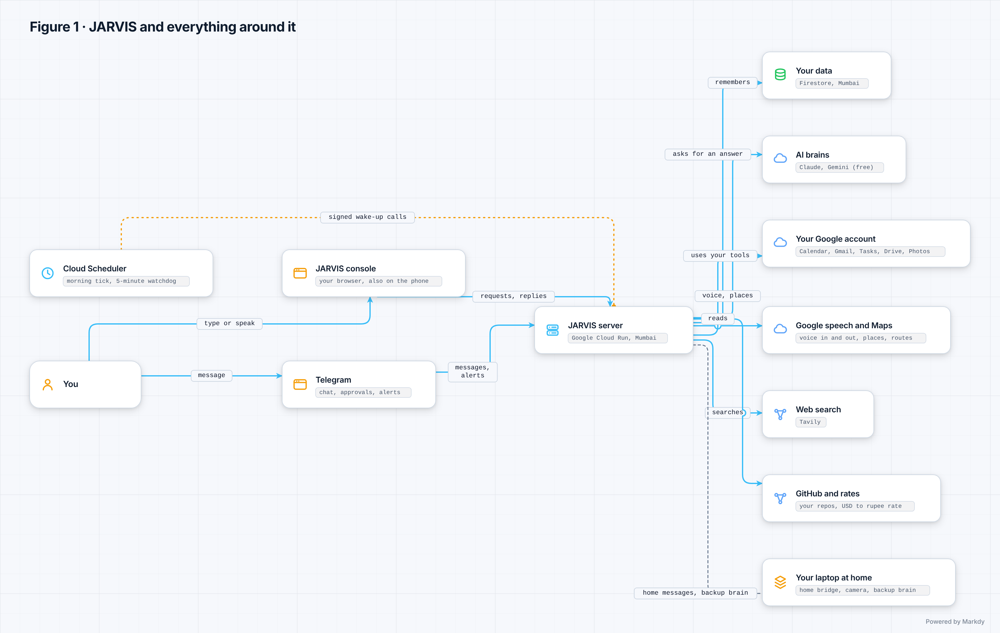](diagrams/01-context.svg)

*Figure 1. Context: the people, devices and outside services around JARVIS.* The owner reaches
JARVIS from the console, by voice or on Telegram; JARVIS runs in the owner's Google Cloud project
and talks to Google, Anthropic, Tavily, Telegram and the laptop at home.

Walk-through: everything outside the cloud project is either the owner's own device, an outside
service listed in section 5.2, or the laptop. Nothing else can reach JARVIS: the console needs a
Google sign-in for an owner account, Telegram needs the paired owner, Cloud Scheduler and the
bridge sign their calls.

### Figure 2 — The eight layers, as built

[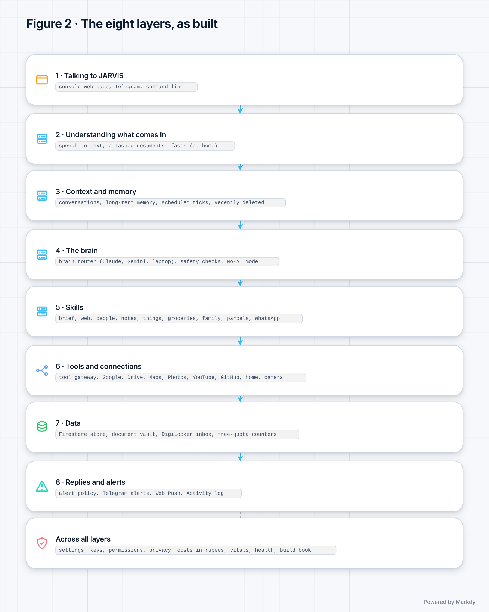](diagrams/02-layers.svg)

*Figure 2. The eight layers and the cards in each.* The same map as the table in section 2,
with the cross-cutting parts drawn as a band across all layers.

### Figure 3 — Where JARVIS runs

[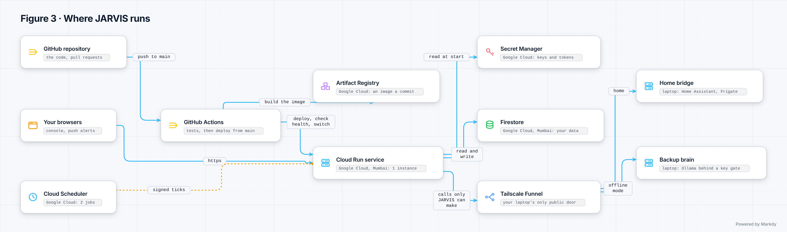](diagrams/03-deployment.svg)

*Figure 3. Deployment: what runs where.* One Cloud Run container (at most one copy, scaled to
zero) in asia-south1 with Firestore, Secret Manager and Cloud Scheduler in the same project; the
home bridge and the optional laptop brain on the owner's laptop behind Tailscale Funnel.

Walk-through: GitHub Actions builds the image, pushes it to Artifact Registry and rolls it out
(C58). The container runs as its own service account `jarvis-run`, which may read only JARVIS's
secrets and use Firestore. The laptop is reached only through its `*.ts.net` address on port 8443
(bridge) and the Caddy key gate (laptop brain).

### Figure 4 — One conversation turn

[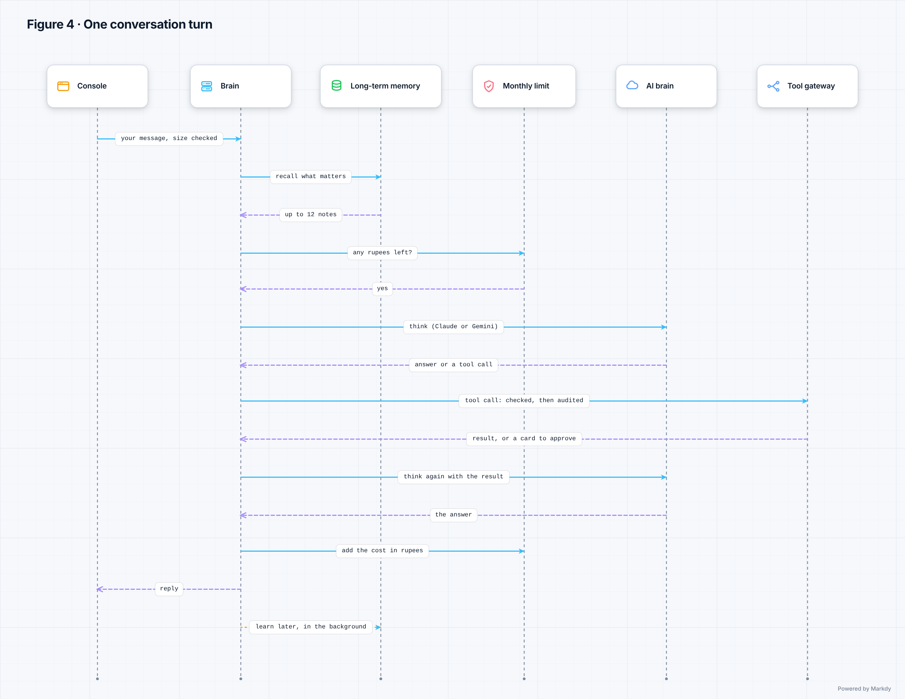](diagrams/04-chat-turn.svg)

*Figure 4. One chat turn, from your message to the reply.* The input guard checks the message,
the brain loads the conversation and recalls memory, the monthly limit is checked, the router
picks the brain, every tool call passes the gateway and the audit, the cost is recorded in ₹,
and learning is queued after the reply.

Walk-through (the same ten steps the build book checks against the code): `api.routes:chat` →
`core.guardrails:guard_input` → `core.brain:Brain.chat` → `recall.service:MemoryService.recall` →
`billing.service:Billing.ensure_allowed` → `llm.router:ModelRouter.complete` →
`tools.gateway:Gateway.execute` → `tools.audit:AuditLog.append` → `billing.service:Billing.record`
→ `recall.service:MemoryService.after_turn`.

### Figure 5 — Confirm before commit: cards and passkeys

[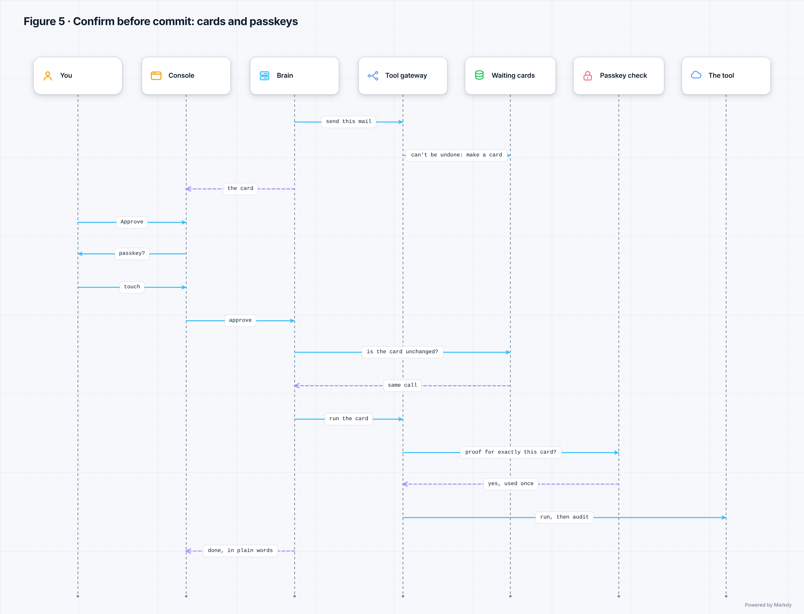](diagrams/05-approvals-passkeys.svg)

*Figure 5. Approvals and passkeys: how a risky action waits for you.* A risky tool call becomes a
card written by code; it waits in the approval store; you approve it in the console (reversible
cards also on Telegram); an irreversible one needs your passkey when passkeys are in force; the
gateway checks the card is unchanged, audits the intent, then runs it.

### Figure 6 — A spoken turn

[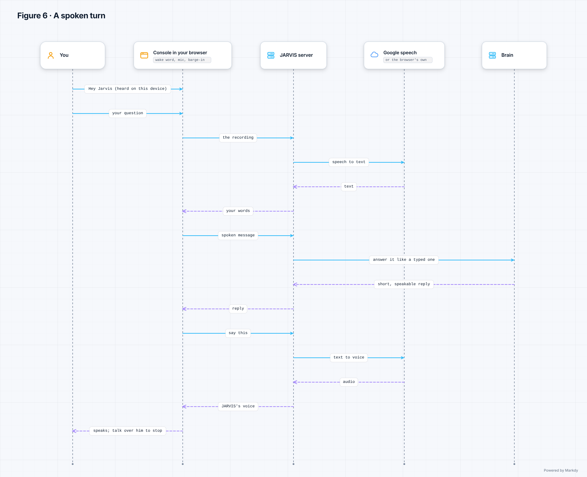](diagrams/06-voice-loop.svg)

*Figure 6. The voice loop: wake word, listening, thinking, speaking, barge-in.* "Hey Jarvis" is
detected in the browser; speech goes to Google Speech-to-Text (or the browser's own); the reply
is made speakable and spoken by Google Text-to-Speech (or the browser's voice); talking over
JARVIS interrupts it; mic off stops all capture.

Walk-through: a spoken turn is treated as possibly someone else in the room, so every write it
asks for becomes a card that you approve on screen (C28).

### Figure 7 — How JARVIS remembers you

[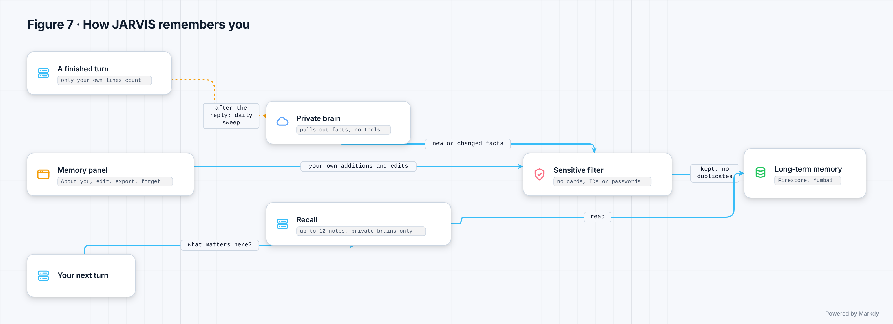](diagrams/07-memory.svg)

*Figure 7. Memory: short-term conversation, long-term facts, notes and things.* The conversation
window goes with every message; up to 12 matching facts from "About you" are added for a private
brain; notes and things are searched by code on request; learning runs in the background after
the reply, only when you switched it on.

### Figure 8 — The document vault and the DigiLocker import

[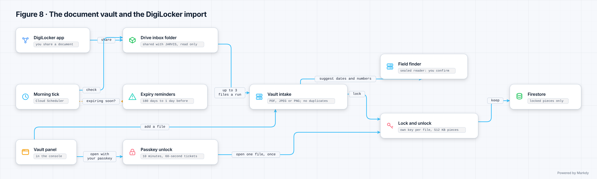](diagrams/08-vault-digilocker.svg)

*Figure 8. The vault and the DigiLocker import folder.* A file arrives from the Vault panel or the
Drive import folder, is checked and sealed with its own key, gets proposed fields you confirm,
and is opened only after an unlock; expiry reminders ride the morning tick.

### Figure 9 — The morning tick, the watchdog and alerts

[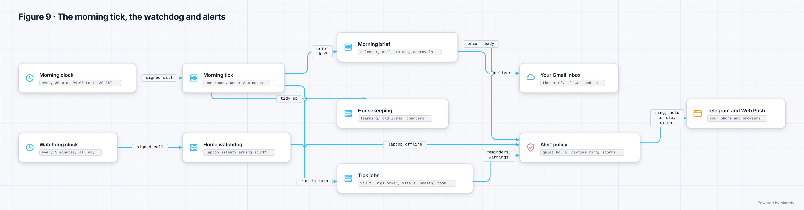](diagrams/09-brief-ticks.svg)

*Figure 9. The morning brief and the scheduler ticks.* Cloud Scheduler's morning job calls
JARVIS every 30 minutes from 04:00 to 11:30 IST; JARVIS decides whether your brief is due, makes
it from fixed reads, then runs the tick jobs one after another inside a 150-second budget. The
5-minute watchdog runs all day.

### Figure 10 — The burglar alarm: from the camera to your phone

[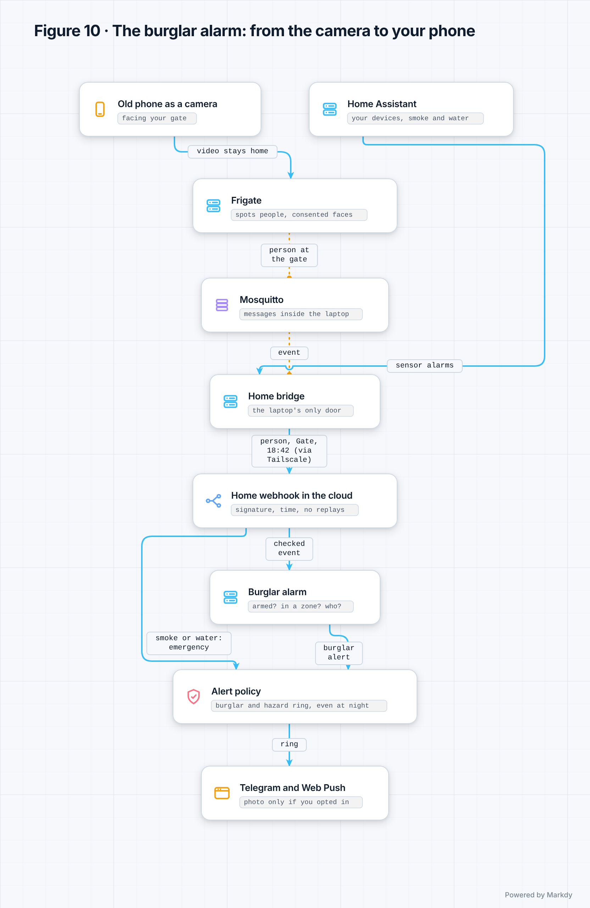](diagrams/10-home-alarm.svg)

*Figure 10. Home: the signed link, the bridge and the burglar alarm.* Frigate sees a person, the
bridge filters it at home and sends a signed event; if the alarm is armed the alert policy rings
you on Telegram and in the browser; disarming needs your passkey or a fresh sign-in and is
audited first.

### Figure 11 — The systems check and the Vitals board

[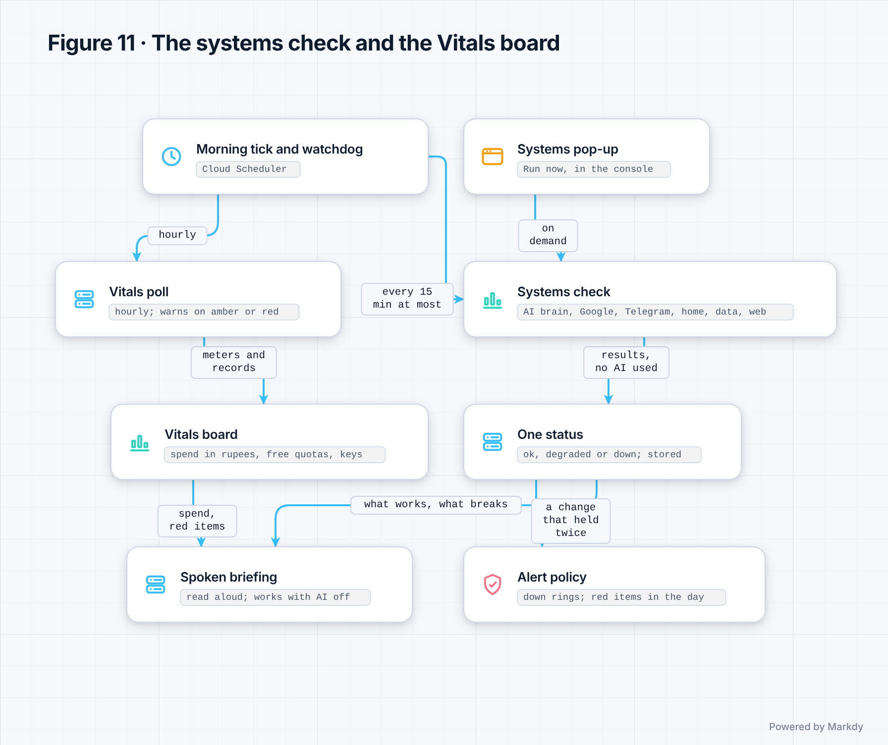](diagrams/11-systems-vitals.svg)

*Figure 11. The systems check and the Vitals board.* One probe per integration, rolled up and
spoken from fixed templates; Vitals merges meters, allowances and your own records and alerts
once when a line is crossed. No model is called on either path.

### Figure 12 — The build book and the guest show

[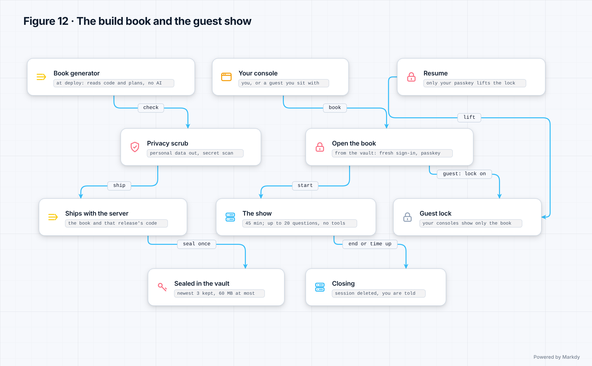](diagrams/12-build-book-guest.svg)

*Figure 12. The build book and the guest show.* The generator writes the book at each release,
the sealer puts it in the vault, you open it with your passkey and a fresh Google sign-in, and a
guest show locks your other consoles until your passkey lifts the lock.

### Figure 13 — How a change reaches the live JARVIS

[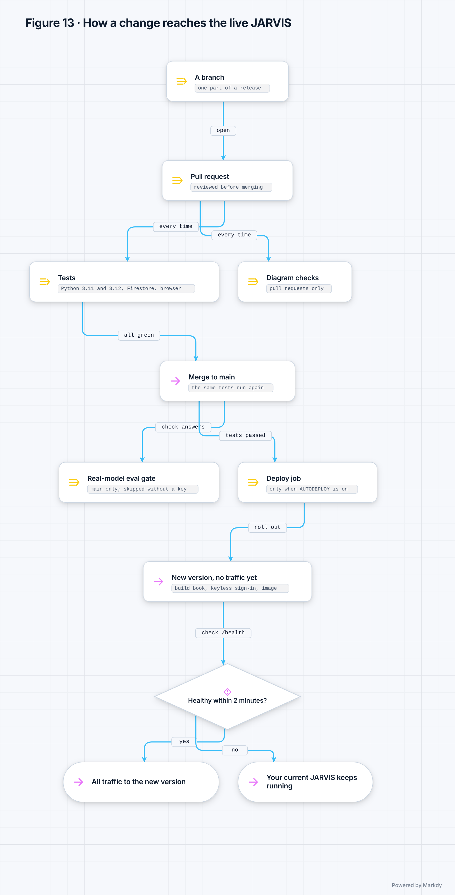](diagrams/13-release-flow.svg)

*Figure 13. How a change reaches the live JARVIS.* A branch for one part of a release, a pull
request, the checks (the tests on Python 3.11 and 3.12, the Firestore emulator, the browser, the
document checks with this guide's coverage; on pull requests also the title check and the diagram
checks), merge to main. On main the real-model eval gate (skipped without a key) runs beside the
deploy job and does not hold it back; the deploy job waits only for the tests, the emulator and
the browser, never for the document, title or diagram checks. It makes a new version with no
traffic, checks its health for up to 2 minutes, and only then sends all traffic to it. If it isn't
healthy, your current JARVIS keeps running.

### Figure 14 — Where your data lives

[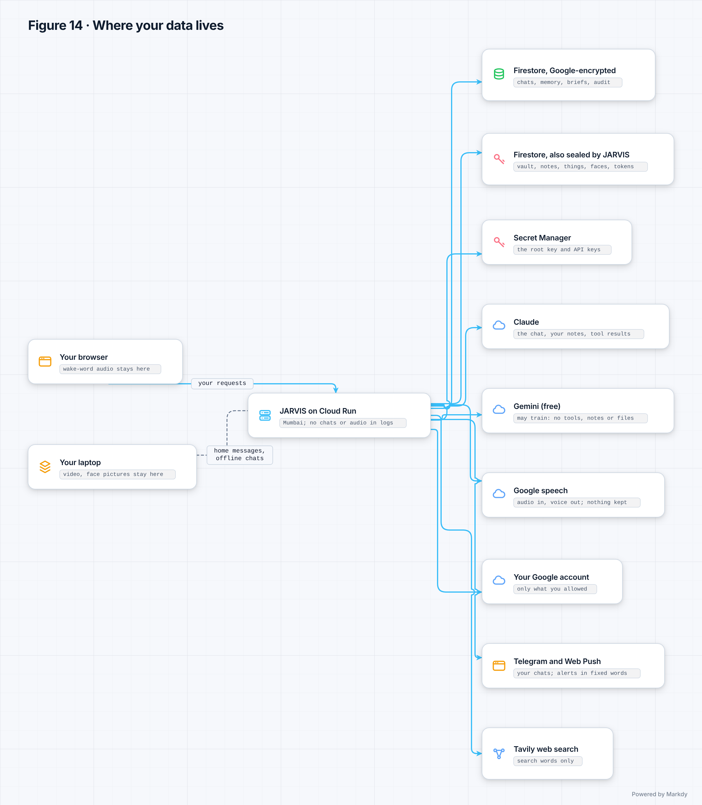](diagrams/14-privacy-map.svg)

*Figure 14. Where your data lives, and who can read it.* Firestore in Mumbai (with the
collections JARVIS encrypts with its own keys marked), Secret Manager, the laptop (pictures and
face library), the browser, and the outside services that see a part of your data.

## 5. Technology

### 5.1 Technology table

Versions are the ones locked in `requirements.lock` and vendored in `src/jarvis/api/static/` at
R6.1. "Cost per month" is what JARVIS pays at the owner's use; every paid figure is an estimate.

| Area | Technology | What it does (plain words) | Why we chose it | Alternatives we could use | Why not those (today) | Cost per month (₹) | Since |
|---|---|---|---|---|---|---|---|
| Language | Python 3.11+ (the image runs 3.12) | The language all of JARVIS's server code is written in | Typed, well known, strong libraries for web, AI and security | TypeScript (Node), Go | The team's tests, evals and tools are Python; a second language would double the work | ₹0 | Phase 0 |
| Web framework | FastAPI 0.162 with Uvicorn 0.54 | Answers every request from the console, Telegram, the scheduler and the bridge | Fast, typed requests and answers, simple dependency checks for sign-in | Flask, Django, Starlette alone | Flask lacks typed request checks; Django brings an ORM and admin we don't use | ₹0 | Phase 0 |
| Data shapes and settings | Pydantic 2.14 and pydantic-settings 2.16 | Checks every request, stored record and setting; keeps secrets from being printed | Strict validation at every boundary; settings from environment variables | attrs, marshmallow | Less integrated with FastAPI | ₹0 | Phase 0 |
| Hosting | Google Cloud Run (asia-south1), one container, at most one copy, scale to zero | Runs JARVIS on the internet without a server to look after | Free for one owner (2 million requests a month), in Mumbai, next to Firestore | Render, a small VM, Kubernetes | Render was used first; a VM needs patching; Kubernetes costs money and time for one owner | ₹0 | By Slice 4 (*unverified*: the slice 4 plan already reads Cloud Run's logs) |
| Database | Firestore (Native mode) through the `Docs` port | Keeps conversations, approvals, the audit chain and every feature's data | Free at this size (1 GiB), no new account or key, data stays in the owner's project | Postgres (Neon, Cloud SQL), SQLite on a disk | Cloud SQL has no free tier; Neon is a new vendor and a new secret; Cloud Run has no lasting disk | ₹0 | Slice 5 (v0.5.0) |
| Local session cache | Redis 7 (docker-compose only) | Keeps conversations when JARVIS runs on a developer's machine | Simple and fast for local runs | Memcached, in-memory only | Memcached keeps no data across restarts; in-memory loses it on every restart | ₹0 | Phase 0 |
| Secrets | Google Secret Manager | Keeps the API keys, the session secret and the token key | Readable only by JARVIS's own service account, per secret | Environment files, HashiCorp Vault | Files leak; Vault is a server to run | ₹0–30 (section 5.2) | With Cloud Run, by Slice 4 (*unverified*) |
| Clock | Google Cloud Scheduler (2 jobs) | Wakes JARVIS for the morning brief and every 5 minutes for the watchdog | 3 jobs free; signs each call with a Google token | Cron on a VM, GitHub Actions schedule | No VM to run cron on; Actions schedules are not reliable to the minute | ₹0 | Slice 7 (v0.7.0) |
| Build and deploy | GitHub Actions with Workload Identity Federation | Tests every change and deploys main with no stored key | No key exists anywhere; only main of this repository may deploy | Cloud Build triggers, manual deploys | Manual deploys are error-prone; triggers would need a second CI | ₹0 | Slice 5c (v0.5.2) |
| Container | Docker image from `python:3.12-slim`, hash-locked `requirements.lock` | Packs JARVIS and exactly its locked libraries | A tampered package can't get in: every file's hash is checked | Buildpacks, unlocked `pip install` | Less control over what is installed | ₹0 | Slice 2 |
| Paid brain | Anthropic Claude (Haiku, Sonnet, Opus 5.5) through the `anthropic` SDK 2.3 | Answers, plans and calls tools | The real-model eval gate runs on it; JARVIS treats it as a brain that does not learn from prompts, so it may use tools and personal data | OpenAI, Gemini paid tier | Not run against JARVIS's eval suites yet; the core is model-agnostic, so they can be added | Per use: about ₹100 at 20 replies a day (estimate, section 9) | Phase 0 |
| Free brain | Google Gemini free tier (REST over httpx) | A free brain for chat | ₹0 | Groq or OpenRouter free models (the OpenAI-compatible slot) | Free tiers may learn from prompts, so this brain gets no tools and no personal data | ₹0 | Slice 3 |
| Offline brain | Ollama on the laptop (default qwen2.5:3b), behind Caddy and Tailscale Funnel | Answers when the cloud brain can't be reached | Free, private (your words go only to your machine) | LM Studio, llama.cpp server | Ollama speaks the OpenAI format and is the simplest to set up | ₹0 | R1 (v1.0.0) |
| Outbound calls | httpx 0.28 | Calls every outside REST API (Google, Tavily, Telegram, GitHub) | One client, timeouts everywhere; no vendor SDK outside `jarvis.llm` | Each vendor's SDK | SDKs pull in many packages and hide errors; direct calls keep errors in plain words | ₹0 | Phase 0 |
| Speech | Google Cloud Text-to-Speech and Speech-to-Text v1; the browser's own speech as fallback | JARVIS's voice and listening | Inside the free monthly allowance; no new account | ElevenLabs, Deepgram, Whisper | New vendors and keys; a cloned voice is not allowed; local Whisper is slow on the server's single CPU | ₹0 inside the allowance | Slice 9 (v0.9.0) |
| Wake word | openWakeWord models 0.5.1 run with onnxruntime-web 1.30 in the browser | Hears "Hey Jarvis" on the device | Nothing is sent until the wake word is heard | Porcupine, always-on cloud listening | Porcupine needs a vendor key (*unverified*); cloud listening would send room audio | ₹0 (models are non-commercial use only, section 10) | Slice 9 (v0.9.0) |
| 3D look | three.js 0.187 (vendored) | The optional scenes in the console and the build book show | Mature WebGL library, served by JARVIS itself | Babylon.js, plain canvas | Larger; plain canvas would mean writing a 3D engine | ₹0 | Slice 5c (v0.5.2) |
| Encryption | `cryptography` 50 (AES-256-GCM, HKDF-SHA256) | Locks the vault, notes, things, home records, faces and tokens with JARVIS's own keys | A vetted library; one key per purpose | Cloud KMS, libsodium | Cloud KMS is a paid call per use; libsodium adds a native dependency | ₹0 | Slice 6 (tokens); R2 (v2.0.0) keyring |
| Passkeys | py_webauthn 3.0.1 | Checks your passkey for irreversible actions | Standard WebAuthn, phishing-resistant | One-time codes by e-mail or SMS | Codes can be phished; SMS costs money | ₹0 | Slice 10 (v0.10.0) |
| Sign-in and cookies | Authlib 1.9 and itsdangerous 2.2 | Google sign-in and the signed session cookie | Standard OpenID Connect | Firebase Auth, Auth0 | Another vendor in the sign-in path | ₹0 | Slice 2 |
| Signed tokens | joserfc 1.7 | Checks Cloud Scheduler's Google token; signs Web Push (VAPID) | Small, standards-only | PyJWT | Already locked through Authlib | ₹0 | Slice 7 (v0.7.0) |
| Document text | pypdf 6.21 and python-docx 1.2 | Takes the text out of PDFs and Word files | Pure Python, safe parser settings, run in a killable child process | Apache Tika, OCR | Tika is a Java server; OCR is not built | ₹0 | Slice 10 (v0.10.0) |
| Web search | Tavily | Search results and page text with sources | 1,000 free credits a month (searches and page reads), no card; JARVIS can fence and audit the page text | Claude's built-in web search, Brave Search | Claude's search costs about ₹6 a search turn on Opus and its page text bypasses the gateway; Brave needs a card (slice 10 plan) | ₹0 (stops at 900 credits) | Slice 10 (v0.10.0) |
| Phone chat and alerts | Telegram Bot API | Chat and alerts on the phone | Free, official API | WhatsApp Business API, SMS | WhatsApp's terms bar general AI assistants; SMS costs money | ₹0 | R1 (v1.0.0) |
| Browser alerts | Web Push (VAPID, RFC 8291 encryption) | Notifications in your browsers | A standard; free; encrypted to each browser | Firebase Cloud Messaging SDK | Another SDK and account for the same result | ₹0 | R3 (v3.0.0) |
| Smart home | Home Assistant version 2026.10 (on the laptop) | Lights, sensors and other devices at home | Works with almost every device; local | SmartThings, Google Home | Cloud-first; less control; more accounts | ₹0 | R3 (v3.0.0) |
| Cameras | Frigate 0.17.2 with Mosquitto 2.0.20 (MQTT) | Sees people and packages, keeps the face library at home | Local detection; pictures stay at home | Cloud camera services | Pictures would leave home; monthly fees | ₹0 | R3 (v3.0.0) |
| Reaching the laptop | Tailscale Funnel | Gives the laptop's bridge one public HTTPS address | No router changes; TLS ends on the laptop | Cloudflare Tunnel, port forwarding | Quick tunnels end TLS at Cloudflare and change address each start; named tunnels need a domain (about ₹995 a year); port forwarding exposes the home router (R1 and R3 plans) | ₹0 (free personal plan, *unverified* limits) | R1 (v1.0.0) offline brain; R3 (v3.0.0) bridge |
| Maps | Google Places API (New) and Routes API | Place search and routes | Best data for India; one server key | OpenStreetMap services, Mappls | Weaker place data for Indian businesses (*unverified*) | ₹0 (stops at 90 % of the free allowance) | Slice 12 (v0.12.0) |
| Video | YouTube Data API v3 | Video and music search, your playlists | The source itself | Scraping | Against the terms; breaks often | ₹0 | Slice 12 (v0.12.0) |
| Exchange rate | Frankfurter | The daily dollar-to-rupee rate | Free, no key | A paid FX API | No need to pay for one number a day | ₹0 | Slice 7b (v0.7.1) |
| Tests | pytest, pytest-asyncio, Playwright 1.63 with Chromium, the Firestore emulator | Unit, store and browser tests on every change | Standard; the emulator tests the real Firestore behaviour | unittest, Selenium | Less expressive; Selenium is slower | ₹0 | Phase 0; browser Slice 6; emulator Slice 5 |
| Code checks | ruff and mypy (strict) | Style, mistakes and types | Fast; one tool for lint and format | flake8 with black, pyright | More tools to keep in step | ₹0 | Phase 0 |
| Diagrams | Markdy CLI 1.5.7 (dev only, never in the console) | Draws this guide's diagrams from text | Diagrams live as text next to the code and are checked in CI | Mermaid, draw.io | Mermaid can't do the scene types this guide uses; draw.io files are not reviewable as text | ₹0 | R6.1 (v6.1.0) |
| Phone app | A Trusted Web Activity through Google's android-browser-helper 2.7.4 (Apache-2.0), Kotlin, Views | The JARVIS app on Android: the console drawn by Chrome full screen, plus a tile, alerts, Health Connect and SOS | Sign-in, passkeys, cookies and Web Push keep working unchanged because Chrome draws the page; chosen instead of Capacitor | An installed web app only, React Native | An installed web app cannot read Health Connect or offer the tile; React Native would be a second copy of the console | ₹0 | R7 |
| Android build | Android Gradle plugin 9.5.1, Gradle 9.6.0, Kotlin 2.4.10 (the `core` module), JDK 17 in CI | Builds and tests the app: CI proves it, the owner's laptop builds the one he installs | The pins Google's pages give for Android Studio Rabbit 2 (13 Nov 2026) | Older plugin lines | The phone's Health Connect client needs `compileSdk` 36 | ₹0 (GitHub Actions is free for a public repository) | R7 I0 (CI's first version) |
| Vision on the device | MediaPipe Tasks Vision, tesseract.js with English data, zxing-wasm (Apache-2.0 and MIT), served by JARVIS and pinned by hash | Reads printed text, codes and labels and finds 80 everyday things and a body's 33 points in the browser, so no frame leaves the device | Open licences, no outside host, runs on the phone and the laptop alike; not ML Kit | ML Kit, Ultralytics YOLO, a cloud vision service | ML Kit's terms (not open source; it reports usage to Google), YOLO's AGPL licence, and a cloud service would see the frames | ₹0 | R7 (PLANNED) |
| Watch data | Android Health Connect (read on the phone) | Steps, heart rate and sleep from any app that writes there | Part of Android since 14; one source for every watch app | Google Fit's APIs, a watch maker's own cloud | Google ends the Fit APIs with 2026; a maker's cloud needs another account and sends health data away | ₹0 | R7 (PLANNED) |
| Time zones | tzdata | Correct local and Pacific time for allowances | Works even in an image without system zone files | System zone files only | The slim image may lack them | ₹0 | Slice 12 (v0.12.0) |

### 5.2 Outside services and free limits

"JARVIS stops at" is where JARVIS's own counter stops calling, so the service never becomes paid.
Google counts some allowances per billing account; if other projects share the account, JARVIS's
counter sees only its own use (the deploy script warns about this).

| Service | What JARVIS uses it for | Free allowance | What happens at the limit | ₹ after the limit |
|---|---|---|---|---|
| Google Cloud Run | Runs JARVIS | 2 million requests a month | *unverified*: requests beyond are billed | Billed per use; the ₹1 budget alert e-mails at once |
| Firestore | All stored data | 1 GiB stored; 50,000 reads, 20,000 writes, 20,000 deletes a day; one free database per project | Google bills the excess | Billed per use (*unverified* rates) |
| Secret Manager | Secrets | 6 active secret versions per billing account (R2 plan); JARVIS keeps 4 to 11 secrets | Each version beyond 6 is billed, disabled ones too | About ₹5.7 a version a month (US$0.06, R2 plan): ₹0–30 for JARVIS's 4–11 secrets |
| Cloud Scheduler | The two clocks | 3 jobs per billing account | A 4th job | About ₹10 a month per extra job (the deploy script's dollar price, converted) |
| Artifact Registry | Container images | 0.5 GB (deploy script note) | Old images are deleted after 30 days to stay near it | Billed per GB (*unverified*) |
| GitHub Actions | CI and deploy | 2,000 minutes a month (as the plans list them) | Runs wait or need a plan | — |
| Anthropic | Claude brain | None (prepaid credit) | Your monthly limit in ₹ stops paid calls | Per tokens, see C16 |
| Google Gemini | Free brain | Google's free tier | Google answers "too many requests"; JARVIS says so | — (no paid key used) |
| Google Cloud Text-to-Speech | JARVIS's voice | 1 million characters per voice type a month; JARVIS uses 900,000 | Counted against your monthly limit | About ₹2,857 (Chirp 3: HD) or ₹15,238 (Studio) per million characters |
| Google Cloud Speech-to-Text v1 | Listening | 60 minutes a month; JARVIS uses 54 | Counted against your monthly limit | About ₹2.29 a minute |
| Tavily | Web search, people research | 1,000 credits a month (searches and page reads), no card; JARVIS stops at 900 credits | Web search says it is used up | Never used (no pay-as-you-go) |
| Google Places API (New) and Routes API | Maps | Global list: 5,000 searches and 5,000 car routes a month (1,000 two-wheeler, 10,000 walking); India list: 35,000 | JARVIS stops at 90 % | Never used |
| YouTube Data API | Video search and playlists | 100 searches and 10,000 units a day | JARVIS stops at 90 % | Never used |
| Google Calendar, Gmail, Tasks, People (Contacts), Drive, Photos Picker APIs | The Google tools | No charge for these APIs; Google's per-day quotas apply (*unverified* exact quotas) | Google answers "quota exceeded"; JARVIS says so | — |
| Google sign-in (OAuth) | Owner sign-in and the Google link | Free | — | — |
| Telegram Bot API | Phone chat and alerts | Free | Telegram's own rate limits | — |
| Web Push services | Browser notifications | Free (run by the browser makers) | — | — |
| Frankfurter | Exchange rate | Free, no key; JARVIS asks at most once a day | The stored rate is used | — |
| Open-Meteo | The helpers' weather (C60) | Free for personal, non-commercial use, no key: 600 calls a minute, 10,000 a day; JARVIS asks about 24 times a day. Data CC BY 4.0, credited "Weather data by Open-Meteo.com" | *unverified*: calls are refused; the panel says since when | Never used |
| NDMA SACHET | Disaster and weather warnings for your district (C60) | Public domain feed, no key, no published limit; JARVIS reads your state's feed every 10 minutes (about 150 a day) | The panel says "can't reach SACHET since ..."; the official app, SMS and cell broadcast stay first | — |
| USDA FoodData Central | Nutrition values (C60) | CC0 1.0 (public domain); a subset of the SR Legacy download is bundled, so no call is ever made | — | — |
| GitHub API | Your own GitHub, read-only | Free with your token | GitHub's rate limits; Vitals shows them | — |
| Tailscale | Reaching the laptop | Free personal plan (*unverified* limits) | — | — |
| Home Assistant, Frigate, Mosquitto, Ollama | Home and offline brain on your laptop | Free, open source, run by you | — | — |

### 5.3 Original plan vs as built

The project's build phases, and what was actually delivered in which release:

| Phase (original plan) | Planned | As built | Releases |
|---|---|---|---|
| 0 Core loop | Text in, Claude, text out, session memory | Done: the brain loop, tiers, the console, the CLI | Phase 0, slices 1–5 |
| 1 Voice | Voice in and out, wake word, TTS | Done: Google speech with browser fallback, on-device wake word, barge-in, mic off, sound devices | Slice 9 (v0.9.0), R5 (v5.0.0), R5.1 (v5.1.0) |
| 2 Tool calling | Calendar, e-mail, web search, files | Done and wider: calendar, reminders, Gmail, to-dos, documents, Drive, Maps, YouTube, Contacts, WhatsApp drafts, groceries, parcels, family calendars | Slices 1, 6, 10, 11, 12; R1 (v1.0.0) |
| 3 Long-term memory | Memory, profile, personalisation | Done: About you, notes, things, the vault (no vector database) | Slice 8 (v0.8.0), R2 (v2.0.0) |
| 4 Proactive agents | Scheduled reasoners that nudge | Done in part: the morning brief, expiry reminders, Vitals and health alerts, all from fixed rules (no free-running agent) | Slice 7, R2, R4 (v4.0.0) |
| 5 Smart home and devices | IoT and multi-device sync | Done in part: the home bridge, cameras, alarm and faces; no Matter; no multi-device sync beyond the browser | R3 (v3.0.0) |
| 6 Mobile, wearable, always-on | Apps and a watch | PLANNED: R7 (a Trusted Web Activity app around the console, Health Connect, SOS, the phone camera; its joins are built at R7 I0) | R7 I0 (v7.0.0, joins only) |
| 7 Evals, red-teaming, cost, launch | Quality and launch | Ongoing: evals with negative controls in every slice, costs in ₹, the build book, this guide. A public launch is not planned (one owner). | Slice 7b, R5.1, R6, R6.1 |

Releases so far (from `docs/github-backfill.tsv`):

| Version | Release | What it brought |
|---|---|---|
| v0.5.0 | Slice 5 | Conversations, approvals and audit kept in Firestore |
| v0.5.2 | Slice 5c | The 3D command deck and deploy on merge |
| v0.6.0 | Slice 6 | Google Calendar and Gmail tools |
| v0.7.0 | Slice 7 | Morning brief |
| v0.7.1 | Slice 7b | Costs in rupees and the monthly limit |
| v0.8.0 | Slice 8 | Long-term memory |
| v0.9.0 – v0.9.2 | Slice 9 | Voice (and two test fixes) |
| v0.10.0 | Slice 10 | Web search, to-dos, documents and passkeys |
| v0.11.0 | Slice 11 | Full control of calendar, reminders and to-dos (undo bin, Approve all) |
| v0.12.0 – v0.12.1 | Slice 12 | Drive, Maps, YouTube, Contacts and WhatsApp drafts |
| v1.0.0 | R1 | Free tools: Telegram, offline mode, Activity, groceries, parcels, family calendars, mail read aloud |
| v2.0.0 | R2 | Memory and the personal vault: vault, DigiLocker import, notes, things, privacy dashboard |
| v3.0.0 | R3 | Home bridge and camera security |
| v4.0.0 | R4 | Vitals, self-health and people research; No-AI mode; Photos and GitHub connectors |
| v5.0.0 | R5 | Voice that listens: wake word, barge-in, mic off, sound devices |
| v5.1.0 – v5.1.1 | R5.1 | The owner's observations fixed; the visual gate; spoken systems briefing |
| v6.0.0 | R6 | The build book |
| v6.1.0 | R6.1 | This guide, one versioning standard, the dock that fits every screen |

### 5.4 Decisions log

| When | Decision | Reason | Alternatives | Where |
|---|---|---|---|---|
| Phase 0 (by 1 Nov 2026) | Skills ask for a tier, never a model id; only `jarvis.llm` imports a vendor SDK | Keeps the core model-agnostic and swappable | Hard-coding Claude | `CLAUDE.md`, `src/jarvis/llm/router.py` |
| Slice 1 (1 Nov 2026) | Every tool call passes one gateway; irreversible calls always ask; no "don't ask again" | Confirm before commit, in one place | Per-tool checks | `phase2-slice1-tool-spine.md` |
| Slice 3 (1 Nov 2026) | A brain that may train on prompts gets no tools and no personal data | Private by default | Trust the vendor | `phase2-slice3-gemini-free-brain.md` |
| Slice 5 (1 Nov 2026) | Firestore instead of Postgres, behind ports | Free, no new account or key, data in the owner's project | Neon Postgres, Cloud SQL | `phase2-slice5-persistence.md` |
| Slice 5c (1 Nov 2026) | Deploy on merge with Workload Identity Federation | No stored deploy key; only main may deploy | A service-account key in GitHub | `phase2-slice5c-command-deck.md` |
| Slice 6 (1 Nov 2026) | Direct REST to Google, no SDK and no MCP server | Google's MCP servers were a developer preview; errors stay in plain words | Google's SDKs, remote MCP | `phase2-slice6-gmail-calendar.md` |
| Slice 7b (1 Nov 2026) | All money in ₹ with the owner's monthly limit enforced before every paid call | The owner thinks in rupees; no surprise bills | Showing dollars; no limit | `phase7-slice7b-inr-costs-budget.md` |
| Slice 8 (1 Nov 2026) | Learning is opt-in with a spend consent; sensitive data is refused by code | Privacy and cost | Always-on learning | `phase3-slice8-long-term-memory.md` |
| Slice 9 (1 Nov 2026) | No clone of the film voice; a stock British Google voice | Rights and vendor terms | ElevenLabs clone | `phase1-slice9-voice.md` |
| Slice 11 (2 Nov 2026) | Undo bin for own deletes; trust by provenance | Fewer cards for the owner's own items, still safe | Asking for every delete | `phase2-slice11-full-control.md` |
| Slice 12 (3 Nov 2026) | Telegram, not WhatsApp, as the phone front door; WhatsApp only as drafts | Meta's terms; ban risk with unofficial libraries | WhatsApp Business API | `phase2-slice12-integrations.md` |
| R1 (4 Nov 2026) | The laptop as an offline backup brain with at most 12 tools and every write asking | Works when the cloud brain is down; a small model is easier to fool | No fallback | `r1-free-tools.md` |
| R2 (5 Nov 2026) | One keyring: a key per purpose from the one token key; no new secret | Separation without more secrets to manage | Cloud KMS | `r2-memory-vault.md` |
| R2 (5 Nov 2026) | DigiLocker through a shared Drive folder | DigiLocker's partner APIs are for registered organisations | DigiLocker API | `r2-memory-vault.md` |
| R3 (5 Nov 2026) | Pictures stay at home; only one small opt-in snapshot may leave | Privacy of the household | Cloud vision | `r3-home-camera.md` |
| R4 (5 Nov 2026) | People research only behind a positive verification gate | No profiling of private people | Open search | `r4-vitals-health-people.md` |
| R4 (5 Nov 2026) | A persisted No-AI mode that fails closed | A guarantee of no model spend | A session-only switch | `r4-vitals-health-people.md` |
| R6 (10 Nov 2026) | The build book is generated by code (no model), sealed per release, opened with passkey and fresh sign-in | Deterministic, private, free | A model-written summary | `r6-build-book.md` |
| R6.1 (11 Nov 2026) | Record an 11th core skill "Health & Wellbeing" and a Layer-2 vision engine, and mobile as a wrapped console rather than React Native, all as PLANNED (R7 later chose a Trusted Web Activity instead of Capacitor: next row) | Owner decision 10 in the 11 Nov 2026 release plan (the skill and the vision engine); the R6.1 plan adds mobile as a wrapped console | Keep ten skills; React Native | `r6-1-architecture-guide.md` decision 6 |
| R7 (12–13 Nov 2026) | The phone app is a Trusted Web Activity (Chrome draws the console) with a few native parts, not Capacitor and not React Native; the vision engine runs in the browser, not ML Kit; SOS is never a tool | Google refuses its sign-in inside an app's WebView and a WebView has no Web Push; the same web engine serves the phone and the laptop; asking for a passkey in an emergency defeats the purpose | Capacitor, React Native, ML Kit | `r7-mobile.md` (decision record, D1, D14, D19) |

## 6. Data and privacy

### 6.1 Where data lives

| Place | What is there | Who can read it |
|---|---|---|
| Firestore, your Google Cloud project, Mumbai (asia-south1) | Everything JARVIS keeps (6.2) | JARVIS's service account `jarvis-run`, and you as the project owner in the Google Cloud console |
| Secret Manager, same project | The API keys, the session secret, the API token, the token key | `jarvis-run`, one grant per secret |
| Your laptop (home bridge volume, Frigate, Home Assistant) | Camera recordings and events, the face library, face attempts (72 hours for unknown people, 7 days for enrolled people), the doorstep log (7 days), Home Assistant's own data | You; only the bridge's signed door is reachable from outside |
| Your browser | Small conveniences (the open conversation, look and layout, chosen sound devices) | You |
| Google (your account) | Your Calendar, Gmail, Tasks, Contacts, Drive and Photos, as always | Google and you; JARVIS reads them through your link |
| Outside services | What each call needs (6.5) | That vendor |

### 6.2 Firestore collections

Every collection name carries the prefix `jarvis_` (setting `JARVIS_FIRESTORE_PREFIX`). Google
encrypts all of Firestore at rest. "Sealed by JARVIS" means JARVIS also encrypts the content with
its own key (AES-256-GCM) before it reaches Google, so a reader of the database sees only a blob.

| Collection | What it holds | Sealed by JARVIS (key) | Kept for | Card |
|---|---|---|---|---|
| `sessions` (and `turns`) | Conversations | No | Until you delete them | C09 |
| `approvals` | Waiting approval cards | No | Until decided | C18 |
| `audit` | The hash-chained audit trail: tool, risk, outcome, a hash of the arguments and a short detail (never the arguments themselves) | No | Always (append-only) | C28 |
| `meta` | The audit chain's head; a health ping | No | Always | C41 |
| `memory`, `memory_shards` | Facts about you (long-term memory) | No (*see 10. Known limits*) | Until you delete them | C10 |
| `kb`, `kb_shards`, `kb_fetch` | Notes, memo transcripts, saved links | Yes (`notes`) for the notes | Until you delete them | C23 |
| `belongings`, `belongings_history` | Things and where they are | Yes (`belongings`) | Until you delete them | C24 |
| `vault` (and `vault_chunks`) | Vault index and files | Yes (`vault_index`; each file under its own key wrapped by `vault`) | Until you remove them (30 days in the bin) | C42 |
| `vault_unlocks` | Unlock windows and download tickets | Hashed (`tickets`) | 10 minutes / single use | C42 |
| `vault_alerts` | Which expiry reminders were sent (ids and dates) | No | With the item | C42 |
| `vault_inbox` | The DigiLocker import folder and what was seen | No | Until you change it | C43 |
| `tokens` | Your Google tokens | Yes (the token key) | Until you unlink Google | C29 |
| `connectors_github` | Your GitHub token | Yes (`connectors`) | Until you disconnect | C37 |
| `photos` | A Photos picker session (ids only) | No | Until it expires | C37 |
| `maps_places` | Your Home and Work for routes | Yes (the token key) | Until you change them | C35 |
| `drive_roots` | The Drive folders you chose | No | Until you change them | C34 |
| `attachments` (and `chunks`) | Text of files you attached | No | With the conversation; unsent uploads 1 day | C07 |
| `briefs`, `brief_settings` | Your briefs and their settings | No | Briefs 7 days | C19 |
| `deleted_items` (and `items`) | Copies of deleted items for undo | No | 30 days | C12 |
| `activity`, `activity_days` | What JARVIS did today | No | 7 days | C48 |
| `outside_tasks` | Ids of to-dos written from outside content | No | With the to-dos | C32 |
| `groceries` | The Groceries list's id | No | Until you change it | C25 |
| `family_calendars` | Family calendars you registered | No | Until you remove them | C26 |
| `people_last` | Your last people research | No | Replaced by the next one | C21 |
| `permissions` | Your Allow / Ask first / Never choices | No | Until you change them | C52 |
| `passkeys`, `webauthn_challenges` | Passkey public keys; one-time challenges | No (public keys only) | Until removed; challenges 2 minutes | C52 |
| `usage`, `allowance`, `budget`, `fx` | ₹ spend per month, the speech allowance used, your limit, the day's rate | No | Months are kept (past months deletable with a passkey) | C54 |
| `web_usage`, `web_vendor_usage` | Web searches this month | No | Per month | C20 |
| `api_quota` | Maps and YouTube counters | No | Per period | C44 |
| `voice_settings` | Your voice choices and words to recognise | No | Until you change them | C05 |
| `settings` | The AI on / No-AI switch | No | Until you change it | C17 |
| `local_brain` | The laptop brain's address and key, its model and switch | Yes (the token key) for the address and key | Until you change it | C17 |
| `telegram`, `telegram_users`, `telegram_pairing`, `telegram_pairing_tries`, `telegram_updates`, `telegram_alerts` | Telegram pairing, update claims, counters | No | Updates 48 hours, counters 3 days, codes 10 minutes | C04 |
| `notify`, `notify_held`, `notify_rate` | Alert settings and VIP list, held alerts, storm counters | Yes (`notify`) for the VIP list | Held until quiet hours end; counters 3 days | C46 |
| `webpush` | Your browsers' push subscriptions | Yes (`webpush`) | Until removed (at most 5) | C47 |
| `home`, `home_link`, `home_claims`, `home_devices` | The home link, a pending code, event claims, the device list | Yes (`home`) for the link and devices | Claims 48 hours; code 10 minutes | C38 |
| `home_arm`, `home_cameras`, `home_feed` | Alarm state, camera settings, the home feed | Yes (`home`, `home_feed`) except the arm state | Feed 7 days | C40 |
| `faces` | People JARVIS may recognise and their consent | Yes (`faces`) | Until removed | C08 |
| `health_last` | The last systems check | No | Replaced each check | C56 |
| `helpers_nudge`, `helpers_gate`, `helpers_clock` | Nudge caps, snoozes and stops; when each helper message went out (kind and minute); the clock's last run | No | Send log 15 days | C60 |
| `bills`, `bills_told`, `birthdays_told` | Your bills (never a card number); claims for reminders sent (hashes only, never a birth year) | Yes (`bills`) for the bills | Claims 60 and 400 days | C60 |
| `chores`, `maintenance`, `house_told`, `outside` | The chores rota and upkeep list; reminder claims; your place and the warnings' words | Yes (`alerts_place`) for `outside` | Claims 30 days | C60 |
| `nudges`, `wellbeing` | Your nudge settings and free-time ideas; water, stand-ups and check-ins | Yes (`wellbeing`) for the log | The log 30 days | C60 |
| `kitchen`, `spend`, `spend_scan` | Pantry, tastes and saved recipes; grocery totals a month; the receipts switch and seen hashes | Yes (`kitchen`, `spend`) | Spend 13 months | C60 |
| `phone_link`, `phone_devices` (R7) | A pending phone link code (its hash only); the linked phones' public keys and signing fingerprints | No | 10 minutes; until unlinked | C62 |
| `watch_days`, `watch_state` (R7) | Daily steps, heart rate and sleep; the last sync and a typed sleep time | Yes (`watch`) for the days | 400 days | C64 |
| `sos`, `sos_join`, `sos_log` (R7) | Emergency contacts; pending join words; each SOS without coordinates | Yes (`sos`) for the contacts | Join words 24 hours, the log 400 days | C65 |
| `vision_results` (R7) | Camera results you kept (never a frame) | Yes (`vision`) | 90 days | C63 |
| `vitals_providers`, `vitals_status`, `vitals_index` | What Vitals tracks and the last status (never a key's value) | No | Until removed | C55 |
| `book` (and `book_chunks`), `book_lease`, `book_lock`, `book_sessions`, `book_settings`, `book_tickets`, `book_notices`, `book_closed` | Sealed build books, the sealer's lease, the guest lock, book sessions, settings, tickets, content-free notices | Yes (`book_index`, `book_session`) for the books and sessions; tickets hashed (`tickets`) | Books until removed (60 MB cap); sessions 45 minutes | C57 |

### 6.3 Redis

Only in local Docker runs (`docker-compose.yml`): conversations as `jarvis:session:{id}` with a
24-hour idle expiry and a per-user index `jarvis:user:{id}:sessions`. Production uses Firestore;
the systems check pings Redis only when it is configured.

### 6.4 Encryption and the keyring

- **In transit:** HTTPS everywhere; the bridge's calls are also signed both ways (HMAC) with a
  nonce against replay; Web Push messages are encrypted to each browser.
- **At rest:** Google encrypts Firestore and Secret Manager. On top of that, JARVIS seals the
  collections marked "Yes" above with AES-256-GCM.
- **Keys:** one token key (32 random bytes, Secret Manager `jarvis-token-key`, made once by the
  deploy script). `src/jarvis/keyring.py` derives one key per purpose with HKDF-SHA256:

| Purpose | Protects |
|---|---|
| `vault` | Wraps each vault file's own key |
| `vault_index` | The vault's index |
| `notes` | Notes, memos and links (also a MAC domain) |
| `belongings` | Things and their history |
| `tickets` | Single-use download tickets (MAC only) |
| `home` | The home link record, devices and camera settings |
| `home_feed` | The home feed |
| `faces` | The faces registry |
| `webpush` | Browser subscriptions |
| `notify` | The alerts VIP list |
| `connectors` | Your GitHub token |
| `book_index` | The sealed build-book index |
| `book_session` | Build book sessions (and the hash of a session token) |
| `watch` (R7, PLANNED) | Watch days: steps, heart rate and sleep |
| `sos` (R7, PLANNED) | Emergency contacts (and the hash of a join word) |
| `vision` (R7, PLANNED) | Camera results you kept |
| `webpush_vapid` (raw secret) | The Web Push signing key |

Google tokens, the saved Home and Work and the laptop brain's address and key use the token key
directly (they predate the keyring).

### 6.5 What leaves your project

| Service | What it sees |
|---|---|
| Anthropic | The conversation window, matching memory facts, tool results of the turn |
| Gemini (free) and training OpenAI-compatible brains | The conversation only: no tools, no memory, no personal data, never an attachment |
| Tavily | Search queries (a guard refuses private ones) and the pages read |
| Google speech | Text to speak, audio of a listening turn |
| Google Maps and YouTube | Search words; Home and Work only in a route |
| Telegram | Your Telegram chat and alert texts (Telegram stores bot chats; they are not end-to-end encrypted) |
| Web Push services | Encrypted messages they can't read |
| Frankfurter | Nothing about you (one rate request a day) |
| Your laptop | The camera and faces commands the bridge needs |

### 6.6 Deleting

The Privacy panel (C53) exports or deletes each category. Firestore has no backups or point-in-time
recovery in this setup (Google bills them), so a delete is final once it leaves the 30-day bin.

## 7. Security model

### 7.1 Risk levels

Risk levels for actions are written "R1 read", "R2 reversible" and "R3 irreversible"; releases
are written "R4 (v4.0.0)". They share a letter but are different things.

| Level | Meaning | Examples | Default |
|---|---|---|---|
| R1 read | Only looks | Search, read calendar, list files | Runs |
| R2 reversible | Changes something that can be changed back | A draft, a reminder, a to-do, an undo-able delete | Runs, but asks on a spoken turn, after outside text reached the model, beyond 10 undo-able deletes, or when your rule says Ask first |
| R3 irreversible | Can't be taken back | Send mail, invitations, write to a family calendar, permanent deletes | Always asks; with passkeys in force, needs your passkey; never approvable on Telegram |

Rules: deny always wins; an irreversible group can never be set to Allow; a message may propose at
most 5 new cards; your rules can't relax a spoken turn or a tainted round.

### 7.2 Who may call JARVIS

| Caller | How it proves who it is |
|---|---|
| You in the console | Google sign-in for an e-mail in `JARVIS_OWNER_EMAILS`, then a signed cookie (12 hours); writes need a custom header against cross-site requests |
| The terminal and evals | The API bearer token (Secret Manager `jarvis-api-token`) |
| Cloud Scheduler | A Google-signed OIDC token for `jarvis-scheduler`, with the exact audience of each route |
| Telegram | The webhook secret token, then the paired owner's user and chat id |
| The home bridge | HMAC signatures with keys made at linking, a nonce and a time window |
| GitHub Actions (deploy) | Workload Identity Federation: only this repository's main branch, on GitHub's runners |

### 7.3 Service accounts

| Account | May do |
|---|---|
| `jarvis-run` | Run JARVIS: read its own secrets (one grant each), use Firestore, write logs, use the speech APIs |
| `jarvis-scheduler` | Nothing in the project; it only proves "I am JARVIS's clock" |
| `jarvis-deployer` | Roll out new versions of this one service, push images, run them as `jarvis-run` |
| The default build account | Build the container; its secret and database access is removed after a deploy |

### 7.4 Other controls

- The console's content security policy allows scripts only from JARVIS itself
  (`script-src 'self' 'wasm-unsafe-eval'`: the second part lets the wake word compile its
  WebAssembly model and allows no `eval`), and every server string is shown as text.
- Requests are rate-limited per client (120 a minute by default) and body sizes are capped.
- Outside content (mail, web, documents, contacts, camera labels) is fenced as data; camera history
  answers are rebuilt from fixed words so a planted label has nowhere to go.
- Secrets live only in Secret Manager and are never logged; the repository is public, so no secret,
  personal e-mail, phone number or chat link may be committed (the build book's scrubber and this
  guide's scan check that).
- Main is protected by pull requests; anyone who can change main can ship code that runs as
  `jarvis-run`, so the owner's GitHub account needs 2-step sign-in (deploy script note).

## 8. Operations

**Environments.** `dev` (a developer machine: in-memory or Redis, the mock brain, token sign-in) and
`prod` (Cloud Run with Firestore and Google sign-in). There is no separate staging service; a new
version gets a no-traffic "candidate" tag and a health check before it receives traffic.

**CI** (`.github/workflows/ci.yml`):

| Job | What it checks | When |
|---|---|---|
| `test` | ruff; unit tests on Python 3.11 and 3.12; the Phase 0 eval on the mock brain (`evals/phase0/run.py --mock`); the build book `--check` (byte-identical twice, no personal data, every package in a layer) | Every pull request and every push to main |
| `docs-check` | Once, on Python 3.12: every plan and architecture document has its version line and change log (`scripts/check_doc_versions.py`), and this guide's coverage check (`scripts/arch_coverage.py`) | Every pull request and every push to main; no job waits for it |
| `pr-title` | The pull request's title reads "v6.1.0 · R6.1 Short name · Mark XIII" (`scripts/check_pr_title.py`, with a read-only token) | Pull requests only (Dependabot's are exempt) |
| `docs` | The diagrams: the privacy rule, Markdy's `lint --strict` and `verify --quality showcase` for all 14; when a pull request changes them, the Markdy tool or the export scripts, also that every SVG and PNG matches its source (`scripts/markdy_export.py --check`) | Pull requests only |
| `firestore` | The store contract tests against the official Firestore emulator | Every pull request and every push to main |
| `browser` | The console in headless Chromium, including the visual gate | Every pull request and every push to main |
| `eval-gate` | The real-model eval (skipped with a notice when no key is set) | Main only |
| `deploy` | Build the image, roll out with no traffic, check `/health`, switch traffic | Main, when `AUTODEPLOY` is on, after `test`, `firestore` and `browser` pass (not after `eval-gate`, `docs-check`, `pr-title` or `docs`) |

The coverage check fails when a package, console module, Scheduler job, outside service or
Firestore collection is missing from the catalogue, a card or technology row is incomplete, a
cited file or diagram doesn't exist, or the secret scan finds something in `docs/architecture/`.

**Versions and pull requests.** The version number lives in one place (`src/jarvis/__init__.py`,
now `6.1.0`); the Dockerfile writes the build time into the image, and Vitals shows both. Every
pull request opens with the template's header lines (version, release, Mark, plan, build log,
your steps) and five sections in plain words: what you get, cost in ₹, checks, reviews, and what
wasn't verified live. The back-fill (`bash scripts/github_backfill.sh`) brings the 21 merged pull
requests before R6.1 up to the same standard: it retitles each one, adds the header line, labels
it (the kind and its Mark) and creates its GitHub Release, which also tags the merge. By default
it is a practice run that only reads from GitHub and prints each change; `--apply` makes them, is
safe to re-run (it skips what exists) and has not been run yet.

**First deploy and re-runs.** `bash deploy/cloudrun.sh` in Cloud Shell, eight steps: project check,
switch on the Google services, your details and secrets, Firestore in asia-south1 (with its
indexes), permissions, build and deploy, deploy-on-merge, the two Scheduler jobs. Re-runs ask
nothing; `--reconfigure`, `--web-search` and `--telegram` ask again.

**Evals.** `make eval-mock` runs every suite against the mock brain (each with a negative control
that must fail). `bash deploy/run-real-evals.sh` runs them on the real brain after showing a ₹
estimate and asking you to type YES.

**Backups.** None of the data, by design for now (Firestore backups are billed). The code is in
GitHub, and each release's source is also sealed in the vault with its build book. Copies of this
guide and the project documents are kept in the owner's Drive by hand (R6.1 D5).

**Monitoring.** Vitals (C55), the systems check (C56), alerts on Telegram and Web Push, structured
logs in Cloud Logging, and the ₹1 budget alert on the billing account.

**Recovery.** Roll forward, not back: an old revision from before slice 5 runs as the build account
and would fail to start. A failed health check leaves the current version serving. A lost passkey
during a guest show has an emergency unlock (C57).

## 9. Costs

All figures are **estimates** in ₹ at ₹95.24 to the dollar.

| Item | A typical month | What drives it |
|---|---|---|
| Cloud Run, Firestore, Scheduler, Artifact Registry, Cloud Logging | ₹0 | Inside the free tiers at one owner's use |
| Secret Manager | ₹0–30 | 6 secret versions are free; about ₹5.7 a month for each one beyond (with every feature on, JARVIS keeps 11 secrets) |
| GitHub Actions | ₹0 | Inside the free minutes |
| Claude replies | About ₹100 at 20 replies a day (₹0.17 a reply in the owner's test run) | Replies a day, the tier (Opus costs twice Sonnet), web search (₹0.5–2 a reply) |
| Morning brief summary | About ₹3 (optional) | One fast-tier call a morning |
| Background learning | About ₹5, at most ₹24 (optional) | Runs a day (at most 20) |
| People research summary, build book questions | A few rupees (about ₹1.5 a book question) | How often you use them |
| Voice | ₹0 inside 900,000 characters and 54 minutes | Beyond: about ₹2.29 a minute of listening, ₹2,857 per million characters of Chirp 3: HD speech |
| Web search, Maps, YouTube, Telegram, Web Push, Frankfurter | ₹0 | JARVIS stops before any paid use |
| Gemini, laptop brain, No-AI mode | ₹0 | Free |

**A typical month** is about ₹110 (Claude replies, the brief summary and learning), plus ₹0–30
for Secret Manager. The worst cases come from web-search replies (₹300–1,200 a month if all 20 a
day search), listening beyond 54 minutes (about ₹560 a month at 10 minutes a day) and the strong
tier.

**The brake.** Your monthly limit in ₹ (Vitals panel) is checked before every paid model or speech
call; at the limit no paid call is made and the reply says so. A new JARVIS has no limit until you
set one (₹1 to ₹1,00,000; `src/jarvis/billing/budget.py`), and then Anthropic's prepaid credit is
the only stop for Claude. The ₹1 budget alert is a warning, not a brake, for anything charged to
the Cloud project.

## 10. Known limits

- **One copy only.** Cloud Run is capped at one instance: rate limits, the per-conversation queue
  and the home nonce cache live in one process. More copies need those moved out first.
- **No data backups.** Deletes are final after the 30-day bin.
- **Long-term memory is not sealed by JARVIS.** Facts in `memory_shards`, conversations, the text
  of attached files (`attachments`) and the audit are protected by Google's encryption at rest
  only; anyone who can open the Cloud project can read them.
- **The morning window.** Tick jobs that ride only the morning clock (the Vitals poll, vault
  reminders, the DigiLocker import and the sweeps of old data) run only between 04:00 and 11:30
  IST. With Home switched on, the systems check and book sealing (with the book sweep) also ride
  the 5-minute watchdog, all day.
- **The laptop must be awake** for home devices, cameras, the alarm, faces and the offline brain.
- **Allowances are per billing account.** If other projects share the billing account, JARVIS's
  free-allowance counters see only JARVIS (the deploy script warns).
- **Telegram is not end-to-end encrypted**, so personal reads stay off there unless switched on.
- **Licences.** The openWakeWord models are CC-BY-NC-SA-4.0 (personal, non-commercial use only);
  certifi is MPL-2.0 (copyleft terms apply if JARVIS is ever shared).
- **No key rotation tool** for the token key yet.
- **Observability** is logs only; OpenTelemetry is planned for Phase 7.
- **Unverified in this guide:** some vendor limits and prices beyond the free tiers (marked
  *unverified* where they appear).

## 11. Roadmap (PLANNED)

Nothing in this section is built. It follows the 11 Nov 2026 release plan v6.1.1, with R7's row from the R7 plan (`docs/plans/r7-mobile.md`).

| Release | PLANNED content |
|---|---|
| R7 Mobile, watch and phone camera | A small Android app around the console (a Trusted Web Activity, not Capacitor and not React Native), Health Connect, SOS, the phone camera and the vision engine in the browser (cards C62 to C65; built and joined, not yet deployed) |
| R8 Vision core and fitness coach | The fitness coach on R7's vision engine (MediaPipe, Tesseract; no ML Kit and no AGPL YOLO); the phone on a stand or a USB webcam |
| R9 Kitchen and nutrition vision | Kitchen and food use cases on the same engine |
| R10 Care and health assist | Care and health use cases |
| R8–R10 together | 66 home vision use cases, on-device only, each starting after the owner confirms its cameras |
| New core skill | An 11th core skill, "Health & Wellbeing" |
| Later | R11 free helpers, R12 smart home extras, R13 camera life, R14 hardening, R15–R18 subscription releases, R19 a trading desk (decision later) |
| Phase 7 | OpenTelemetry tracing |

## 12. Glossary

Library and tool names that appear only in sections 5 to 8 (Uvicorn, httpx, Caddy, pytest,
Playwright, ruff, mypy and the like) are described in the technology table, section 5.1.

| Term | Meaning |
|---|---|
| AAD | Extra data an encryption is bound to (here the document's name), so a blob can't be moved to another document |
| AES-256-GCM | A standard, strong way to encrypt data that also detects tampering |
| Allowance (free) | The amount of a service a vendor gives free each month or day |
| Background read | A job that reads your Google data with nobody in the loop (at 05:00, say); it asks the tool gateway first and only goes ahead on "Allow" |
| CAP | Common Alerting Protocol: the standard format of an official warning (what, where, how severe, until when) |
| CC0 / CC BY 4.0 | Open licences: CC0 gives data away with no conditions (public domain); CC BY lets anyone use it if they credit the source |
| Anthropic | The company that makes Claude, JARVIS's paid AI brain |
| API | A set of addresses a program calls to use a service |
| Approval card | The box that shows what an action will do and waits for your Approve |
| Approve all | One tap that clears several waiting low-risk approval cards at once (C18) |
| Artifact Registry | Google's store for container images |
| Audit trail (hash chain) | An append-only list of every tool call where each entry includes a fingerprint of the one before, so a change is detectable |
| Back-fill | Bringing older pull requests up to today's standard afterwards: their titles, labels and GitHub Releases (C58) |
| Barge-in | Talking over JARVIS to interrupt it |
| Bearer token | A secret the terminal and the evals send with each request to prove who they are |
| Billing account | The Google account that pays for a Google Cloud project; its administrators get Google's budget e-mails |
| Blob | A block of scrambled (encrypted) data that means nothing without its key |
| BM25 | A classic way to rank text by matching words |
| Brain | The AI model JARVIS uses for a reply (Claude, Gemini, the laptop's model) |
| Build book | JARVIS's own generated description of each release, sealed with its source code |
| Capacitor | A tool that wraps a web page as a phone app inside a WebView; R7 uses a Trusted Web Activity instead of Capacitor |
| Card (component card) | One table in section 3 describing one part of JARVIS |
| CDN | A network of servers that delivers files for other websites (JARVIS uses none) |
| Change log / version line | The table of editions at the end of a document, and its first line naming its version, date, release, status and owner; every plan and this guide has both |
| Chirp 3: HD / Studio | Google's two kinds of natural-sounding voices. Chirp 3: HD is the default and the cheaper beyond the free allowance (about ₹2,857 against ₹15,238 per million characters) |
| CI | Continuous integration: the automatic tests on every change |
| Claude (Haiku / Sonnet / Opus) | Anthropic's AI models: Haiku is the fast tier, Sonnet the balanced tier and Opus the strong tier (about twice Sonnet's price) |
| CLI | Command-line interface: a program you use by typing in a terminal (`jarvis chat`) |
| Cloud Run | Google's service that runs a container on demand and scales it to zero |
| Cloud Scheduler | Google's clock service that calls a web address on a timetable |
| Cloud Shell | Google's terminal in the browser, where the deploy script is run |
| Console | The JARVIS web page |
| Construct | The console panel with the optional 3D "hologram" scene |
| Container / Docker | A packed, self-contained copy of the program and its libraries |
| Cookie | A small note the browser keeps and sends back; here, the signed proof that you signed in |
| Cron | The usual way to write a timetable: `0,30 4-11 * * *` means every 30 minutes from 04:00 to 11:30 |
| Cross-site request | A request that another website makes your browser send; JARVIS refuses writes without its own header |
| Crypto-shredding | Deleting data by destroying its key, so the remaining blob is unreadable |
| CSP | Content security policy: the browser rule that blocks scripts not served by JARVIS |
| DEK | Data encryption key: the key of one vault file |
| Deterministic | Gives the same result every time from the same input (no AI guessing) |
| DigiLocker | India's government document wallet |
| Dock, ruler, radar | Parts of the console's Command Deck look: the dock is the row of panel buttons (the ones that don't fit wait behind More), the ruler the 24-hour time strip and the radar the live activity display |
| Dossier | A short written profile of a person, from public sources |
| Emulator | A local stand-in for a cloud service, used in tests (the Firestore emulator) |
| Envelope encryption | Each file gets its own key, and that key is locked with a master key |
| Eval | A fixed test of the assistant's behaviour, with cases and a pass mark |
| FoodData Central | The US Department of Agriculture's public food-nutrient data; JARVIS bundles part of its "SR Legacy" set |
| Face library | The pictures of enrolled people that Frigate keeps on the laptop to recognise them |
| Fails closed | When in doubt, it stops or refuses instead of going ahead |
| FastAPI | The Python web framework JARVIS's server is built on |
| Fenced (as data) | Wrapped and marked as outside text, so the model treats it as information, never as orders |
| Firestore | Google's document database |
| Free tier | What a vendor gives free each day or month (not the same as a model tier) |
| Frigate | Open-source camera software that detects people and packages at home |
| Gateway | The one door every tool call passes through |
| Gemini | Google's AI models; JARVIS uses the free tier for chat only |
| GitHub Release / tag / label | On GitHub, a named release page for a version; a tag is the name pinned to the exact code of that version; a label is a coloured word attached to a pull request ("release", "Mark XIII") |
| GiB | Gibibyte: about 1.07 billion bytes |
| Grant | An extra Google permission you add from Integrations (Tasks, Contacts, YouTube, Photos) |
| Groq / OpenRouter | Vendors that serve open AI models in the OpenAI format (usable in the OpenAI-compatible slot) |
| Guest show / guest lock | Showing the build book to a guest. While it runs, your other consoles are locked until your passkey lifts the lock |
| Headless (browser) | A browser that runs without a window, for automatic tests |
| Health Connect | Android's store for health and fitness data; the phone app reads steps, heart rate and sleep from it (R7, C64) |
| Heartbeat | A short "I'm alive" message the laptop sends every 2 minutes |
| HKDF | A standard way to derive many keys from one |
| HMAC | A signature made with a shared secret |
| Home Assistant | Open-source home automation software |
| Home bridge | JARVIS's small signed service on the laptop |
| HTML / JavaScript | The text format of web pages / the language web pages run in the browser |
| HTTPS / TLS | Encrypted web traffic |
| Index (Firestore) | A sorted list Firestore keeps so a query can be answered quickly |
| Instance | One running copy of the program |
| IoT | Internet of Things: devices at home that are connected to the network |
| IST | India Standard Time |
| JSON | A plain text format for structured data |
| Keyring | JARVIS's module that derives one key per kind of data |
| Kubernetes / Terraform | A system to run many containers / a tool to describe cloud set-ups as code (old blueprint; not used) |
| LangGraph | A library for building agent workflows as graphs (old blueprint; not used) |
| Laptop brain (offline backup brain) | The small AI model (Ollama) on your laptop that answers when Claude can't be reached |
| Layer | One of the eight levels of the architecture (section 2) |
| Licences (CC-BY-NC-SA-4.0, MPL-2.0, AGPL, copyleft) | Terms for using other people's software. CC-BY-NC-SA-4.0: personal, non-commercial use only. Copyleft (MPL-2.0 for some files, AGPL for whole programs): changes must be shared under the same terms if the software is handed on; AGPL also counts offering it over the internet |
| LLM | Large language model: the AI behind a brain |
| MAC | A tamper check made with a key (HMAC is one kind); "MAC only" means the data is checked, not hidden |
| Mark (Mark XIII) | The build name of a JARVIS build team, as in the films. A release is built by one Mark or two (R6.1: Mark XIII–XIV), and they sign its documents and pull requests |
| Markdy | The text format and tool used to draw this guide's diagrams |
| Matter | A smart-home device standard (not used) |
| MCP | Model Context Protocol, a standard for connecting AI to tools (not used as built) |
| MediaPipe / OpenCV / Tesseract / PaddleOCR / YOLO | Vision libraries that run on the device; R7's engine uses MediaPipe and Tesseract in the browser (C63), not ML Kit (Google's terms), and YOLO is ruled out by its AGPL licence |
| Mock (brain, eval) | A pretend AI that gives fixed answers, so tests cost nothing |
| More (button and sheet) | The dock's last button: it opens a sheet listing the panel buttons that didn't fit on this screen, and shows only when something is behind it |
| Mosquitto | A small message server (MQTT) that Frigate uses at home |
| MQTT | A light message format used by cameras and sensors |
| Native mode | Firestore's standard mode (the other is the older Datastore mode) |
| Negative control | A deliberately broken run that an eval must catch, proving the eval works |
| Next.js / React Native / Electron | Web, phone and desktop app frameworks the old blueprint planned (not used) |
| No-AI mode | A switch that makes JARVIS answer with fixed skills only and no model |
| Nudge | A short helper reminder (stand up, drink water, your top priority): off until you switch it on, within the caps you set, dropped at night |
| Nonce | A number used once, so a recorded message can't be replayed |
| OAuth | The standard that lets you give JARVIS limited access to your Google account without your password |
| OCR | Reading text from a picture of a page (not built) |
| OIDC | OpenID Connect: a signed identity token, used for Google sign-in and Scheduler calls |
| Ollama | Software that runs small AI models on a laptop |
| ONNX | A file format for AI models that runs in the browser |
| OpenAI-compatible | Any AI vendor that accepts the same request format as OpenAI; JARVIS has one slot for such a brain |
| OpenTelemetry / Grafana | Standards and tools for traces and dashboards (planned) |
| Pacific time | US Pacific time; Google resets some free allowances (YouTube, speech) on Pacific days and months |
| Passkey | A sign-in key kept on your device (fingerprint or PIN), resistant to phishing |
| Phase 0–7 | The project's original build plan in eight steps, from the core loop to launch (section 5.3) |
| PITR | Point-in-time recovery: restoring a database to an earlier moment (not set up; billed) |
| Port (in the code) | A small, fixed interface that a part uses to reach something (for example the `Docs` port to the database), so what sits behind it can change |
| Postgres | A relational database the old blueprint planned |
| Prepaid credit | Money paid to Anthropic in advance; Claude stops answering when it runs out |
| Provenance | Where a piece of text came from (your own words or someone else's) |
| Pull request / main | A proposed change, and the branch that is deployed. Every pull request starts from a template and is titled with its version, release and Mark |
| Push devices | The browsers you allowed to show JARVIS's notifications (at most 5) |
| Pydantic | A Python library that checks the shape of data |
| Quiet hours | The night hours (23:00–06:30 by default) when only urgent alerts ring; the rest wait for a summary |
| Quota | A limit a vendor sets on how much you may use in a day or a month |
| R1 / R2 / R3 (risk) | Read / reversible / irreversible actions (section 7.1) |
| R1 … R6.1 (release) | JARVIS's numbered releases (section 5.3) |
| Red-teaming | Attacking your own system on purpose to find its weak spots |
| Redis | A fast in-memory store, used only for local runs |
| REST | The common way of calling a web API with plain web requests |
| Revision / candidate | A Cloud Run version; a new one first gets a "candidate" tag and no traffic |
| Scale to zero | No copy of JARVIS runs (or costs) while nobody uses it |
| SDK | A vendor's ready-made library for calling its API (JARVIS avoids them outside `jarvis.llm`) |
| Secret Manager | Google's locked store for keys and passwords |
| SACHET | India's official disaster-warning feed, run by the National Disaster Management Authority (NDMA) |
| Service account | A Google identity for a program, with only the permissions it needs |
| Service worker | A small browser script that receives push notifications |
| Slice | One build step of the early project (slices 1 to 12, before R1); each slice had its own plan |
| SOS | An emergency call for help: in R7 a held button that tells your emergency contacts where you are (R7, C65); not an emergency service |
| Trusted Web Activity | Android's way for a small app to show a website full screen in Chrome itself, with the browser's own sign-in, passkeys and notifications (the R7 phone app, C62) |
| Storm counters | Counts of alerts per hour, so a burst of alerts becomes one summary instead of many messages |
| Tailscale Funnel | A service that gives the laptop one public HTTPS address without opening the router |
| Taint | A mark that other people's text reached the model in this request |
| Tavily | The web-search company JARVIS uses |
| Telegram | A free chat app; JARVIS talks to you there through a bot |
| three.js | A library for 3D drawing in the browser |
| Tick | A scheduled call that wakes JARVIS to do timed work |
| Tier | Fast, balanced or strong: the kind of model a task needs (not the same as a vendor's "free tier") |
| Token (AI billing) | The unit AI companies count and bill by: a small piece of text, usually part of a word. Not a sign-in token |
| Token (sign-in) | A signed piece of data that proves who is calling (Google tokens, Cloud Scheduler's token, the API token) |
| Trace id | A random label put on every log line of one request, so its lines can be found together |
| TTS / STT | Text-to-speech / speech-to-text |
| UPI | India's Unified Payments Interface: you pay from your bank app with your PIN; JARVIS only gets a payment ready |
| VAPID | The standard key that signs Web Push messages |
| Vector database | A database that finds text by meaning using number lists (embeddings); not used |
| Vendored | A copy of an outside library kept inside JARVIS's own files, so nothing is loaded from elsewhere |
| Version (v6.1.0) | The number of a JARVIS release: major.minor.patch. It is kept in one place in the code and shown on Vitals' "About JARVIS" line |
| VIP list | The people (by face, phone number or e-mail) you mark as important for alerts |
| Visual gate | The browser test that checks every console panel at desktop and phone size, Night and Day |
| Vitals | The board of keys, quotas, bills and limits |
| Wake word | "Hey Jarvis", heard on the device before anything is sent |
| Watchdog | The 5-minute check that the laptop is still answering |
| Web Push | The browser standard for notifications |
| WebAssembly | A fast program format that browsers run; the wake word's model uses it |
| WebAuthn | The browser standard behind passkeys |
| WebGL / WebGL2 | The browser's way to draw 3D graphics (WebGL2 is its newer version) |
| Webhook | An address a service calls to deliver news (Telegram calls JARVIS's webhook) |
| Whisper / Deepgram / ElevenLabs | Other speech vendors and models the old blueprint named (not used) |
| Workload Identity Federation | A way for GitHub to prove who it is to Google without a stored key |

## How this guide was checked

- **Coverage.** `python scripts/arch_coverage.py` passes. Every top-level package and module,
  console module, Cloud Scheduler job, outside service and Firestore collection in the code is
  named inside a component card's fields. Every path a card cites, and every diagram file this
  guide links, exists.
- **Completeness.** Every card has its 11 fields and every technology row its 8 cells; the version
  line and the change log follow the workshop rules.
- **Secret scan.** The build book's scrubber finds no secret, personal e-mail, phone number or chat
  link in `docs/architecture/` (in a diagram it reads only the drawn words).
- **20 + 10 claims.** A fresh reviewer checked 20 claims picked at random against the code: one was
  wrong (the morning window) and is fixed, and the 10 wrong or loose statements found while
  skimming are fixed too. The writer then checked 10 more claims in sections the sample missed;
  one quoted the wrong alert text and is fixed.
- **Plain-language read.** A fresh reviewer read page 1 as the owner. The gaps found (one monthly
  total, voice costs, who sees your data, no backups, what JARVIS doesn't lock itself, technical
  words) are fixed on page 1 and in the glossary.
- **Edition v6.1.2.** Written after the four R6.1 parts were merged into one branch: the files they
  added (`console-dock.js`, `src/jarvis/about.py`, the title, version-line and back-fill scripts)
  are on their cards (C01, C55, C58), section 8 lists the CI jobs as they now are, and
  `python scripts/arch_coverage.py`, `scripts/check_doc_versions.py` and
  `scripts/markdy_export.py --check` pass on that branch. The diagrams are unchanged.
- **Edition v11.0.2.** Written after the four R11 parts were merged into `r11-i1` and joined: card
  C60 describes what was built (its modules, collections, jobs, alert kinds, sources and night
  rules), C28 the background reads' governed path, section 5.2 the three new free sources, section
  6.2 the R11 collections, page 1 the helpers and who sees what; `scripts/arch_coverage.py`,
  `scripts/check_doc_versions.py` and `scripts/markdy_export.py --check` pass. The diagrams are
  unchanged.
- **Edition v11.1.2.** Written after the four R11.1 parts were merged into `r11-1-i1` and joined:
  card C61 describes what was built (each part's modules, routes, tools, jobs, collections, what
  it costs and how it fails), and the cards each part changed say so (C04 Telegram, C05 Voice,
  C07 Attached documents, C08 Faces, C12 Recently deleted, C13 Brain core loop, C18 Approvals,
  C19 Morning brief, C21 People research, C37 Photos and GitHub, C38 Home link, C39 Home bridge,
  C52 Permissions, C53 Privacy, C55 Vitals); `scripts/arch_coverage.py`,
  `scripts/check_doc_versions.py` and `scripts/markdy_export.py --check` pass. The diagrams are
  unchanged.
- **Edition v7.0.1.** Written at R7's I0 on `r7-i0` (main at v11.1.1 merged in): cards C62 to
  C65 are PLANNED with what I0 built (the parts' contract, the phone's signed request and its
  vectors, the stub parts and routes, the app lock's slot, the picture door, the vision port, the
  Telegram hook, the Android project's first files and CI); the Mobile departure, the roadmap, the
  decisions log and the glossary now say a Trusted Web Activity (not Capacitor) and open vision
  tools (not ML Kit); C01 lists the Camera tab. `scripts/arch_coverage.py`, `scripts/check_doc_versions.py` and
  `scripts/markdy_export.py --check` pass. The diagrams are unchanged.
- **Edition v7.0.2.** Written at R7's I1 on `r7-i1` (the five parts merged and joined): cards C62
  to C65 as built, with every file, route, collection, the `r7_dev` cookie, what only the browser
  keeps (the share tray in Cache Storage `jarvis-share-v1`, the camera-off switch), the jobs
  (`watch_stale`, `body_sweep`, `vision_sweep`), the privacy rows and Telegram as the one outside
  service; the camera button beside the paperclip is not built; the brief's sleep line. The
  diagrams are unchanged (no figure became wrong).

## Change log

| Version | Date | Release | What changed | By |
|---|---|---|---|---|
| v6.1.1 | 11 Nov 2026, 11:43 IST | R6.1 | First edition: summary, layers and departures, 59 component cards, 14 diagram captions, technology table, outside services and free limits, plan vs build, decisions, data and privacy, security, operations, costs, limits, roadmap and glossary, written from the code. Before publishing, corrected after the R6.1 reviews: page 1 rewritten in plain words (one monthly ₹ total with worst cases, no limit until you set one, voice paid after the free minutes, who sees your data, no backups, what JARVIS doesn't lock itself); 11 fact-check fixes and 1 from the writer's own 10 checks; glossary filled; "How this guide was checked" added | 🛠 Mark XIII |
| v6.1.2 | 11 Nov 2026, 13:30 IST | R6.1 | After the R6.1 parts were merged: the dock that fits every screen (More holds the buttons that don't fit) on page 1 and C01 with `console-dock.js`; the "About JARVIS" version and build-date line on Vitals (C55, `about.py`); the pull request template, title check, version-line check and GitHub back-fill (C58, section 8); the CI table with the `pr-title` and `docs` jobs and the `docs-check` job (version lines and this guide's coverage, run once, never before a deploy); C58: the back-fill reports every write GitHub refuses with what to do by hand, and goes on; C01 lists the panels in the dock's order; Figure 13's caption names the title and coverage checks; Mark explained for a release built by two Marks; glossary: back-fill, change log and version line, GitHub Release, tag and label, More, version; the "documentation drift" known limit removed, since `CLAUDE.md` now matches the code | 🛠 Mark XIV |
| v11.0.1 | 11 Nov 2026, 18:20 IST | R11 | R11 I0 (the joins for the free proactive helpers): card C60 Helpers (PLANNED, with what I0 built), the Helpers tab on C01 and its frame module, `r11_wiring.py` and `startup_log.py` on C02, the helpers clock on C11 (with Home off the watchdog runs only it), the 13 helper alert kinds on C46, five keyring purposes on C51, the L5 row | 🛠 Mark XIV |
| v11.0.2 | 11 Nov 2026, 21:43 IST | R11 | R11 I1: card C60 as built (Today, Home, Nudges and Kitchen: what each does, the modules, every collection, the sources with Open-Meteo's CC BY 4.0 credit, NDMA SACHET and USDA FoodData Central CC0, the jobs, kinds and night rules); C28 the background reads' governed path (`background.py`); page 1: the helpers, who sees what (Open-Meteo, SACHET) and that JARVIS never pays; section 5.2 three free sources; section 6.2 the R11 collections; the glossary (background read, CAP, CC0 / CC BY, FoodData Central, nudge, SACHET, UPI); the version line's owner is Mark XIV | 🛠 Mark XIV |
| v11.0.3 | 11 Nov 2026, 23:10 IST | R11 | R11 integrated review fixes: C60 "When it fails" (a helper a permission row stops says so in one fixed line in its tab, the brief and breach notices; in the console "Ask first" asks and then reads; no permission service means no read; a cut read is still audited; a payment card that can't be shown spends nothing), `helpers/paused.py` in its code; C28 the gateway-decided "Ask first" read and the fail-closed rows. (The version line's owner has been Mark XIV since v11.0.2.) | 🛠 Mark XIV |
| v11.0.4 | 11 Nov 2026, 23:52 IST | R11 | C60 and C28: "Ask first" opens a read only inside the gateway's call for that same tool, so your top priority leaves your to-dos out on "Ask first" and says they weren't checked | 🛠 Mark XIV |
| v11.1.1 | 12 Nov 2026, 05:52 IST | R11.1 | R11.1 I0 (the joins for 'Your observations, fixed'): card C61 (PLANNED, with what I0 built: the four parts' contract, their packages, routes, console loader and planned collections) | 🛠 Mark XV |
| v11.1.2 | 12 Nov 2026, 12:20 IST | R11.1 | R11.1 I1: card C61 as built (A: no filler reply, one card for many calendar events with Undo all and Retry, a followed plan's check-ins and re-plans, the whole inbox by kind; B: heard / understood as, Excel, PowerPoint, pictures, zip and folders, the rupee estimate; C: 2,000 photos in the background, face groups on the laptop named with consent; D: profile cards, picture research that never identifies a person and the turn guard, Vitals' home parts and the GitHub limits), with its modules, routes, collections, costs and failures; the R11.1 lines on C04, C05, C07, C08, C12, C13, C18, C19, C21, C37, C38, C39, C52, C53 and C55 | 🛠 Mark XV |
| v11.1.3 | 12 Nov 2026, 17:23 IST | R11.1 | R11.1 I1 after the integrated reviews: C61's picture guard as built (strict unless the picture is known to show nobody; YouTube, Maps and a research's context behind it too) | 🛠 Mark XV |
| v7.0.1 | 13 Nov 2026, 16:05 IST | R7 | R7 I0 (the joins for 'Mobile, watch and phone camera'): cards C62 Phone app and the phone's door, C63 Camera and vision engine, C64 Watch and sleep, C65 Emergency SOS (PLANNED, with what I0 built); the Mobile departure as a Trusted Web Activity; four technology rows (phone app, Android build pins, vision on the device, Health Connect); the R7 collections and key purposes; the roadmap, decisions log and glossary corrected; C01's Camera tab; the program version v7.0.0 (the number goes down on purpose) | 🛠 Mark XVI |
| v7.0.2 | 13 Nov 2026, 23:00 IST | R7 | R7 I1: cards C62 Phone app and the phone's door, C63 Camera and vision engine, C64 Watch and sleep, C65 Emergency SOS from PLANNED to built, each with its files, routes, collections, the `r7_dev` cookie, the browser-only stores (Cache Storage `jarvis-share-v1`, the camera-off switch), jobs, privacy rows and outside service; the camera button beside the paperclip not built; the brief's sleep line (watch, phone, another health app, typed); page 1, the Mobile row, the R7 collections, roadmap and glossary no longer say planned | 🛠 Mark XVII |
