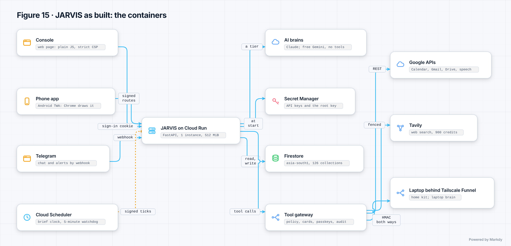
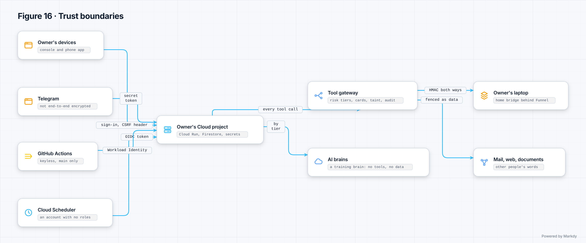

Version v6.6.0 · 27 Nov 2026, 22:04 IST · Release R5.2 · Status: Current · Owner: 🛠 Mark XXV

# 02 · System context and deployment

**In plain words.** JARVIS is one small server in your own Google Cloud project (region
asia-south1, Mumbai). You reach it from the console web page, the phone app or Telegram. It keeps
its data in Firestore and its keys in Secret Manager in the same project, asks an AI brain to
think, and calls Google and a few other services for its tools. A set of free programs on your
laptop (the "home kit") connects it to your house and can stand in as a backup brain. GitHub
tests every change and deploys `main` without any stored key. Figure 15 shows the parts; Figure 16
shows where trust changes hands.

**New in R18 ("Calls from your laptop", built, not yet deployed).** Your phone places the call
from your own number when you approve it. Windows **Phone Link** carries the call's sound to your
laptop over Bluetooth, like a car kit. A new Windows program on the laptop, the **call desk**,
listens to that sound and plays JARVIS's voice back into the call through **VB-CABLE**, a free
virtual microphone. The server keeps a call's connections open for up to 30 minutes. Section 2.13
has the details.

**New in R5.2 ("Your voice", built, not yet deployed).** A free **speech kit** on your laptop can
listen for JARVIS, so Google's free minutes last longer. It also keeps your voice session's
recordings and trains your own "Hey Jarvis". It is a small separate program, not part of the home
kit. The internet reaches it only at your laptop's own Tailscale address on port 10000, and only
with the kit's key; a gate program (Caddy) checks that key first. You give JARVIS the address and
the key once, with `bash deploy/cloudrun.sh --local-speech`. The call desk on the same laptop
talks to the kit directly, never through the internet. If the laptop is off, JARVIS uses Google,
then the browser, as before. Section 2.14 has the details.

## 1. System context

*Figure 15. JARVIS as built: the containers.* Source:
[`15-containers.markdy`](../diagrams/15-containers.markdy). The guide's Figure 1
(`../diagrams/01-context.png`) draws the same context in the owner's words. Redrawn for R18: the
laptop box now holds the call desk too, whose signed socket comes in to Cloud Run (step 3), and
the phone app places calls; the speech services a call uses are in Figure 16. Updated for R5.2:
the laptop box now names the speech kit as well. Cloud Run's voice service calls the kit directly
with the kit's key over https (section 2.14, boundary B13), not through the tool gateway; the
"HMAC both ways" arrow is the home bridge's only. A separate arrow for the kit was tried and
dropped, because the router laid it over the call desk's arrow and cut its label.

| Actor or system | Role | How it reaches JARVIS, or JARVIS reaches it | Evidence |
|---|---|---|---|
| Owner, in the console | The only user | HTTPS to the Cloud Run URL; Google sign-in for an e-mail on `JARVIS_OWNER_EMAILS`, then a signed cookie | `src/jarvis/api/auth.py`, `src/jarvis/api/app.py:_install_google_sign_in` |
| Owner, in the phone app | Same user, same page | Chrome draws the console (TWA); four signed routes for the phone's own requests | `android/app/build.gradle.kts` (`androidbrowserhelper`), `src/jarvis/phone/door.py` |
| Owner, on Telegram | Chat and alerts | Telegram's webhook to `/telegram/webhook` with a secret token | `src/jarvis/api/telegram.py:WEBHOOK_PATH` |
| Owner, in a terminal | Engineering use | `jarvis chat --stream` (no server) or the API with the bearer token | `src/jarvis/cli.py`, `src/jarvis/api/auth.py` |
| Cloud Scheduler | The clock | Signed POSTs to `/internal/brief/tick` and `/internal/home/watchdog` | `deploy/cloudrun.sh` step 8, `src/jarvis/api/scheduler_auth.py` |
| AI brains | Reasoning | Anthropic (SDK), Gemini (REST), one OpenAI-compatible slot, the laptop's Ollama | `src/jarvis/llm/` |
| Google APIs | Tools and speech | REST over `httpx` with the owner's OAuth token or the service account | `src/jarvis/integrations/google.py`, `src/jarvis/voice/google_cloud.py` |
| Other outside services | Web search, weather, warnings, exchange rate, GitHub | REST over `httpx` | the guide, section 5.2; chapter 06 |
| The home kit | House, cameras, faces, backup brain | Through Tailscale Funnel to the owner's laptop, signed both ways | `deploy/home/docker-compose.yml`, `src/jarvis/home/signing.py` |
| GitHub | Code, CI, deploy | GitHub Actions; Workload Identity Federation to Google | `.github/workflows/ci.yml`, `deploy/cloudrun.sh` step 7 |
| The person JARVIS calls (R18) | Someone outside, never a user of JARVIS | An ordinary phone call from the owner's own SIM; their voice reaches the laptop through Phone Link | `docs/plans/r18-calls.md` (section 3, set-up A) |
| The call desk on the laptop (R18) | Carries a call's sound between Phone Link and JARVIS | The desk opens a WebSocket out to `/v1/calls/desk/ws`, signed like the home bridge; no Funnel | `src/jarvis/calldesk/`, `src/jarvis/api/calls_ws.py:CallSockets` |
| The phone app, for calls (R18) | Dials, answers and ends calls on signed commands | A Web Push "doorbell", then the door's fifth route `POST /phone/v1/calls` | `src/jarvis/phone/calls.py:PhoneCalls`, `src/jarvis/mobile/ports.py` |
| Speech services for calls (R18) | Hearing and speaking Indian languages | REST over `httpx`: Google (already linked), Microsoft Azure Speech free tier F0, Bhashini, Sarvam (paid, off) | `src/jarvis/calls/speech/build.py` |
| Hugging Face (R18; R5.2) | Test clips (FLEURS) for the language check; from R5.2 also the speech kit's pinned Whisper files | REST, only when the owner runs the check; the kit's files are downloaded once by the laptop, never by the cloud | `src/jarvis/calls/langcheck/fleurs.py`, `deploy/local-speech/models.json` |
| The laptop speech kit (R5.2) | Listens for JARVIS, keeps the voice session's recordings, trains the owner's own wake word | JARVIS calls out to the laptop's Tailscale https address on Funnel port 10000 with the kit's key; the call desk on the same laptop calls it on `127.0.0.1` | `src/jarvis/localspeech/client.py:cloud_kit`, `loopback_kit`, `deploy/local-speech/Caddyfile` |

## 2. Deployment view

### 2.1 Cloud Run service

One container, built from `Dockerfile` (`python:3.12-slim`, every package hash-checked from
`requirements.lock`, runs as user `jarvis` uid 10001, `jarvis serve` on port 8000, the build time
written into `src/jarvis/BUILD_DATE`). Deployed by `deploy/cloudrun.sh` step 6 and then by CI's
`deploy` job. Since R18 the image also carries `deploy/calldesk` (the call desk kit it zips on
request; `.dockerignore` lets it in) and NumPy, the language check's audio maths (`pyproject.toml`).
R5.2 adds no package to the cloud image: the speech kit's engines and server run only on the
laptop, from their own hash-pinned list (`deploy/local-speech/requirements-kit.txt`), and a test
keeps the kit's heavy modules out of the cloud's imports (`tests/test_r52_v1_import_guard.py`).

| Setting | Value | Where | What it implies |
|---|---|---|---|
| Service, region | `jarvis`, `asia-south1` | `deploy/cloudrun.sh` (`SERVICE`, `REGION`) | Data and compute in the owner's project, one region |
| Instances | `--min-instances 0 --max-instances 1` | `deploy/cloudrun.sh` step 6 | Scales to zero when idle; never two copies (chapter 06, section 5); R18's call hub relies on it (ADR-36) |
| Size | `--memory 512Mi --cpu 1` | same | The document extractor's child process is capped at 200 MiB to leave room (`src/jarvis/documents/isolation.py:MEMORY_LIMIT_BYTES`) |
| Request timeout | `--timeout 1800` (seconds; 300 before R18) | same | A request or WebSocket may stay open 30 minutes, so a call's desk socket and live listeners are not cut. A call itself stops at 6 minutes by default and 30 at most (`src/jarvis/calls/models.py:CALL_MAX_MINUTES_CEILING`) |
| Concurrency | not set | same | Cloud Run's own default applies. *Unverified:* that default (80 requests per instance) is Google's, not set or read anywhere in this repository |
| CPU allocation | not set | same | The default: CPU only while a request runs; background learning is swept at the start of the next request (`src/jarvis/core/brain.py` module docstring) |
| Ingress | `--allow-unauthenticated` | same | The URL is public; JARVIS does its own sign-in on every route (section 4) |
| Identity | `--service-account jarvis-run` | same | No key file anywhere; Google libraries use the service account |
| Settings | `JARVIS_ENV=prod`, `JARVIS_AUTH_MODE=google`, `JARVIS_SESSION_BACKEND=firestore`, `JARVIS_DEFAULT_TIER=balanced`, `JARVIS_EFFORT=low`, `JARVIS_LLM_TIMEOUT_S=20`, `JARVIS_LOG_JSON=true` and the feature switches; from R5.2 `JARVIS_LOCAL_SPEECH_ENABLED` and, when the owner gave one, `JARVIS_LOCAL_SPEECH_URL` (`LS_ENV`) | `deploy/cloudrun.sh` (`INFRA_ENV`) | Re-runs keep the owner's answers; `--reconfigure` rewrites them |
| Health | `GET /health` | `src/jarvis/api/routes.py`; `Dockerfile` `HEALTHCHECK` | The deploy switches traffic only after `/health` answers `"status":"ok"` |
| Start-up guards | refuses `JARVIS_ENV=dev` or token sign-in on Cloud Run; refuses a weak session secret, no owner e-mail, or a malformed token key | `src/jarvis/config.py:Settings._refuse_dev_on_cloud_run`, `_require_google_auth_config` | A misconfiguration fails the health check, so the old version keeps serving |

### 2.2 Firestore

One database, `(default)`, Firestore Native mode, created in `asia-south1` ("This location is
permanent"; `deploy/cloudrun.sh` step 4). Every collection name starts with `jarvis_`
(`JARVIS_FIRESTORE_PREFIX`). The deploy makes one composite index (`jarvis_sessions`: `user_id`,
`updated_at`) and exempts the sealed `blob` fields of 11 collection groups from indexing. No TTL
policy is set (TTL deletes are billed); JARVIS deletes what expires itself. Every store reaches
Firestore through the `Docs` port (`src/jarvis/storage/docs.py:Docs`;
`src/jarvis/storage/firestore_docs.py:FirestoreDocs`). Chapter 04 lists the 139 collections (131
before R18; the calls add 8). R18 added no index and no indexing exemption to the deploy.

### 2.3 Secret Manager

Up to 15 secrets, each readable by `jarvis-run` through its own grant (`deploy/cloudrun.sh` step
5): `jarvis-google-client-secret`, `jarvis-anthropic-key`, `jarvis-gemini-key`,
`jarvis-openai-compat-key`, `jarvis-session-secret`, `jarvis-api-token`, `jarvis-token-key` (the
root of the keyring, 32 random bytes made once), `jarvis-tavily-key`, `jarvis-google-api-key`,
`jarvis-telegram-bot-token`, `jarvis-telegram-webhook-secret`, from R18's review the three
optional speech keys below, and from R5.2 `jarvis-local-speech-key` (the laptop speech kit's key,
section 2.14). The optional ones (web search, Maps and YouTube, Telegram, the speech keys, the
kit's key) are left unmounted if their grant fails; every other grant failing stops the deploy
(`grant_failed`). Secrets reach the process as environment variables and are held as
`SecretStr` in `src/jarvis/config.py` (11 fields, one per secret: `api_token`,
`google_client_secret`, `session_secret`, `anthropic_api_key`, `gemini_api_key`,
`openai_compat_api_key`, `token_key`, `tavily_api_key`, `telegram_bot_token`,
`telegram_webhook_secret`, `google_api_key`).

**R18's speech keys.** `src/jarvis/config_calls.py:CallsConfig` (a base class of `Settings`) adds
three optional `SecretStr` fields, 14 in all: `azure_speech_key` (Azure's free tier F0),
`sarvam_api_key` (paid; also needs `sarvam_enabled`) and `bhashini_api_key` (with
`bhashini_user_id`). Without a key that option is simply not offered. Since the combined review
(`docs/plans/r18-integration/REVIEW.md`, item 23) `deploy/cloudrun.sh:speech_keys` mounts each
one from Secret Manager only when its secret exists (`jarvis-azure-speech-key`,
`jarvis-sarvam-key`, `jarvis-bhashini-key`), on both deploy paths. It asks no question and creates
no secret, and no key value is in the repository: the owner stores a key from Cloud Shell and runs
the script again (`deploy/calldesk/README.txt`, "On the server"). A failed grant leaves that key
out and never stops the deploy (`speech_unmount`); a quick re-run unmounts a key whose secret is
gone. With none stored, calls use Google's speech only. The three plain settings
(`JARVIS_AZURE_SPEECH_REGION`, `JARVIS_SARVAM_ENABLED`, `JARVIS_BHASHINI_USER_ID`) are set on the
service by hand, and a `--reconfigure` run clears them (the same README). Tests:
`tests/test_r18_review_deploy_speech.py`. The go-live guide, a project document outside this
repository, does not have this step yet, by the review's report (REVIEW.md, section 4;
*unverified* here, since the guide is not in the repository).

**R5.2's kit key.** `src/jarvis/config_voice.py:LocalSpeechConfig` (another base class of
`Settings`) adds `local_speech_key`, a `SecretStr` of at least 32 characters, 15 fields in all,
and `local_speech_url`, the kit's address. Unlike R18's keys, the deploy asks for this one:
`deploy/cloudrun.sh:local_speech_answer` asks once on a full run (and on any run with
`--local-speech`) for the address and the key, reads the key without echo and stores it straight
in the secret `jarvis-local-speech-key`, never in a file or the log. Enter skips it, and a quick
re-run keeps the saved answer. A failed grant leaves the kit off with a plain note
(`grant_failed`). An address of the wrong shape, a key under 32 characters or a failed secret write
stops the whole deploy (`die`), although I1's notes say an optional part never does: an open item
for the review (chapter 12, section 7).

### 2.4 Service accounts

| Account | Roles | Why |
|---|---|---|
| `jarvis-run` | `roles/datastore.user`, `roles/logging.logWriter`, `roles/serviceusage.serviceUsageConsumer`, one `secretAccessor` grant per secret; the custom `jarvisTryOn` role (only `aiplatform.endpoints.predict`) when See it on me is on; the backup drill's three grants after the owner's backup step | The runtime identity |
| `jarvis-scheduler` | none | Only proves "I am JARVIS's clock" through its OIDC token |
| `jarvis-deployer` | `iam.workloadIdentityUser` for this repository's id only; `iam.serviceAccountUser` on `jarvis-run`; `run.developer` on the one service; `artifactregistry.writer` on the build repository; `serviceusage.serviceUsageConsumer` | GitHub's keyless deploy (`deploy/cloudrun.sh:setup_autodeploy`) |
| The default compute account | builder, Artifact Registry writer, log writer, storage viewer; its secret and database access is removed after each deploy | Builds the image for `--source .` deploys |

### 2.5 Cloud Scheduler

| Job | Schedule (IST) | Calls | Deadline | Created by |
|---|---|---|---|---|
| `jarvis-morning-brief` | `0,30 4-11 * * *` (every 30 minutes, 04:00–11:30) | `POST /internal/brief/tick` | 180 s | `deploy/cloudrun.sh:setup_brief_clock` |
| `jarvis-home-watchdog` | `*/5 * * * *` (all day) | `POST /internal/home/watchdog` | 60 s | `deploy/cloudrun.sh:setup_home_watchdog` |

The morning tick runs the tick jobs (`src/jarvis/ticks.py:run_jobs`, wired in
`src/jarvis/api/tick_wiring.py:tick_jobs`); the 5-minute call runs the clock jobs
(`tick_wiring.py:clock_jobs`: the self-health watch first, then the systems check, the helpers'
clock and the others), with Home on or off. Both are signed with an OIDC token whose audience is
the exact URL (`src/jarvis/api/scheduler_auth.py`). If either job is missing, JARVIS still works:
the brief is made when the Brief panel opens.

### 2.6 The console and the phone app

| Part | As built | Evidence |
|---|---|---|
| Console | One page served by the API: `console.html` plus 136 `console*.js` modules (120 at R6.4, 131 after R18; R5.2 added the voice session, the owned wake word and the speaker check's three), plain JavaScript with no build step, vendored libraries pinned by hash; content security policy `script-src 'self' 'wasm-unsafe-eval'` | `src/jarvis/api/console.py:CONSOLE_CSP`, `src/jarvis/api/static/` |
| Installable web app | A web app manifest with three shortcuts and a share target | `src/jarvis/api/app_shell.py` |
| Phone app | Android app in `android/`: a Trusted Web Activity (`android-browser-helper`), native parts for the Talk tile, alerts, Health Connect, SOS and a DigiLocker folder; Chrome draws the console, so sign-in, passkeys, cookies and Web Push are unchanged | `docs/plans/r7-mobile.md` D1, D2 |
| Site and app vouch for each other | `GET /.well-known/assetlinks.json` names the one package with the signing fingerprints of the linked phones (empty until a phone is linked; cached one minute) | `src/jarvis/api/phone.py` |
| The phone's door | `POST /phone/v1/{hello,health,inbox,sos,calls}`, signed with a P-256 key kept in the phone's secure hardware; never reads a conversation, the vault or mail, never calls a tool. R18 added the fifth route, `calls` (16 KB bodies) | `src/jarvis/phone/door.py`, `src/jarvis/mobile/ports.py` |
| Calls on the phone (R18) | App version 18.0.0 (versionCode 2). Four Android permissions, each asked on a first-run screen: place calls, answer and end calls, the phone's state, and the call log (only for an answering rule by saved contacts). The cloud's commands (`call.dial`, `call.answer`, `call.end`, `call.route`, `call.card`) wait in an in-memory outbox; a Web Push of kind `call_command` (a plain sentence, never a number) makes the app fetch them through the `calls` route. Each command is signed by the cloud with a P-256 key made at each start, and acted on once | `android/version.properties`, `android/app/src/main/AndroidManifest.xml`, `src/jarvis/phone/calls.py`, `src/jarvis/phone/calls_wire.py`, `docs/plans/r18-calls/INTEGRATION-D.md` |
| Build | CI proves the app with a throwaway key against `jarvis.invalid`; the app the owner installs is built on his laptop. Since R18 CI also reads the calls' shared test vectors and breaks two call checks on purpose (`call_signature_off`, `call_number_leaks`), which must make the tests fail | `.github/workflows/android.yml`, `tests/fixtures/r18/phone_calls_vectors.json` |

### 2.7 The home kit on the laptop

Installed by `deploy/home/setup-windows.ps1` and `deploy/home/setup-wsl.sh` into WSL; run by
Docker Compose (`deploy/home/docker-compose.yml`, project `jarvis-home`).

| Service | Image | Exposure | Hardening |
|---|---|---|---|
| `mosquitto` (MQTT) | `eclipse-mosquitto:2.0.20` | internal network only | password file and ACL: Frigate writes `frigate/#`, the bridge only reads |
| `frigate` (cameras) | `ghcr.io/blakeblackshear/frigate:0.17.2` | `127.0.0.1:8971` (its own login page) | other ports not published |
| `homeassistant` | `ghcr.io/home-assistant/home-assistant:2026.10.0` | host network, limited to loopback and the WSL host address in its configuration | — |
| `bridge` (JARVIS's home bridge) | built from `deploy/home/bridge.Dockerfile` on `python:3.12-slim` | `127.0.0.1:8099` (the signed API that Funnel forwards) and `127.0.0.1:8098` (the local Faces page, never funnelled) | read-only root, `cap_drop: ALL`, `no-new-privileges`, uid 10001, 768 MB memory limit |

**Tailscale Funnel** gives the laptop one public HTTPS name; TLS ends on the laptop. JARVIS accepts
only a `<machine>.<tailnet>.ts.net` address: port 8443 for the bridge
(`src/jarvis/home/client.py`), and 443, 8443 or 10000 for the laptop brain
(`src/jarvis/offline/config.py`) and, from R5.2, the speech kit (`src/jarvis/config_voice.py`).
**The laptop brain** is Ollama behind a Caddy gate on
`127.0.0.1:11435` that wants a bearer key of at least 16 characters and allows only
`POST /v1/chat/completions` and `GET /v1/models`, bodies up to 2 MB
(`deploy/local-brain/Caddyfile`).

**One public port per program.** Funnel gives each program on the laptop its own https port. The
speech kit uses 10000 (`src/jarvis/localspeech/protocol.py:FUNNEL_PORT`). The home bridge's set-up
(`deploy/home/setup-windows.ps1`) and the laptop brain's start script
(`deploy/local-brain/start-windows.ps1`) both take 8443, so on one laptop the brain's script
replaces the bridge's door, and stopping the brain closes it. That clash is older than R5.2 and
open (chapter 12, section 7).

### 2.8 Telegram

The deploy registers the webhook once (`deploy/cloudrun.sh:telegram_webhook`): one connection
(matching one instance), `message` and `callback_query` updates only, pending updates dropped on
re-registration. A request without the right `X-Telegram-Bot-Api-Secret-Token` (constant-time
compare) gets a bare 401; only the paired owner's user and chat get a reply
(`src/jarvis/api/telegram.py`, `src/jarvis/telegram/service.py`).

### 2.9 Google APIs switched on

`deploy/cloudrun.sh` step 2 enables Cloud Run, Cloud Build, Artifact Registry, Secret Manager,
Firestore, IAM, IAM Credentials and STS, Calendar, Gmail and Tasks; then, each in its own command
that may fail without stopping the deploy: Text-to-Speech and Speech-to-Text, Drive (the Drive
feature is on only when this run enabled it), People (contacts), the Photos Picker, and the Agent
Platform (See it on me). Step 3, when the owner gives JARVIS Maps and YouTube, enables Places,
Routes, YouTube Data and API Keys (`MAPS_APIS`, `setup_maps_key`; a failure only leaves Maps off).
Step 8 enables Cloud Scheduler; the budget alert enables Billing Budgets.

### 2.10 GitHub CI/CD

`.github/workflows/ci.yml` runs `test`, `docs-check`, `pr-title`, `firestore`, `browser` (4 shards),
`docs`, `eval-gate` and `deploy`; `.github/workflows/android.yml` runs `wrapper-pin`, `build` and
`controls` when Android files change. Chapter 07 describes each job. The `deploy` job runs only
on `main` (push or a manual run), only when the repository variable `AUTODEPLOY` is `on`, and
only after `test`, `firestore` and all four `browser` shards pass. In order it: writes the build
book (best effort, before any Google credential exists), signs in through Workload Identity
Federation as `jarvis-deployer`, builds and pushes the image to Artifact Registry
(`cloud-run-source-deploy`), refuses if `main` has moved on, rolls out with no traffic under the
tag `candidate`, polls `/health` up to 12 times 10 seconds apart, and only then moves all traffic.
A failed check leaves the current version serving. Old images: the newest 10 are kept, older ones
deleted after 30 days (`setup_autodeploy`'s clean-up policy).

### 2.11 Backups

Backups exist only after the owner's one-time step, `bash deploy/backup_setup.sh` (it shows the
cost and waits for a typed YES): a daily Firestore backup schedule kept 7 days, delete protection
on `(default)`, and three least-privilege grants for the monthly restore drill (a custom
`jarvisDrillCleanup` role limited by condition to the database `jarvis-drill`, then
`roles/datastore.restoreAdmin` and `roles/datastore.backupSchedulesViewer`). The deploy runs only
the read-only `--status` mode. The drill restores the newest copy into `jarvis-drill`, checks a
canary and deletes it (`src/jarvis/backup/`). Chapter 04, section 6 covers what the copies hold.

### 2.12 Environments

| Environment | Where | Store | Sign-in | Brain |
|---|---|---|---|---|
| `dev` | A developer's machine (`docker-compose.yml` with Redis, or in memory) | memory or Redis sessions | bearer token | mock or a real key |
| `prod` | Cloud Run | Firestore | Google sign-in (token sign-in refused) | as configured |

There is no staging service; the no-traffic `candidate` revision plays that part for one health
check. R18's calls are wired only when `calls_enabled` is on, the token key exists (numbers and
records are sealed) and a brain that doesn't train on prompts is configured; otherwise the calls
routes answer 501, or 503 when calls are switched off (`src/jarvis/api/r18_wiring.py:wire_r18`). `render.yaml` is the Render blueprint of slice 2 (`docs/plans/phase2-slice2-web-console-auth.md`);
`README.md` still lists it as the alternative host, and neither CI nor any deploy script uses it.
The Cloud Run script was added 17 minutes after the Render blueprint, on 31 Oct 2026 (UTC),
before slice 3's Gemini brain (GitHub commits `3e73d81`, `dc93f81`, `db109f3`, `b7037c5`; this
clone's history is shallow and starts on 18 Nov 2026).
*Unverified:* why hosting moved from Render to Cloud Run; no commit message, plan or deploy file
says.

### 2.13 The call desk on the laptop (R18)

The call desk is a Windows program, not part of the home kit: the home kit runs in WSL (Windows
Subsystem for Linux), which cannot reach Windows' sound devices or Bluetooth (ADR-27). It runs
from the owner's own folder in a Python 3.12 virtual environment, with its packages hash-pinned
(`deploy/calldesk/requirements-calldesk.txt`). It was built and tested with fakes only: the plan's
S0 laptop test of the real sound path has not been run yet (*unverified* on a real laptop).

| Part | As built | Evidence |
|---|---|---|
| Phone Link | Windows' own app. It makes and takes the phone's calls over Bluetooth on Windows' default speaker and microphone, and offers no setting to choose other devices. It refuses calls while a Bluetooth headset is connected to the laptop | `docs/plans/r18-calls.md` (section 3; risk 7) |
| Hearing the call | The desk records what the laptop's speaker plays (WASAPI "loopback" recording) and sends it to JARVIS only while the other person speaks (a voice detector with no model) | `src/jarvis/calldesk/audio.py`, `src/jarvis/calldesk/vad.py` |
| Speaking into the call | For a JARVIS call only, VB-CABLE's "CABLE Output" becomes Windows' default microphone in all three roles and JARVIS's voice is played into "CABLE Input". The owner's microphone comes back at a takeover, at the end, after a crash (a watchdog) and at the next start | `src/jarvis/calldesk/micguard.py`, `src/jarvis/calldesk/watchdog.py`, `deploy/calldesk/restore-microphone.ps1` |
| Checks before every call | VB-CABLE installed, Phone Link running, no Bluetooth headset on the laptop, the sound path moving; the call card says what is missing and nothing is dialled | `src/jarvis/calldesk/checks.py` |
| Installing it | The owner downloads the kit from Calls → Settings (only when JARVIS has an https public address), runs `install-calldesk.ps1`, then links it with an 8-character code shown once (10 minutes, one use). The installer can start it at sign-in; `deploy/home/start-home.ps1` also starts it with JARVIS Home | `src/jarvis/api/calldesk_kit.py:desk_kit`, `deploy/calldesk/install-calldesk.ps1`, `deploy/calldesk/README.txt` |
| What it keeps on the laptop | `%LOCALAPPDATA%\JARVIS\CallDesk`: the desk's id and link seed, the microphone roles it changed, a log that never holds sound, words, numbers or keys | the guide's C77 |
| Laptop speech | In R18 a hook only, shipped off. Since R5.2 the desk reaches the speech kit on the same laptop at its gate on `127.0.0.1:11436` when the desk holds the kit's key (from its environment or `local-speech.key` in its own folder; `install-calldesk.ps1 -SpeechKit` copies it). It offers only languages the kit both hears and speaks; kit 1.0.0 has no voice (section 2.14), so every call still uses the cloud's speech | `src/jarvis/calldesk/app.py:local_speech`, `src/jarvis/calldesk/config.py:speech_key`, `src/jarvis/localspeech/desk.py`, `src/jarvis/calldesk/speech_local.py` |

### 2.14 The laptop speech kit (R5.2)

A small speech program on the owner's own laptop (the guide's card C79). It is a separate local
server, not part of the home kit and not the laptop brain (ADR-40): its own folder, its own gate,
its own key and its own Funnel port. Built and tested with fakes and in-memory stand-ins only; the
real engines, Caddy, Tailscale Funnel and the PowerShell scripts have not run on a laptop yet
(*unverified* there; `docs/plans/r5-2-integration/I1-NOTES.md`, 4.6).

| Part | As built | Evidence |
|---|---|---|
| The kit's server | Python 3.12 on Windows, Starlette and uvicorn on `127.0.0.1:11437` only, never published; no access log, no server header; kit version 1.0.0 on its own track | `src/jarvis/localspeech/__main__.py:serve`, `src/jarvis/localspeech/kitconfig.py:HOST`, `src/jarvis/localspeech/server.py` |
| The gate | Caddy bound to `127.0.0.1:11436`. It passes exactly the kit's API (`GET /v1/health`, `GET /v1/jobs/job_…`, and the `POST` routes for listening, speaking, the session's clips and the wake word) and only with `Authorization: Bearer <key>`; a known address without the key gets 401, anything else 404, a body over 3 MB 413; with no key, or one under 32 characters, every request gets 503 | `deploy/local-speech/Caddyfile`, `src/jarvis/localspeech/protocol.py:GATE_PORT` |
| The public door | Tailscale Funnel publishes the gate on https port 10000 (`-HttpsPort 443` when 10000 already serves something else; the laptop brain keeps 8443). TLS ends on the laptop. The start script never takes a Funnel port that already serves something else, and closes only the port it opened | `deploy/local-speech/start-kit.ps1` (`Test-FunnelTaken`), `src/jarvis/localspeech/protocol.py:FUNNEL_PORT` |
| Installing it | `install-kit.ps1` installs Python 3.12 and Caddy only with the owner's typed Y, makes the kit's private folder (only his account can open it), its hash-pinned packages and the pinned Whisper files (about 2 GB, each file checked) | `deploy/local-speech/install-kit.ps1`, `deploy/local-speech/requirements-kit.txt`, `deploy/local-speech/models.json`, `deploy/local-speech/README.md` |
| Starting it | `start-kit.ps1` makes the key on the first run (32 random bytes, 43 characters), starts the server, the gate and Funnel, and prints the address (`https://<laptop>.<tailnet>.ts.net:10000`) and the key to give JARVIS; `-SelfTest` prints a report the owner can paste, which never holds the key, a folder name, the Tailscale name or anything he said | `deploy/local-speech/start-kit.ps1`, `src/jarvis/localspeech/selftest.py` |
| Giving JARVIS the address and key | `bash deploy/cloudrun.sh --local-speech` in Cloud Shell: the address must be the laptop's Tailscale https name with a Funnel port (443, 8443 or 10000) and no path; the key goes straight to the secret `jarvis-local-speech-key` (section 2.3) | `deploy/cloudrun.sh:local_speech_answer`, `ls_url_ok` |
| The cloud reaching it | One kit client (`HttpKit`) for the console's voice, R18's calls, the voice session and the wake word: https only, R1's pinned transport (the name resolved again, every address public, the connection made to the address just checked), no redirects, at most 4 MB of a reply read; its health trusted 30 s, so no turn waits for an absent laptop | `src/jarvis/localspeech/client.py:cloud_kit`, `src/jarvis/voice/laptop.py:LaptopVoice`, `src/jarvis/api/r52_wiring.py:voice_service` |
| The call desk reaching it | Over loopback: plain http to the gate on `127.0.0.1:11436`, under `/v1`, with the kit's key; nothing leaves the laptop | `src/jarvis/localspeech/protocol.py:LOOPBACK_BASE`, `src/jarvis/localspeech/client.py:loopback_kit`, `src/jarvis/localspeech/desk.py` |
| Engines | Each in its own slot, loaded on demand so a 4 GB graphics card is enough (else the CPU). Kit 1.0.0 pins only faster-whisper small and medium (English listening, MIT). Kokoro and Piper (voices) and AI4Bharat's Indian-language engines are left out (ADR-41), so the kit has no voice and no Indian-language engine | `src/jarvis/localspeech/engines.py`, `deploy/local-speech/models.json` (`left_out`) |
| What it keeps | In `%LOCALAPPDATA%\JARVIS\LocalSpeech`: the key, the session's recordings (encrypted), the model files with their licences, what it installed, the wake word's trained files (sealed with their own key). Nothing in Firestore (chapter 04, section 8) | `src/jarvis/localspeech/kitconfig.py`, `src/jarvis/localspeech/clips.py` |
| Turned off | No address, no key, or `JARVIS_LOCAL_SPEECH_ENABLED=false` → no client, Vitals' kit line hidden, voice as before (Google, then the browser) | `src/jarvis/config_voice.py:LocalSpeechConfig.local_speech_configured`, `src/jarvis/voice/laptop.py:laptop_voice` |

**When the voice parts are wired.** `src/jarvis/api/r52_wiring.py:voice_service` builds the voice
service with the kit and the voice profile in `app._wire_core`. With `voice_profile_enabled` off
the `/v1/voice/profile` routes answer 503 and listening keeps its usual order; a part that fails
to build leaves its routes at 501, logged by name.

## 3. Trust boundaries

*Figure 16. Trust boundaries.* Source:
[`16-trust-boundaries.markdy`](../diagrams/16-trust-boundaries.markdy). Each arrow is a crossing;
its label is what the receiving side checks. Redrawn for R18 with the call desk's signed socket
(B10) and the speech services that hear a call (B12). Not every crossing is drawn: B5, B9 and B11
never were, and R5.2's B13 and B14 (the speech kit) are in the table only. Every layout that
added the kit as its own box made an arrow cross another arrow's label, so the figure stays as
R18 left it; it is not wrong for R5.2, only incomplete, as before.

| # | Boundary | Crossing | Checked by | Data that crosses |
|---|---|---|---|---|
| B1 | Internet → JARVIS (owner) | Console and phone page requests; from R18 also the live call socket | Google sign-in + owner allow-list, signed 12-hour cookie, `X-Requested-With: JARVIS` on writes, per-client rate limit, body caps, R3 passkey; the live socket takes the bearer, the cookie from JARVIS's own page, or a one-use 30-second ticket (chapter 05, section 8) | The owner's messages, files, approvals; a call's captions and sound |
| B2 | Internet → JARVIS (phone door) | Five signed POST routes (R18 added `calls`) | `src/jarvis/phone/door.py:DoorGate` (route, header, flood, device, time, cap, nonce, P-256 signature, rate) | Hello, health readings, inbox items, SOS; call states, command results, card decisions |
| B3 | Internet → JARVIS (machines) | Scheduler ticks, Telegram updates | OIDC with exact audience; Telegram secret token, then the paired owner | No personal data in; ticks start owner work |
| B4 | GitHub → Google Cloud | Deploy | Workload Identity Federation: this repository id, `refs/heads/main`, push or manual run, `ci.yml` on `main`, GitHub-hosted runner | A new image |
| B5 | JARVIS → its own project | Firestore, Secret Manager, Logging | The `jarvis-run` service account, no key | Everything JARVIS keeps |
| B6 | JARVIS → the laptop | Bridge calls and the laptop brain | HMAC-SHA256 both ways with keys from a 32-byte link seed, a nonce, a 60-second window (`src/jarvis/home/signing.py`); a key gate for Ollama | Device and camera commands, chat for the laptop brain |
| B7 | JARVIS → AI brains | Model calls | Tier and training flag (`src/jarvis/llm/brains.py`); monthly limit | The conversation window; for non-training brains, memory notes and tool results |
| B8 | Outside content → the model | Tool results | The gateway's untrusted prefix, fences, taint (chapter 05, section 2.4) | Mail, web, documents, contacts, camera labels |
| B9 | JARVIS → Telegram and Web Push | Alerts and chat replies | Personal reads off on Telegram unless switched on; Web Push encrypted to each browser | Alert text, replies |
| B10 | The laptop's call desk → JARVIS (R18) | The desk's WebSocket | Linked once by a one-use code; every upgrade signed with HMAC-SHA256 keys derived from the desk's 32-byte seed, a nonce, a 60-second window, checked before the socket opens (`src/jarvis/api/calls_ws.py:CallSockets`); at most 150 audio frames a second | The other person's speech while they talk; JARVIS's voice and commands back |
| B11 | JARVIS → the phone (R18) | Call commands through the phone's door | Each command signed by the cloud (P-256); the phone acts on it only if it verifies, names this phone, is fresh and was never acted on; a dial only while the owner's approval is live (`src/jarvis/phone/calls.py:PhoneCalls`) | Dial, answer, end, route; a waiting call card |
| B12 | JARVIS → speech services (R18) | Hearing and voice for a call | HTTPS with each option's own key; a call uses only an option that passed the language check for that language; paid Sarvam only with its key, `sarvam_enabled` and the owner's YES; the in-call brain is never one that may train on prompts (chapter 05, section 8) | Other people's voices and words on a call; the test clips' audio for the check |
| B13 | JARVIS → the laptop speech kit (R5.2) | Listening, the voice session's clips and scoring, the wake word's training and files | The address rule (https, a `*.ts.net` name, a Funnel port, every resolved address public) and the pinned transport on JARVIS's side; the kit's key at the Caddy gate and again, in constant time, in the kit's server; no redirects, a 4 MB reply cap; the kit's answers become fixed words (chapter 05, section 9) | The owner's recorded speech for a listening turn and the session's clips (stored only on the laptop, encrypted); the engines' text back; the wake word's trained files (checked by hash and licence before the console uses them) |
| B14 | The call desk → the speech kit, on the laptop (R5.2) | A call's hearing and voice in laptop mode | Loopback only (`127.0.0.1:11436`) and the kit's key; the desk offers only languages the kit both hears and speaks | The other person's speech while they talk (kit 1.0.0 offers no language, so nothing crosses yet) |

## Change log

| Version | Date | Release | What changed | By |
|---|---|---|---|---|
| v6.4.1 | 27 Nov 2026, 14:50 IST | R6.4 | First edition: system context, Cloud Run settings and what they imply, Firestore, Secret Manager, service accounts, the two Scheduler jobs, the console and phone app, the home kit, Telegram, the Google APIs, CI/CD, backups, environments, nine trust boundaries; Figures 15 and 16 | 🛠 Mark XXV |
| v6.4.2 | 27 Nov 2026 | R6.4 | Verification (chapter 13): `SecretStr` fields 13 → 11, named; step 3's Maps and YouTube APIs added; `render.yaml`'s status and the date of the move to Cloud Run from GitHub's history, the reason marked unverified; the concurrency default marked unverified in plain words | 🛠 Mark XXV |
| v6.5.0 | 27 Nov 2026, 19:30 IST | R18 | R18 "Calls from your laptop": the calls' actors in the context table; `--timeout 1800`; the image carries the call desk kit and NumPy; 139 collections; the three speech keys (not mounted by the deploy, how to add them unverified); the phone app's calls (version 18.0.0, the door's fifth route, signed commands, CI's two new controls); when calls are wired; new section 2.13, the call desk, VB-CABLE and Phone Link; trust boundaries B1 and B2 widened, B10–B12 added; Figures 15 and 16 redrawn for R18 (the call desk, the speech services); the capacity pointer fixed to chapter 06, section 5 | 🛠 Mark XXV |
| v6.5.1 | 27 Nov 2026, 21:25 IST | R18 | The R18 review's later fixes: the deploy now mounts each optional speech key when its secret is stored (`deploy/cloudrun.sh:speech_keys`, both deploy paths, a failed grant never fatal), so v6.5.0's "not mounted" and "how to add them unverified" no longer hold; how to add one is in the call desk README; up to 14 secrets; the go-live guide's step is left for the owner | 🛠 Mark XXV |
| v6.6.0 | 27 Nov 2026, 22:04 IST | R5.2 | R5.2 "Your voice": the laptop speech kit in plain words; the kit and Hugging Face's Whisper downloads in the context table; no new package in the cloud image; the kit's two settings; up to 15 secrets, `jarvis-local-speech-key` asked by `cloudrun.sh --local-speech` (its stops on a bad address or short key flagged); 136 console modules; one Funnel port per program (the kit's 10000; the bridge and brain both on 8443, an older clash); the call desk's laptop speech reaches the kit over loopback; new section 2.14, the kit (server, gate, Funnel port 10000, install, start, the cloud's pinned client, the desk's loopback, engines, what it keeps); trust boundaries B13 and B14; Figure 15's laptop box names the speech kit (re-exported); Figure 16 unchanged, B13 and B14 in its table only | 🛠 Mark XXV |
