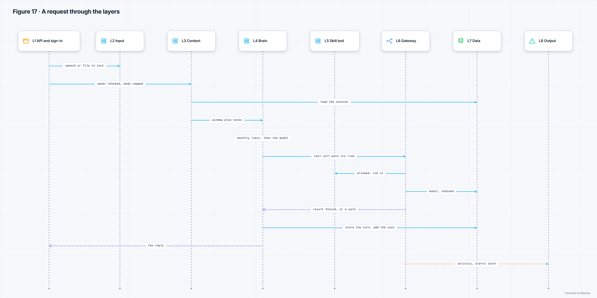

Version v6.5.0 · 27 Nov 2026, 19:40 IST · Release R18 · Status: Current · Owner: 🛠 Mark XXV

# 03 · The eight layers, as built

**In plain words.** JARVIS keeps the reference architecture's eight layers. Every package of its
code sits in exactly one of them, and the build fails if a new package has none. A request goes
in at layer 1, is understood (2), placed in context (3), reasoned about by the brain (4), which
uses skills (5) through the one tool gateway (6), with data kept in layer 7 and replies and alerts
going out through layer 8. This chapter says what each layer holds, how its parts talk to each
other, what it keeps and what happens when something in it fails.

The package-to-layer map is code, not prose: `src/jarvis/buildbook/gen/layers.py:LAYER_OF` (69
packages and top-level modules since R18 added `calls` in L5, `calldesk` in L6 and `config_calls`
in the cross-cutting layer; `python -m jarvis.buildbook.gen --check` fails on one without a
layer).

**R18 in one paragraph.** Phone calls (built in R18, not yet deployed) are five new parts, the
guide's cards C74 to C78. Each sits in the layer that does most of its work, and each also
touches others: C78, the phone app's calls, in L1; C76, call speech and the language check, in L2;
C75, the call engine and its hub, in L3; C74, the Calls skill (cards, approvals, limits, records),
in L5; C77, the call desk on the laptop, in L6. Section 1.1 follows one call through them. Component numbers (C01 …) are the guide's cards in `docs/architecture/JARVIS-Architecture.md`,
section 3, where each part's files are listed in full.

## 1. A request through the layers

*Figure 17. A request through the layers.* Source:
[`17-request-path.markdy`](../diagrams/17-request-path.markdy). The guide's Figure 4
(`../diagrams/04-chat-turn.png`) draws the same turn in the owner's words.

1. **L1** `src/jarvis/api/` authenticates the caller, caps the body and rate-limits
   (`src/jarvis/api/app.py:_install_middleware`); spoken input was already turned into text by
   L2's `POST /v1/voice/transcribe`.
2. **L3** loads the session through the `SessionStore` port (`src/jarvis/memory/base.py`;
   Firestore version `src/jarvis/storage/sessions.py:DocSessionStore`), one turn at a time per
   conversation (`src/jarvis/core/brain.py:Brain._serialised`), and builds the window (at most 40
   turns and about 48,000 characters: `src/jarvis/config.py` `session_max_turns`,
   `session_max_chars`; `src/jarvis/core/window.py`).
3. **L4** admits the call against the monthly limit (`Brain._admit`), adds the notes recalled for
   this message (`src/jarvis/recall/service.py:MemoryService`), and asks the router for a tier
   (`src/jarvis/llm/router.py:ModelRouter`).
4. If the model asks for tools, **L4** sends each call to **L6**'s gateway
   (`Brain._run_calls` → `src/jarvis/tools/gateway.py:Gateway.execute`) with this round's trust
   context; at most 6 rounds (`tool_max_rounds`).
5. **L6** decides, runs the **L5** skill's tool or holds a card, and appends the audit entry in
   **L7** (`src/jarvis/storage/audit.py:DocAuditLog`).
6. **L4** stores the turn (`src/jarvis/core/rounds.py:Rounds`), records the cost
   (`src/jarvis/billing/service.py:Billing`), and returns the reply to **L1**; learning runs after
   the reply, in the background.
7. **L8** hears about executed and held calls through gateway observers
   (`src/jarvis/tools/observers.py:GatewayObserver`) for the Activity log, and sends alerts through
   the alert policy.

### 1.1 A phone call through the layers (R18)

1. **L1 / L5.** The owner asks in the chat or in Calls → New call (`POST /v1/calls/cards`,
   `src/jarvis/api/calls_routes.py`). The Calls skill builds the call card: the number checked,
   the purpose, what JARVIS may say and agree to, the languages that passed the check, the longest
   it may last and the ₹ estimate (`src/jarvis/calls/cards.py:CardBuilder`).
2. **L4 / L6.** His Call runs the gateway's `calls_place` card, R3, every time. On his approval
   `src/jarvis/calls/approvals.py:CallsService.place` issues a dial grant (one use, 10 minutes,
   bound to the number and the card's content) and starts the call in the hub
   (`src/jarvis/calls/hub.py:CallHub`).
3. **L3.** The call engine (`src/jarvis/calls/engine.py`) asks the desk to get ready, then spends
   the grant for this call and counts the day's limits in one transaction
   (`CallsService.take_for_dial`), and only then sends `call.dial` to the phone (L1, C78).
4. **L6 → L2.** The desk sends the other person's speech while they talk; the call's speech option
   hears it in the call's language and detects a switch (`src/jarvis/calls/join_speech.py:CallSpeech`).
5. **L4.** The in-call brain answers on the fast tier with no tools: one JSON reply whose actions
   the engine carries out in code (`src/jarvis/calls/brain.py:CallBrain`). Every line passes the
   reply guard before it is spoken (`src/jarvis/calls/guard.py:check_reply`).
6. **L8 → L6.** JARVIS's voice goes to the desk, which plays it into the call; live captions go to
   the owner's listeners (`src/jarvis/calls/live.py`).
7. **L7.** At the end the audio (8 kHz WAV), the transcript and the English summary are sealed
   (`src/jarvis/calls/join.py:VaultRecords`); a booking goes on his calendar through the gateway;
   the call's ₹ are added to the month once; a Web Push notice tells him.

## 2. The layers

### L1 · User interaction

| Aspect | As built |
|---|---|
| Packages | `api`, `cli`, `telegram`, `mobile`, `phone` |
| Components | C01 Web console, C02 HTTP API and sign-in, C03 Terminal client, C04 Telegram front door, C62 Phone app and the phone's door, C78 Phone calls on the phone (R18) |
| Responsibilities | Serve the console and its static modules; the `/v1` API; Google sign-in and the owner allow-list; the bearer token for the CLI and evals; Telegram pairing and chat; the phone's signed door and app lock. R18: the Calls panel (cards, live view, records, languages, settings), the `/v1/calls` routes and the live call socket; the phone app's dial, answer and end on signed commands |
| Ports and interfaces | HTTP routes (`src/jarvis/api/routes.py` and one router per feature, included by `src/jarvis/api/app.py:_include_routers`); `src/jarvis/mobile/ports.py:MobilePart`, `PhoneRequest`, `PhoneReply` (the phone parts' contract); `src/jarvis/mobile/contract.py` (the signed request's one form); R18: `src/jarvis/calls/ports.py:CallsApi` and `CallsSockets` (what the calls routes call), `src/jarvis/calls/ports.py:PhoneLink` (the engine's way to the phone) |
| Key data | No data of its own beyond Telegram pairing (`telegram*` collections) and linked phones (`phone_link`, `phone_devices`); the user id is always derived on the server from the sign-in. The phone's call outbox, the events seen and the command key are in memory only |
| Failure modes | Wrong or missing sign-in → 401; over the rate limit (120 a minute per client by default) → 429; a body over its cap → 413; a phone-door check failing → bare 401/404/429, logged by check name, never audited; a feature part whose setup fails is left out ("setup failed") and the rest still start. R18: calls not wired → 501, switched off → 503; any other failure in a calls route → 503 `unavailable` in plain words, never a bare 500; a dial the phone could not place ends the call at once |
| The dock (R18) | Calls never displaces a tab. At 1920 px the bar is exactly the bar before R18, to the pixel, and Calls opens from Vitals' calls line, the chat's call card or `?open=calls`; it joins the bar only where it fits beside every other tab (2560 px) and waits in More on narrower screens (`src/jarvis/api/static/console-dock.js`, `tests/browser/test_dock_fit.py`, `tests/browser/test_r18_calls_ways_in.py`; ADR-35) |

### L2 · Input processing and perception

| Aspect | As built |
|---|---|
| Packages | `voice`, `documents`, `faces`, `facegroups`, `understand`, `vision` |
| Components | C05 Voice service, C06 Voice loop in the console, C07 Attached documents, C08 Faces with consent, C63 Camera and vision engine; C61's "understood as" step (`understand`); C76 Call speech and the language check (R18, inside the `calls` package) |
| Responsibilities | Speech in and out (Google Speech-to-Text v1, Text-to-Speech); the wake word in the browser; text out of attached files in a killable child process; a registry of people who consented to be recognised; on-device vision results (never a frame). R18: a call's hearing, voice and language detection over REST (Google, Azure F0, Bhashini, Sarvam), and the language check that every call language must pass |
| Ports and interfaces | `POST /v1/voice/transcribe`, `POST /v1/voice/speak`, `GET /v1/voice` and `PUT /v1/voice/settings` (`src/jarvis/api/voice.py`); `src/jarvis/documents/isolation.py:Sandbox` (CPU, memory 200 MiB and time caps); `src/jarvis/vision/results.py:Result` (the one result contract the browser and a home camera share); `src/jarvis/home/ports.py:FaceMatch` (what the laptop reports); R18: `src/jarvis/calls/ports.py:Hearing`, `Voice` and `LanguageDetector` (16 kHz mono PCM16, BCP-47 codes such as `ml-IN`) |
| Key data | `voice_settings`, `attachments` (text chunks; cleaned pictures under it), `faces` (sealed), `face_groups` (ids and counts), `vision_results` (sealed); R18: `call_lang_check`, `call_check_sentences` (and `call_lines`, `call_line_audio`, which nothing writes in v18.0.0) |
| Failure modes | Google speech off or unreachable → the browser's own voice and recognition; a file too big, unreadable or of the wrong kind → refused in plain words; the extractor busy → queues up to 50 s, then "busy"; no microphone permission → text chat still works; a vision result outside its schema → dropped. R18: a language with no passing option is not offered; a checked language never falls back to an option it did not pass (its stand-in refuses, a failed line); a vendor's failure is one plain sentence, never the vendor's text; no network or Hugging Face refusing → that language stays unchecked |

### L3 · Context and orchestration

| Aspect | As built |
|---|---|
| Packages | `memory`, `recall`, `ticks`, `undo` |
| Components | C09 Conversations, C10 Long-term memory, C11 Scheduler ticks and watchdog, C12 Recently deleted, C75 Call engine, hub and live listening (R18) |
| Responsibilities | Keep conversations and the rolling window; long-term memory (profile blocks, dated facts, the notes block, background learning) searched by word matching (BM25, `src/jarvis/recall/retrieval.py`), not embeddings; run the tick and clock jobs; keep owner deletions undo-able for 30 days. R18: one call at a time per owner as a state machine (preparing → dialling or ringing → opening → talking ⇄ taken over → wrapping up → ended), joining the desk, the phone and the live listeners in one in-memory hub |
| Ports and interfaces | `src/jarvis/memory/base.py:SessionStore` (in-memory, Redis and Firestore versions); `src/jarvis/recall/service.py:MemoryService`; `src/jarvis/ticks.py:TickJob`, `run_jobs` (never raises; each job time-boxed); `src/jarvis/undo/store.py:DeletedStore`; R18: `src/jarvis/calls/hub.py:CallHub`, `src/jarvis/calls/protocol.py` (every desk, phone and live message and the audio frames), `src/jarvis/calls/ports.py:DeskLink` |
| Key data | `sessions` (turns under each), `memory`, `memory_shards`, `deleted_items`; Redis keys `jarvis:session:{id}` only in local Docker runs. A call in progress lives in memory only; what is kept is C74's record |
| Failure modes | A message that clashes with another window's change → not stored, no model called (409); recall never raises (an empty notes block); a tick job that fails or times out is logged and reported "failed" without stopping the others; tick jobs riding only the morning clock run only 04:00–11:30 IST. R18: a second call while one is on → "A call is already on: one call at a time."; the desk or the phone lost → the call wraps up; a restart → the call in memory is gone and no grant is left to dial on |

### L4 · Core reasoning

| Aspect | As built |
|---|---|
| Packages | `core`, `llm`, `offline` |
| Components | C13 Brain core loop, C14 Persona and prompts, C15 Guardrails and trust, C16 Brain router and LLM layer, C17 Brain switch, No-AI and offline mode, C18 Approval cards and Approve all |
| Responsibilities | The one loop: guard input, build context, admit spend, call the model by tier, run tool rounds through the gateway, store the turn, narrate approvals; choose the brain; degrade on failure; run No-AI commands without a model. R18: the in-call brain (part of C75) asks `jarvis.llm` for the fast tier with no tools; it is never a brain that may train on prompts (`src/jarvis/calls/brain.py:pick_call_brain`), and with none configured calls are not wired at all; with the AI switched off no call is placed |
| Ports and interfaces | `src/jarvis/llm/base.py:LLMProvider` (Anthropic, Gemini, OpenAI-compatible, the laptop, the mock); `src/jarvis/llm/router.py:ModelRouter`, `ModelTier`; `src/jarvis/llm/fallback.py:FallbackBrain` (implemented by `src/jarvis/offline/service.py:LocalFallback`); `src/jarvis/core/guardrails.py:ConfirmationGate`, `ApprovalStore`; `src/jarvis/offline/no_ai.py:NoAIRunner` |
| Key data | `approvals` (waiting cards), `settings` (the AI on / No-AI switch), `local_brain` (sealed address and key) |
| Failure modes and degradations | Transient failure → strong falls to balanced, balanced to fast (`_DEGRADE_TO`); cloud unreachable → the laptop brain, offered at most 12 tools and none irreversible (`OFFLINE_TOOLS`), then 2 minutes without trying the cloud (`Breaker`); cloud and laptop both down → a plain message (`FallbackFailed`); out of credit or an auth error → a plain message, never vendor text (`src/jarvis/api/app.py:friendly_llm_error`); monthly limit reached or unreadable → no paid call (`BudgetReached`, `BudgetUnavailable`); **No-AI mode** → fixed phrases choose tool calls that still pass the gateway, replies from fixed templates, no model call; the switch reads "none" when it can't be read (`src/jarvis/offline/mode.py`) |

### L5 · Skills and capabilities

| Aspect | As built |
|---|---|
| Packages | `brief`, `web`, `people`, `kb`, `belongings`, `groceries`, `family`, `packages`, `whatsapp`, `helpers`, `series`, `picture`, `skills`, `sos`, `watch`, `wardrobe`, `calls` (R18) |
| Components | C19 Morning brief, C20 Web search, C21 People research, C22 WhatsApp drafts, C23 Notes, C24 Things, C25 Groceries, C26 Family calendars, C27 Parcels, C60 Helpers, C64 Watch, C65 SOS, C68 Skill register, C69–C73 Wardrobe, laundry, outfits and try-on, C74 Calls: cards, approvals, limits and records (R18) |
| Responsibilities | The things JARVIS does for the owner, each as tools (section 3) plus, for some, scheduled jobs and panels. R18: call cards and their ₹ estimate, the approval and its one-use grant, the day's limits and quiet hours, the sealed records and their 30-day retention, booking with a calendar entry and Undo, the laundry templates, answering missed calls (off by default) |
| Ports and interfaces | `src/jarvis/tools/base.py:Tool` (name, schema, risk, `run`, optional `preview`, `ask_when`, `may_vouch`, `undoable`); `src/jarvis/skills/registry.py:SkillRegister` (files every tool under one skill and group); `src/jarvis/skills/ports.py:ToolOffer` (the tools offered on a turn), `TokenLedger`, `BrainSlots`; R18: `src/jarvis/calls/tools.py:calls_tools` (`calls_place`, `calls_answer_mode`), `src/jarvis/calls/ports.py:CallStore` |
| Key data | Each skill's own collections (chapter 04, section 2); R18: `calls` (cards, records, sealed parts, counters, numbers called before) and `call_settings` |
| Failure modes | Each part is wired on its own; a part whose setup fails is left out and the others run; a skill whose permission row is "Never" refuses in one fixed line; a helper stopped by a permission row says so in its tab and the brief. R18: a limit, the month's ₹ or the owner's overall limit that can't be read refuses the call (fail closed); a stored card or record that doesn't read back is "unreadable", never "no card" |

### L6 · Integration and tools

| Aspect | As built |
|---|---|
| Packages | `tools`, `integrations`, `contacts`, `drive`, `places`, `media`, `photos`, `home`, `homebridge`, `camera`, `calldesk` (R18) |
| Components | C28 Tool gateway and audit, C29 Google account link, C30 Calendar and reminders, C31 Gmail, C32 To-dos, C33 Contacts, C34 Drive, C35 Maps, C36 YouTube and Media, C37 Photos picker and GitHub, C38 Home link, C39 Home bridge, C40 Camera, alarm and history, C77 Call desk on the laptop (R18) |
| Responsibilities | The one gateway every tool call passes (policy, cards, passkeys, taint, audit); direct REST adapters to each Google API (no SDK, no MCP); the signed link to the laptop; the bridge program that runs on the laptop. R18: the call desk, a Windows program on the laptop that carries a call's sound between Phone Link and JARVIS (chapter 02, section 2.13), and its kit, zipped by the server on request |
| Ports and interfaces | `src/jarvis/tools/gateway.py:Gateway`; `src/jarvis/tools/registry.py:ToolRegistry`; `src/jarvis/tools/policy.py:Policy`, `OwnerRules`; `src/jarvis/tools/observers.py:GatewayObserver`; `src/jarvis/tools/background.py` (the helpers' background reads, through the gateway); `src/jarvis/integrations/google.py` (OAuth tokens, sealed); `src/jarvis/home/client.py` and `src/jarvis/home/ports.py` (the bridge's wire models) |
| Key data | `audit` and `meta/audit_head`, `tokens` (sealed), `drive_roots`, `maps_places` (sealed), `home*` (sealed except the arm state), `connectors_github` (sealed); R18: `call_desk` (the linked desk, its seed sealed), `call_desk_codes` (a pending link code as a hash) |
| Failure modes | The owner's rules unreadable, no owner in scope, or a look-up failing → nothing proposed, nothing run (fail closed); a tool that raises → a fixed sentence and a redacted detail, marked "may have done part of it"; Google not linked or the token key missing → the Google tools stay off; the laptop asleep → home tools say so, and the watchdog alerts once within about 6–11 minutes. R18: any desk check failing → the call card says which part is missing and nothing is dialled; a desk socket that doesn't verify → closed 4401 before it opens; the laptop asleep → no calls |

### L7 · Data and persistence

| Aspect | As built |
|---|---|
| Packages | `storage`, `vault`, `vault_inbox`, `quota`, `backup` |
| Components | C41 Document store, C42 Document vault, C43 DigiLocker import folder, C44 Free allowance ledger, C66 Backups and restore drill |
| Responsibilities | The `Docs` port and its Firestore and in-memory versions; the append-only audit; the encrypted vault; the DigiLocker folder import; the free-allowance counters; backups and the monthly drill |
| Ports and interfaces | `src/jarvis/storage/docs.py:Docs` (get, set, create-only, query, transaction); `src/jarvis/tools/audit.py:AuditTrail`; `src/jarvis/keyring.py:Keyring`; `src/jarvis/vault/ports.py:VaultIntake`; `src/jarvis/quota/ledger.py` |
| Key data | All 139 collections (chapter 04; R18 added 8, each listed in the layer that owns it above) |
| Failure modes | A composite index not ready → `IndexNotReady`, callers sort in the app; no token key → `Keyring.from_settings` is None and the vault, notes and things are off (never stored in clear); a counter that can't be read → the paid call is refused; backups not set up → Vitals says "Backups: not set up" |

### L8 · Response and output

| Aspect | As built |
|---|---|
| Packages | `alerts`, `notify`, `webpush`, `activity` |
| Components | C45 Alerts port, C46 Alert policy, C47 Web Push, C48 Activity log |
| Responsibilities | Alerts in fixed words (never model text or other people's words); quiet hours, storm caps and VIPs; Web Push to the owner's browsers and the phone app; the plain-words Activity log |
| Ports and interfaces | `src/jarvis/alerts.py:AlertSink` (never raises for "can't send"); `src/jarvis/notify/ports.py:NotifyPolicy`, `Notifier`; `src/jarvis/notify/sink.py:PolicyAlerts`; `src/jarvis/activity/` (fed by gateway observers) |
| Key data | `notify`, `notify_held`, `notify_rate`, `webpush` (sealed), `telegram_alerts`, `activity`, `activity_days` |
| Failure modes | Telegram down → Web Push still goes; quiet hours → held until they end; a storm → capped; a send failure returns `sent=False` with a reason |

### X · Cross-cutting

| Aspect | As built |
|---|---|
| Packages and modules | `config`, `config_calls` (R18: the calls settings, a base class of `Settings`), `logging`, `keyring`, `permissions`, `privacy`, `billing`, `vitals`, `health`, `selfwatch`, `hardening`, `buildbook`, `fixes`, `about` |
| Components | C49 Configuration, C50 Logging, C51 Keyring, C52 Permissions and passkeys, C53 Privacy dashboard, C54 Costs in ₹, C55 Vitals, C56 Systems check, C57 Build book, C58 Delivery, C59 Evals and the visual gate, C67 Self-health watch (R14; C66 Backups is in L7, C68 Skill register in L5) |
| Ports and interfaces | `src/jarvis/config.py:Settings`; `src/jarvis/logging.py:get_logger` (JSON logs with a trace id; the one file to swap for OpenTelemetry); `src/jarvis/privacy/ports.py:PrivacySource`, `PrivacyRegistry`; `src/jarvis/hardening/ports.py:HardeningPart`; `src/jarvis/buildbook/ports.py:BookSource`, `BookVault` |

## 3. The eleven skills

Measured on 27 Nov 2026 with `PYTHONPATH=src python scripts/skill_coverage.py` (it builds the
fullest registry the test fakes build and files each tool with `SkillRegister`), re-run on R18's
code at 19:20 IST: **159 tools in 11 skills**, 86 R1, 67 R2 and 6 R3; 75 work with the AI off
(No-AI mode). R18 added two, both under Communication's new `calls` group: `calls_place` (R3) and
`calls_answer_mode` (R2; switching answering on always asks). Skill ids and labels are
fixed in `src/jarvis/skills/ids.py`; groups and their tool name patterns in
`src/jarvis/skills/catalogue.json`. The risk column is each tool's declared class; a tool's
read-only look-up may raise a single call's risk (for example deleting an event that has guests
becomes R3; `src/jarvis/tools/gateway.py:_higher`).

| Skill | Tools | R1 / R2 / R3 | No-AI | Groups (tool patterns) | R3 tools |
|---|---|---|---|---|---|
| Task & Productivity | 45 | 16 / 28 / 1 | 18 | calendar (`calendar_*`), reminders, to-dos (`tasks_list`, `task_*`, `list_tasks`), groceries, family, household (`chore_*`, `maint_*`), Recently deleted, wardrobe, laundry | `family_event_add` |
| Research & Intel | 29 | 21 / 7 / 1 | 9 | web, maps, people, memory (`memory_*`), notes (`kb_*`), documents (`doc_*`, `drive_*`), pictures, outdoor (`weather_now`, `disaster_status`), belongings | `memory_forget` |
| Code & DevOps | 13 | 10 / 3 / 0 | 4 | vitals (`vitals_*`), systems (`systems_check`), GitHub, YouTube channel, the register (`skills_open`) | — |
| Decision Support | 7 | 4 / 3 / 0 | 4 | focus (`focus_now`, `pending_list`), outfits (`outfit_*`, `wear_*`) | — |
| Communication | 12 | 8 / 2 / 2 | 3 | email (`gmail_*`), parcels, contacts, WhatsApp drafts, phone calls (`calls_*`, R18) | `gmail_send`, `calls_place` |
| Finance & Analytics | 6 | 2 / 2 / 2 | 4 | bills (`bill_*`), spend (`spend_month`) | `bill_pay_prepare`, `bill_payee_set` |
| Learning | 3 | 1 / 2 / 0 | 3 | followed plans (`series_*`) | — |
| Creative | 8 | 5 / 3 / 0 | 5 | free time (`freetime_*`), videos (`youtube_*`) | — |
| Security Advisor | 12 | 9 / 3 / 0 | 4 | alarm (`home_status`, `home_arm`, `home_disarm`), camera and faces, breach notices, vault (`vault_*`) | — (the disarm is a passkey route, not a tool action) |
| Automation Engine | 2 | 1 / 1 / 0 | 0 | home devices (`home_devices`, `home_control`) | — |
| Health & Wellbeing | 22 | 9 / 13 / 0 | 21 | nudges, sleep and watch, SOS (`sos_*`), kitchen (`pantry_*`, `recipe_*`, `nutrition_*`) | — |

**What the brain is offered on a turn.** Not all 159 (`src/jarvis/skills/offer.py`, R14 D9): the
union of the groups whose words (English and common Hinglish) are in the owner's message, the
groups of tools used in recent turns, the previous turn's set while it is fresh, the core four
(`skills_open`, `reminder_add`, `calendar_list_events`, `memory_search`; `catalogue.json` `core`)
and any tool named in the window; after the model calls `skills_open(skill)` the next round adds
that skill. The setting `tool_offer` set to "all" is the kill switch. The offer only narrows what
the model sees: every call still meets the gateway. On Telegram only the tools in `catalogue.json` `telegram_open` are
open by default; private reads stay off there unless switched on (C04). A call can be proposed
from Telegram, but its card is approved only in the console or the phone app
(`src/jarvis/core/guardrails.py:CONSOLE_ONLY_TOOLS`; chapter 05, section 8).

**Health & Wellbeing** is the eleventh skill (`docs/plans/r14-hardening.md` D11): built in part
(nudges, watch, SOS, kitchen); its camera-based use cases are PLANNED (chapter 11).

## Change log

| Version | Date | Release | What changed | By |
|---|---|---|---|---|
| v6.4.1 | 27 Nov 2026, 15:15 IST | R6.4 | First edition: a request through the layers (Figure 17); for each of the eight layers and the cross-cutting concerns its packages, components, responsibilities, ports, key data and failure modes, No-AI and offline included; the 11 skills measured from the register (157 tools, risk tiers, No-AI counts, R3 tools, groups) | 🛠 Mark XXV |
| v6.4.2 | 27 Nov 2026 | R6.4 | Verification (chapter 13): the cross-cutting components list C67 only (C66 sits in L7, C68 in L5, as the guide's cards are placed) | 🛠 Mark XXV |
| v6.5.0 | 27 Nov 2026, 19:40 IST | R18 | R18 "Calls from your laptop": the five calls components C74–C78 placed in L1, L2, L3, L5 and L6; new section 1.1, a phone call through the layers; each layer's responsibilities, ports, data and failure modes for calls; the dock rule (Calls never displaces a tab at 1920 px); `LAYER_OF` 66 → 69; the skill register re-measured (159 tools, 67 R2, 6 R3; Communication 12); a call card is approved only in the console or the phone app | 🛠 Mark XXV |
