Version v6.1.1 · 11 Nov 2026, 11:45 IST · Release R6.1 · Status: Current · Owner: 🛠 Mark XIII

# The JARVIS architecture diagrams

Fourteen pictures of JARVIS as it is built today (release R6.1). Each one was drawn from the code,
not from the old blueprint, and each shows one idea. The JARVIS Architecture & Technology Guide
(`docs/architecture/JARVIS-Architecture.md`) uses them with the same numbers and captions.

**How to read them.** Boxes are parts of JARVIS or services it uses; the small grey line under a
name says what that part is or does. A solid arrow is a request ("please do this"), a dashed purple
arrow is an answer coming back, and a dotted orange arrow is something that happens on its own
time (a clock, a background job). The PNG picture is the one that was checked by eye; the SVG copy
scales without blurring but takes your computer's fonts, so its words can sit slightly differently.

**For engineers.** Each `.markdy` file is the source. `python scripts/markdy_export.py` checks every
diagram (privacy rule, `lint --strict`, `verify --quality showcase`) and writes the `.svg` and `.png`
beside it, plus `exports.json` (the hashes CI uses to spot an export older than its source). The
Markdy tool (`@markdy/cli` 1.5.7, MIT) is a developer tool only: it is never part of the JARVIS
server, the console or the build book. See `scripts/markdy_export.py` for the details.

---

## Figure 1 — JARVIS and everything around it

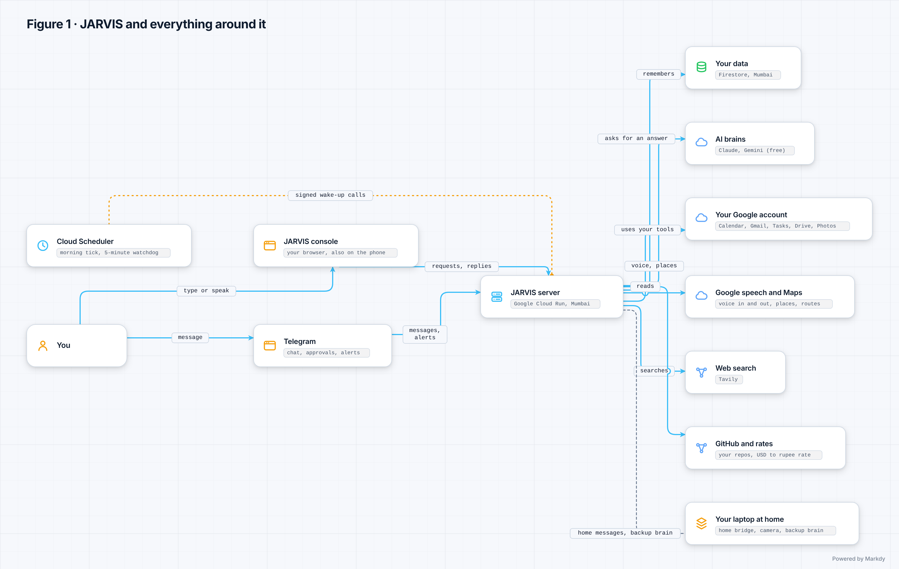

*Figure 1. JARVIS and everything around it.* You reach JARVIS through the console, a web page in
your browser (also on your phone), or through Telegram. JARVIS itself is one small server on Google
Cloud Run in Mumbai, and it keeps your data in Firestore in the same region. To answer you it asks
an AI brain (Claude, or Google's Gemini on its free tier), uses your Google account for the tools
you allowed (Calendar, Gmail, Tasks, Drive, Photos, Contacts, YouTube), Google's speech service for
voice and Google Maps for places and routes, Tavily for web searches, and reads your own GitHub
repositories and a public US-dollar-to-rupee rate (Frankfurter). Cloud Scheduler wakes JARVIS with
signed calls for the morning round and the five-minute home watchdog. Your laptop at home runs the
home bridge (the camera and Home Assistant) and, if you set it up, the backup brain that answers
when the cloud AI can't be reached. If the laptop is off, only the home features and the backup
brain stop; everything else keeps working.

Source: [`01-context.markdy`](01-context.markdy) · scalable copy: [`01-context.svg`](01-context.svg)

## Figure 2 — The eight layers, as built

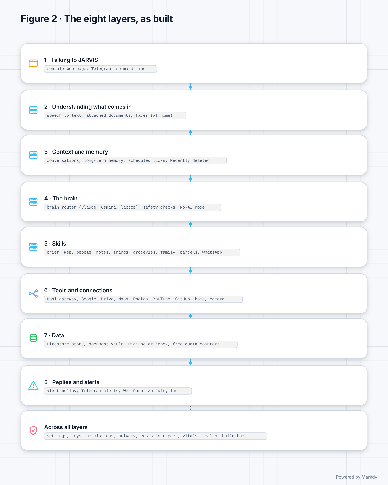

*Figure 2. The eight layers, as built.* The original blueprint split a personal assistant into
eight layers, from how you talk to it (layer 1) down to how it replies and alerts you (layer 8).
JARVIS keeps that map, and every part of its code sits in exactly one layer: the build book's
generator refuses a release in which a new part has no layer (`src/jarvis/buildbook/gen/layers.py`).
The grey line in each band lists what really lives there today, from the console, Telegram and the
command line in layer 1 to the alert policy, Telegram alerts, Web Push and the Activity log in
layer 8. The last band holds what runs across all layers: settings, keys, permissions and
passkeys, the privacy dashboard, costs in rupees, Vitals, the systems check and the build book.

Source: [`02-layers.markdy`](02-layers.markdy) · scalable copy: [`02-layers.svg`](02-layers.svg)

## Figure 3 — Where JARVIS runs

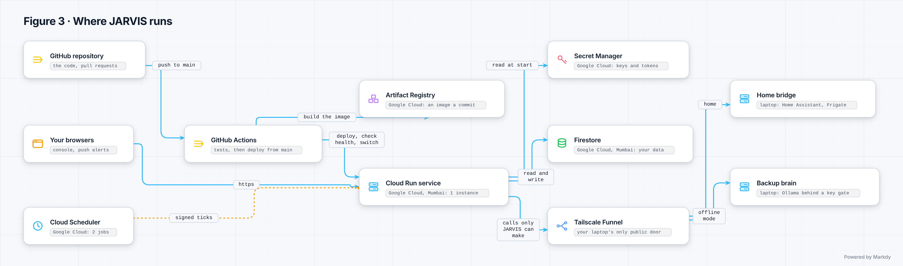

*Figure 3. Where JARVIS runs.* The code lives on GitHub. GitHub Actions tests every change and,
after a merge to main (with automatic deploys switched on), builds a container image, stores it in
Artifact Registry and deploys it to Cloud Run in Mumbai (asia-south1): at most one copy of the
server, 512 MB of memory, sleeping when nobody uses it. The deploy signs in to Google without any
stored key (Workload Identity Federation). Keys and tokens live in Secret Manager and are handed to
the server when it starts; your data lives in Firestore, also in Mumbai. Two Cloud Scheduler jobs
call the server on a timetable (Figure 9). On your laptop, Tailscale Funnel gives one public HTTPS
address; behind it sit the home bridge (Home Assistant, Frigate and Mosquitto in Docker under
Windows WSL) and the backup brain (Ollama behind a Caddy gate that wants a key). This replaces the
blueprint's Kubernetes and Terraform plan: one small Cloud Run service is cheaper and simpler for
one owner. Redis appears only in local test runs (`docker-compose.yml`), not in the cloud.

Source: [`03-deployment.markdy`](03-deployment.markdy) · scalable copy: [`03-deployment.svg`](03-deployment.svg)

## Figure 4 — One conversation turn

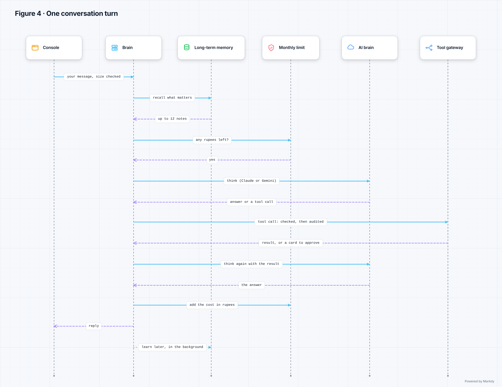

*Figure 4. One conversation turn.* The console sends your message; JARVIS checks its size and
shape, then loads the conversation. Long-term memory adds up to 12 notes that matter for this
message (only for a brain that keeps your words private). Before every paid AI call JARVIS checks
your monthly limit in rupees; if it is used up, no call is made. The brain router picks the model
by tier (fast, balanced or strong), drops to a lower tier after a passing failure, and turns to
your laptop's backup brain when the cloud AI can't be reached at all. If the AI wants to use a
tool, the call goes through the tool gateway, which applies the safety rules (Figure 5) and writes
every call to an audit log that can't be quietly edited (each entry is chained to the one before).
The result goes back to the AI, the cost is added to the month in rupees, and the reply comes
back. Learning from the turn happens afterwards in the background and never delays the reply.

Source: [`04-chat-turn.markdy`](04-chat-turn.markdy) · scalable copy: [`04-chat-turn.svg`](04-chat-turn.svg)

## Figure 5 — Confirm before commit: cards and passkeys

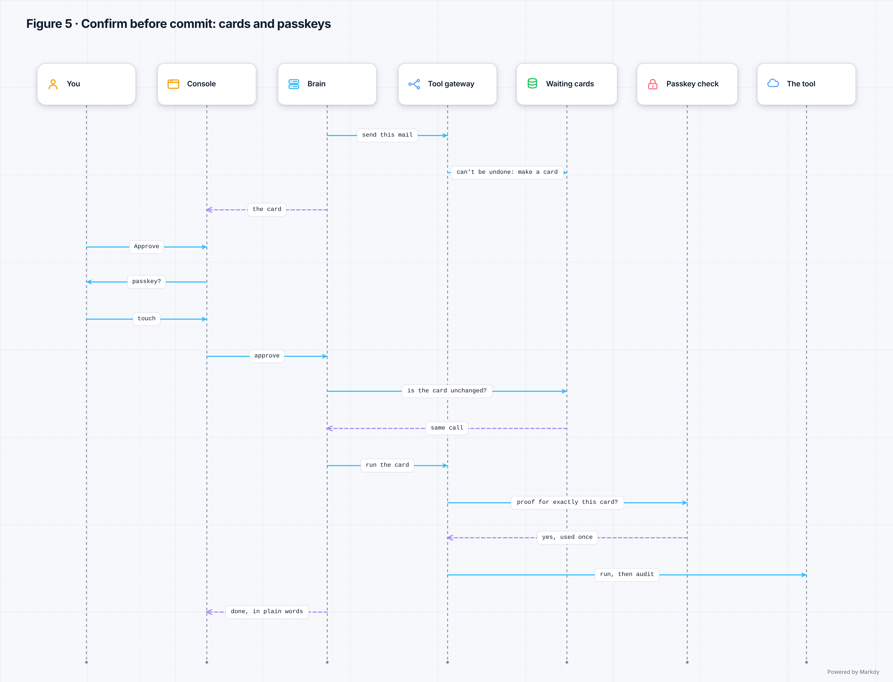

*Figure 5. Confirm before commit: cards and passkeys.* Every tool has a risk level: read-only
(R1), reversible (R2) and irreversible (R3: sending, paying, deleting for good). Read-only and
reversible steps normally just run. A reversible step becomes an approval card when the request
was spoken (someone else in the room may have said it), when other people's words (a mail, a web
page, a document) were read in the same round, or when you set that kind of step to "Ask first".
An irreversible step always becomes a card, and there is no "don't ask again" for it. Once you
have a passkey, approving an irreversible card also needs a fresh passkey check on your device
(fingerprint, face or PIN), made for exactly that card and usable once within two minutes. Before
anything runs, JARVIS checks the card has not changed; then the gateway runs it and records it in
the audit log. Telegram can approve reversible cards only; irreversible ones wait for you in the
console. "Approve all" covers only cards that can be undone.

Source: [`05-approvals-passkeys.markdy`](05-approvals-passkeys.markdy) · scalable copy: [`05-approvals-passkeys.svg`](05-approvals-passkeys.svg)

## Figure 6 — A spoken turn

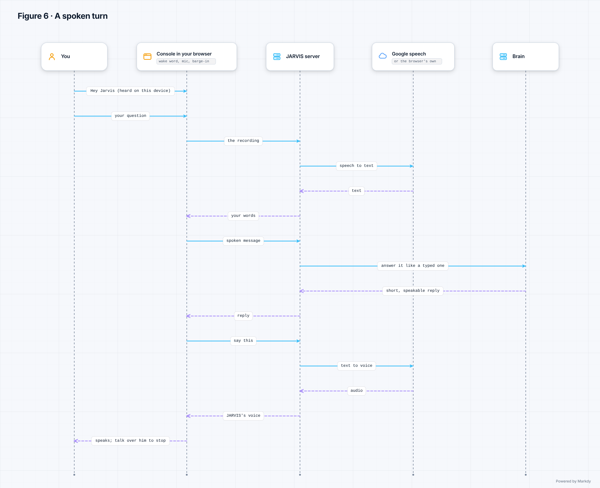

*Figure 6. A spoken turn.* "Hey Jarvis" is recognised entirely inside your browser (open-source
wake-word models), so the sound of the room never leaves the page while JARVIS waits. After the
wake word, the console records your question and sends it to the server, which turns it into text
with Google Cloud Speech-to-Text (or the console uses your browser's own speech engine, if you
chose that). Your words come back to the console and go to the brain as a spoken message, answered
like a typed one but kept short enough to speak. The console then asks for the voice, made by
Google Cloud Text-to-Speech (or your browser's voice). You can talk over JARVIS to stop him, and
the mic-off button (or Ctrl + Shift + Space) locks the microphone until you tap. JARVIS stores no
audio and does not log what was said. Voice is free up to Google's monthly allowance (JARVIS uses
90 % of it) and is priced in rupees above it.

Source: [`06-voice-loop.markdy`](06-voice-loop.markdy) · scalable copy: [`06-voice-loop.svg`](06-voice-loop.svg)

## Figure 7 — How JARVIS remembers you

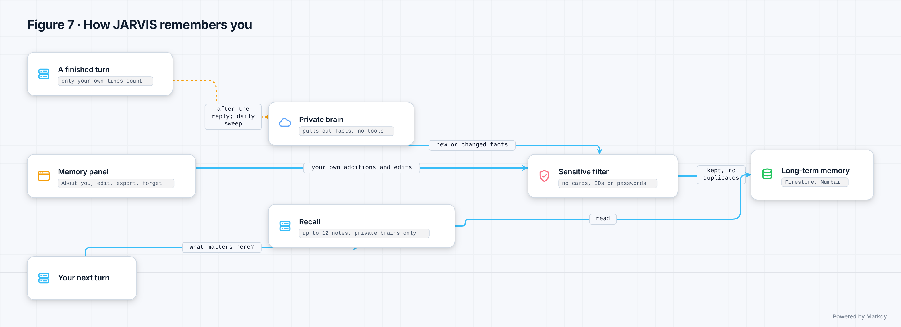

*Figure 7. How JARVIS remembers you.* After a reply, in the background (and once more in a daily
sweep on the morning round), a private AI brain with no tools reads only your own lines from the
conversation and pulls out facts worth keeping. Every fact passes a fixed sensitive-data filter:
card numbers, Aadhaar, PAN, bank account numbers, passwords and keys are never kept, and health,
religion, caste, politics or sexuality are never guessed about you. Duplicates are merged into one
note. The notes live in Firestore in Mumbai (under Google's encryption, not JARVIS's own seal). On
your next message, recall picks up to 12 matching notes by keyword ranking, with no AI call. The
Memory panel ("About you") lets you see, add, edit, export and forget everything, and learning
starts only after you agree to its small cost. A brain that may train on your words (Gemini's free
tier) never gets your notes and never triggers learning.

Source: [`07-memory.markdy`](07-memory.markdy) · scalable copy: [`07-memory.svg`](07-memory.svg)

## Figure 8 — The document vault and the DigiLocker import

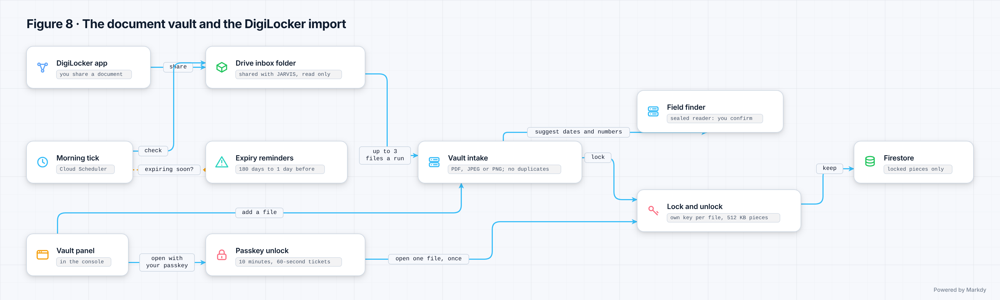

*Figure 8. The document vault and the DigiLocker import.* DigiLocker only lets registered
organisations use its partner service, so you share a document from the DigiLocker app into a
Google Drive folder that you have shared with JARVIS (read only). On the morning round JARVIS checks
that folder and copies in up to 3 new PDF, JPEG or PNG files (10 MB at most) per run; files you
upload in the Vault panel take the same path. The intake checks what the file really is, skips
duplicates, and a separate locked-down reader suggests dates and numbers that you confirm. Each
file is cut into 512 KB pieces and each piece is locked with the file's own key; that key is itself
locked with the vault key, which comes from the root key in Secret Manager. Firestore only ever
holds locked pieces. Opening a file needs your passkey (or, before you have one, a fresh Google
sign-in) in the console: a 10-minute unlock, then a single-use 60-second ticket per file. Expiry
reminders come 180, 90, 60, 30, 14, 7 and 1 day before a document runs out.

Source: [`08-vault-digilocker.markdy`](08-vault-digilocker.markdy) · scalable copy: [`08-vault-digilocker.svg`](08-vault-digilocker.svg)

## Figure 9 — The morning tick, the watchdog and alerts

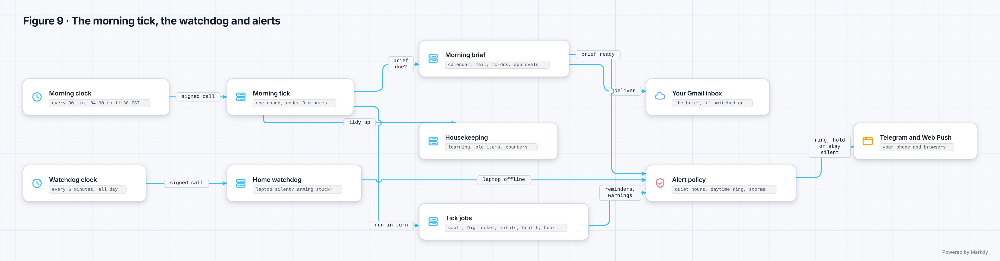

*Figure 9. The morning tick, the watchdog and alerts.* JARVIS sleeps between requests, so two
Cloud Scheduler clocks wake it. Each call carries a token signed by Google for that exact address,
so nobody else can trigger them. The morning clock calls every 30 minutes from 04:00 to 11:30 IST:
each round makes the morning brief when it is due (your calendar, unread mail, to-dos and waiting
approvals, with optional AI summary lines inside your rupee limit) and, if you switched it on, puts
it in your own Gmail inbox. Then it tidies up (learning sweep, expired Recently deleted items, old
counters) and runs the tick jobs one after another: vault reminders, the DigiLocker import, the
Vitals poll, the systems check and the build book. The watchdog clock calls every 5 minutes, all
day: if your laptop has been silent for 6 minutes, or arming the alarm was not confirmed, it tells
you once. Everything that wants your attention passes one alert policy with no AI in it: quiet
hours hold or drop lesser alerts, urgent ones (a burglar, smoke, the laptop gone while armed) ring
through the night, and alerts go out on Telegram and Web Push.

Source: [`09-brief-ticks.markdy`](09-brief-ticks.markdy) · scalable copy: [`09-brief-ticks.svg`](09-brief-ticks.svg)

## Figure 10 — The burglar alarm: from the camera to your phone

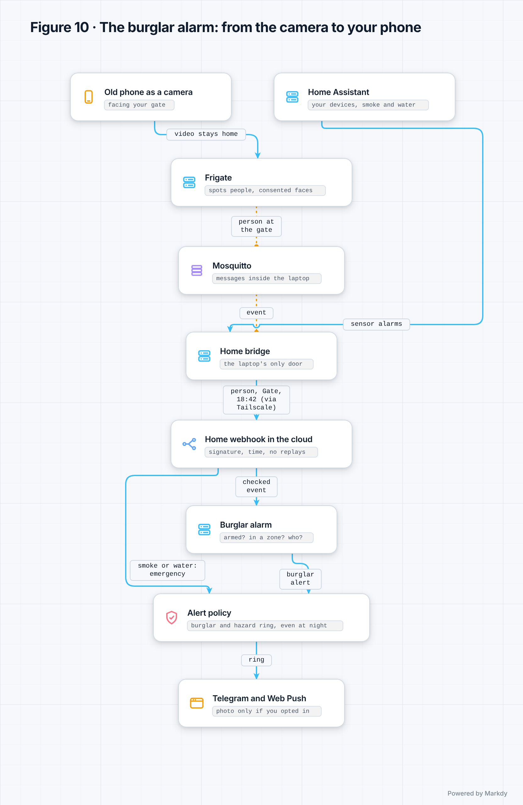

*Figure 10. The burglar alarm: from the camera to your phone.* At home, an old phone running a
camera app watches your gate. Frigate, on your laptop, spots people (and, only for people who gave
their consent, recognises faces: the pictures stay on the laptop). Mosquitto passes Frigate's
messages inside the laptop, and Home Assistant (optional) reports smoke and water sensors. The home
bridge is the laptop's only door: it turns an event into a short signed message ("person, Gate,
18:42") and sends it through Tailscale to JARVIS. The cloud checks the signature, that the message
is less than a minute old and that it was not seen before, then the alarm asks: is it armed, is
this inside an alarm zone, who is it? A burglar or hazard alert rings even at night; Telegram gets
a photo only if you opted in, and the photo is never stored. Recognising someone never silences an
armed alarm, and a child is never named. Arming waits for the laptop to confirm; disarming needs
your passkey in the Home panel (a fresh Google sign-in before you have one), never a voice, chat
or Telegram command. If the laptop sleeps,
camera alerts stop, and the watchdog (Figure 9) tells you.

Source: [`10-home-alarm.markdy`](10-home-alarm.markdy) · scalable copy: [`10-home-alarm.svg`](10-home-alarm.svg)

## Figure 11 — The systems check and the Vitals board

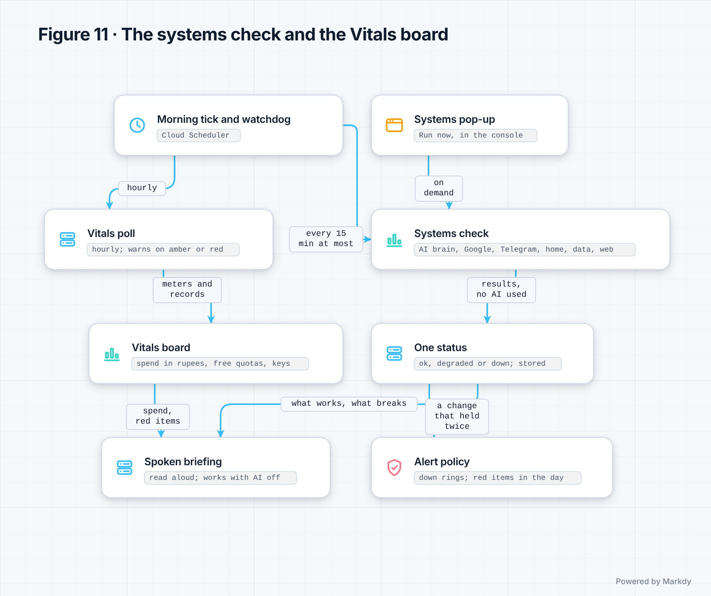

*Figure 11. The systems check and the Vitals board.* The systems check tests each part JARVIS
depends on (the AI brain, Google, Telegram, the home bridge, the data store and web search) with
fixed code and no AI. It runs with the morning round and the watchdog, at most once every 15
minutes, and whenever you press Run in the Systems pop-up. The results become one status (ok,
degraded or down) that is stored. A change must last for two checks before you are told, only
"down" rings, and a recovery is announced once. The spoken briefing is made from fixed sentences,
so it works even with the AI switched off. The Vitals board shows this month's AI spend in rupees
against your limit, Google's free allowances, JARVIS's own keys and connections, and things you
track yourself; its hourly poll (in the morning window) warns you once when something turns amber
or red.

Source: [`11-systems-vitals.markdy`](11-systems-vitals.markdy) · scalable copy: [`11-systems-vitals.svg`](11-systems-vitals.svg)

## Figure 12 — The build book and the guest show

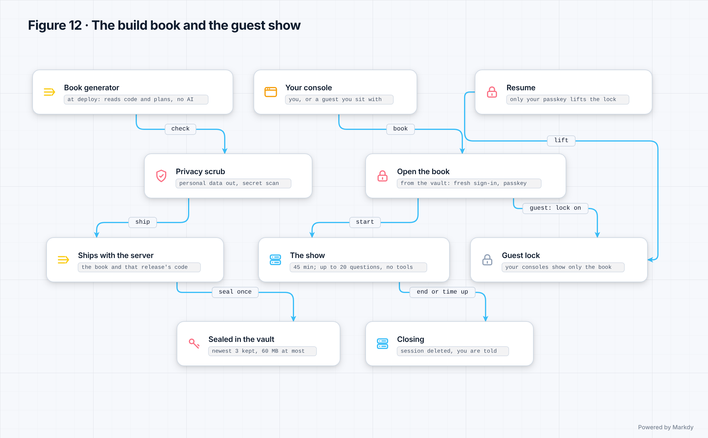

*Figure 12. The build book and the guest show.* At every deploy, fixed code (no AI) reads the code
and the plans and writes the build book; personal data is taken out and the code copy is scanned
for anything that looks like a secret. The book and that release's source code ship inside the
server. Once the release is live, JARVIS seals them in the vault (the newest 3 releases are kept,
60 MB at most) and tells you. Opening the book works only in the console and needs a Google sign-in
from the last 5 minutes plus your passkey. You can present it to a guest: while a guest session is
open, a guest lock keeps all your consoles on the book only. A show lasts at most 45 minutes (10
without activity); a guest may ask up to 20 questions, answered by an AI that has no tools and
nothing of yours, and never sees your spending. When the show ends, the session is deleted and you
are told. Only your passkey lifts the lock (Resume); if you lose it mid-show, an emergency unlock
runs with the server's own Google Cloud access. The Privacy panel can delete the sealed books.

Source: [`12-build-book-guest.markdy`](12-build-book-guest.markdy) · scalable copy: [`12-build-book-guest.svg`](12-build-book-guest.svg)

## Figure 13 — How a change reaches the live JARVIS

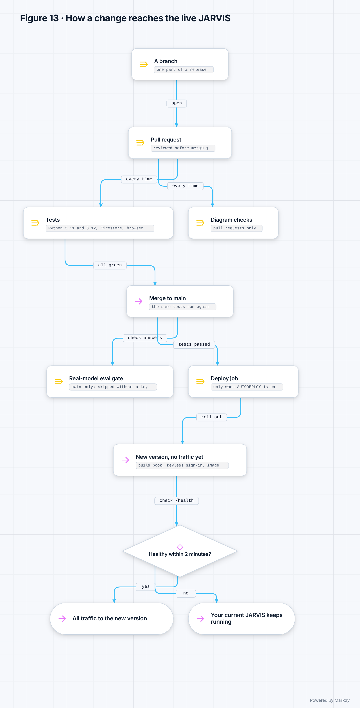

*Figure 13. How a change reaches the live JARVIS.* Each part of a release is built on its own
branch and arrives as a pull request. On every pull request GitHub Actions runs the tests on Python
3.11 and 3.12 (with the lint check, the mock evaluations and a check that the build book still
builds), the Firestore emulator tests and the browser tests; the diagram checks run on pull
requests only and never hold up a deploy. After the merge to main the same tests run again, and the
real-model evaluation runs on main (skipped when no Anthropic key is set). The deploy job runs only
when automatic deploys are on and the tests passed: it writes the build book, signs in to Google
without a stored key, builds the image and starts the new version with no traffic. It refuses if
main has moved on, so an old run can never roll JARVIS back. Only when the new version answers its
health check within about two minutes does all traffic switch to it; otherwise your current JARVIS
keeps running unchanged.

Source: [`13-release-flow.markdy`](13-release-flow.markdy) · scalable copy: [`13-release-flow.svg`](13-release-flow.svg)

## Figure 14 — Where your data lives

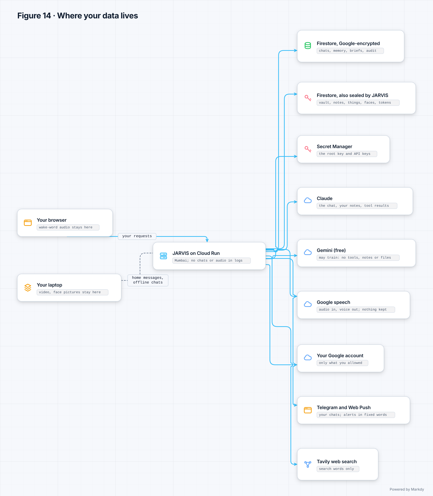

*Figure 14. Where your data lives.* Some things never leave you: the wake-word sound stays in your
browser, and camera video, snapshots and face pictures stay on your laptop (which also answers chats
when the backup brain is used). In Mumbai, Firestore keeps your conversations, memory, briefs,
approvals and the audit log under Google's encryption; your documents, notes and links, things,
the faces list, connection tokens, your Home and Work addresses, the home link and camera feed,
alert choices, browser push details, the backup brain's key and the build book are additionally
sealed by JARVIS with keys only it holds, made from one root key in Secret
Manager. The server's logs record ids, counts and errors, not your chats or audio. Outside
services get only what a task needs: Claude gets the conversation, your notes and tool results;
Gemini's free tier may train on what it is sent, so it gets plain chat only, with no tools, notes
or files; Google speech handles voice and JARVIS keeps none of it; your Google account is used only
as you allowed; Telegram carries your Telegram chats and alerts; Web Push carries short, encrypted
fixed-wording alerts; Tavily sees search words only. The Privacy panel exports or deletes each kind.

Source: [`14-privacy-map.markdy`](14-privacy-map.markdy) · scalable copy: [`14-privacy-map.svg`](14-privacy-map.svg)

---

## Change log

| Version | Date | Release | What changed | By |
|---|---|---|---|---|
| v6.1.1 | 11 Nov 2026, 11:45 IST | R6.1 | First edition: 14 diagrams drawn from the code, with captions, explanations and the export check | 🛠 Mark XIII |
